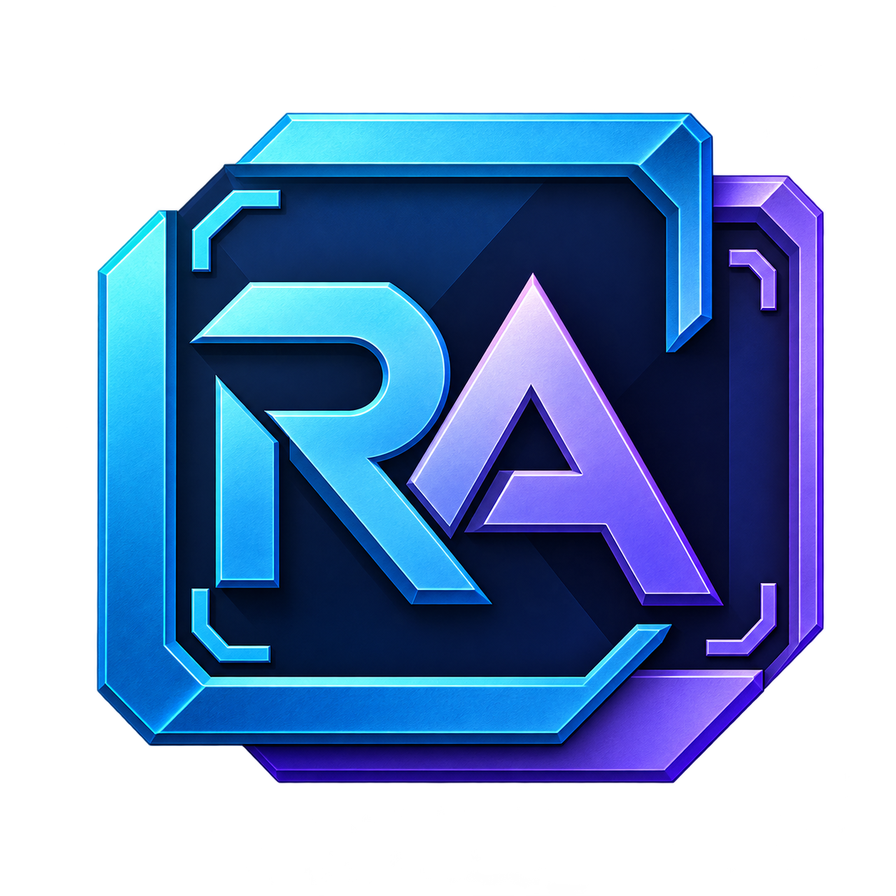

<p align="center">
  
</p>

<h1 align="center">RestArtEngine</h1>

<p align="center">
面向技术美术的 C++20 / DirectX 11 场景渲染引擎与编辑器<br>
A C++20 / DirectX 11 scene rendering engine and editor for technical artists
</p>

<p align="center">
  
  
  
  
  
</p>

> **命名约定**：产品与所有工程文件使用全称 **RestArtEngine**——`RestArtEngine.exe`、`RestArtEngine.sln`、`RestArtEngine.vcxproj`、`RestArtEngine.rc`、`RestArtEngineProject.json`、`include/RestArtEngine/`。只有**文件扩展名与格式标识**保留 `RA` 缩写：`.raproject`、`.rascene`、`.ramat`、`.raeengine`、JSON `format`（`RAEngine.Project` / `RAEngine.Engine` / `RAEngine.Scene` / `RAEngine.Material` / `RAEngine.EngineRegistry` / `RAEngine.ProjectBuild`），以及命名空间 `rae` 与引擎注册表目录 `%LOCALAPPDATA%\RAEngine`。

---

RestArtEngine 是一个**单可执行文件**的 Windows 引擎：编译 `RestArtEngine.vcxproj`（或 CMake 目标 `RestArtEngine`）得到 `RestArtEngine.exe`，它同时扮演两个角色——

- **Project Manager**：不带参数启动时显示，用于创建 / 打开 / 选择 `.raproject` 工程；
- **场景编辑器**：带 `--project` 启动时直接进入，编辑 Actor、静态 Mesh、材质与 HLSL。

工程（`.raproject`）是**纯数据**：`Content/` 场景与材质、工程自己的 `Shaders/`。它不包含 C++ 代码，也不生成自己的 `.sln`；编译引擎永远只打开仓库根目录的 `RestArtEngine.sln`。

## 目录

- [特性](#特性)
- [环境要求](#环境要求)
- [构建](#构建)
- [快速开始](#快速开始)
- [场景操作](#场景操作)
- [工程与引擎](#工程与引擎)
- [渲染管线](#渲染管线)
- [编辑器工作流](#编辑器工作流)
- [启动加载界面](#启动加载界面)
- [源码结构](#源码结构)
- [开发](#开发)
- [测试与验证](#测试与验证)
- [命令行参数](#命令行参数)
- [当前边界](#当前边界)
- [第三方依赖与许可](#第三方依赖与许可)
- [文档](#文档)

## 特性

**渲染**

- 前向（Forward）与延迟（Deferred）两条路径共享同一套材质与光照实现，逐像素结果保持一致。
- 延迟路径写三个 G-buffer（Albedo/Roughness、World Normal/Metallic、World Position/Coverage），再执行全屏光照。
- 9 种直接光阴影方案：2×2 PCF、硬比较、3×3 PCF、PCSS 软阴影、两级 CSM、GTAO、Deferred Contact Shadow、解析光追、禁用。全部共享同一张 2048² 深度图，靠常量位切换。
- 解析式 GPU 光追：内置 Sphere / Plane / Cube 用精确求交，其余网格走 `StructuredBuffer` 三角形路径，用于阴影与反射。**不是 DXR**。
- 单方向光 + 程序化环境光；GGX 高光、Schlick Fresnel、ACES 近似色调映射。
- 检查视图：Lit、Unlit、Albedo、World normals、World position。

**编辑器**

- Dear ImGui Docking 工作区：Outliner、Details、Viewport settings、Content & Editors 和 Scene Viewport 可分割停靠、合并标签及悬浮。
- Actor 变换手柄（ImGuizmo）：移动 / 旋转 / 缩放，世界 / 局部坐标，步进吸附。
- 材质参数草稿 → Apply → Save 两段式提交；`Grid` 程序化网格材质。
- **引擎内 HLSL 热编译**：编辑 `Standard.hlsli` 后 Apply 立即更新预览，失败保留上一版可用 Shader。
- Shader 反射校验：常量缓冲布局、资源绑定、入口签名不兼容时直接拒绝，不会留下半更新状态。
- 相机：环绕、平移、缩放、聚焦选中物体（F）。
- 编辑事务：Actor 增删 / 复制与 Gizmo 拖拽可撤销重做（Ctrl+Z / Ctrl+Y）；连续数值拖动合并为一条。
- 多选：Outliner 与视口支持 Ctrl / Shift 点击切换成员，整组 Gizmo 变换和批量删除各记一条撤销；Details 编辑主 Actor。
- 编辑命令：菜单、按钮与快捷键通过命令注册表执行已接入的动作；双行工具栏按样式计算高度。
- F11 视口全屏：窗口无边框覆盖当前显示器并隐藏面板，再按 F11 或 Esc 恢复。
- 启动加载界面：全屏背景 + 底部相对定位的文案 / 百分比 / 进度条，背景图可替换。

**工程与分发**

- `.raproject` 记录命名的引擎版本关联（`engineAssociation`）、绑定版本 / hash 与相对 `engineRoot`。
- 引擎身份文件 `Engine.raeengine` + 兼容性检查，支持多版本引擎并存与切换。
- 引擎注册表（`engines.json`）解析版本关联；工程移动或换机器后，Project Manager 与 `--project` 入口都会自动重绑并写回相对路径。
- 跨盘符绑定不写绝对路径：manifest 只保留 `engineAssociation`，由注册表在加载时解析。
- 工程数据与引擎目录彻底分离，工程可独立提交、独立分发。

## 环境要求

- Windows 10 / 11（x64）
- Visual Studio 2022，需勾选「使用 C++ 的桌面开发」（MSVC v143 + Windows SDK）
- CMake **3.24+**（仅 CMake 构建方式需要）
- Premake **5.0**（仅 Premake 生成 solution 方式需要；`premake5.exe` 随仓库在 `scripts/premake/`）
- Git（第三方依赖是 submodule，首次需 `git submodule update --init`）
- 支持 D3D11 Feature Level 11.0 的显卡；硬件设备创建失败时自动回退 WARP 软件渲染（性能较低）

## 构建

### 前置：检出第三方依赖

```powershell
git submodule update --init
```

### 方式一：Premake 生成 solution（Rider / Visual Studio）

```powershell
.\scripts\GenerateWIN.bat
# 等价命令：.\scripts\premake\premake5.exe --file=Build.lua vs2022
```

1. 打开生成的 `RestArtEngine.sln`
2. 选择 `Debug | x64` 或 `Release | x64`
3. 构建并运行目标 `RestArtEngine`

输出（`bin/<system>-<arch>/<config>/`）：

```text
bin/windows-x86_64/Debug/RestArtEngine.exe
bin/windows-x86_64/Release/RestArtEngine.exe
```

### 方式二：CMake

```powershell
cmake --preset windows-vs2022
cmake --build --preset windows-debug
.\build\cmake-vs2022\Debug\RestArtEngine.exe
```

Release 用 `cmake --build --preset windows-release`，输出 `build/cmake-vs2022/Release/RestArtEngine.exe`。

CMake 目标：

| 目标 | 说明 |
| --- | --- |
| `RestArtEngine` | 引擎可执行文件（Project Manager + 编辑器） |
| `DearImGui` | 随仓库构建的 ImGui 静态库 |

两种构建方式共享源码，输出目录互相独立（CMake 输出到 `build/`；Premake 输出到 `bin/` 与 `settings/`，solution 由 Premake 生成、不提交）。

> 应用图标：项目 logo 为 [`assets/icons/RAEngine.png`](assets/icons/RAEngine.png)，构建时通过 [`RestArtEngine.rc`](RestArtEngine.rc) 嵌入由它生成的 `assets/icons/RAEngine.ico`，因此任务栏与窗口标题栏显示引擎 logo。

## 快速开始

```powershell
# 1) 打开工程管理器
.\build\cmake-vs2022\Debug\RestArtEngine.exe

# 2) 直接打开示例工程（等价写法：--project Projects\Sandbox\Sandbox.raproject）
.\build\cmake-vs2022\Debug\RestArtEngine.exe Projects\Sandbox\Sandbox.raproject
```

进入编辑器后：

- Outliner 选 Actor，Details 改变换与 Mesh / Material；
- Content 页签导入 OBJ、编辑材质、编辑 HLSL；
- `Save Scene` 写场景，`Save All` 同时落材质、Shader 与场景。

编辑器使用 Dear ImGui 官方 Docking 分支，由 `EditorDockManager` 统一管理五个面板。拖动面板标签或悬浮窗口标题栏，按停靠预览将面板放到目标区域的边缘可左右/上下分割，放到中央可合并为标签；拖离停靠区域可在主窗口内悬浮。拖动分隔条调整相邻区域，视口随布局更新。当前未启用独立操作系统窗口或跨显示器多视口。

顶部左侧 `Layout` 菜单可以聚焦面板，`Restore default layout` 恢复左侧 Outliner / Details、右侧 Viewport settings、底部 Content & Editors 和中央 Scene Viewport。原生 Dock 树及窗口位置、尺寸由本机 `RestArtEngine.imgui.ini` 保存。Scene Viewport 显示场景渲染纹理，拾取和 Gizmo 使用本帧图像内容矩形；Content 内的编辑器标签仍可拖拽重排。首次使用 Docking 时会建立新的默认布局，替换旧版自由窗口的位置安排。

## 场景操作

| 操作 | 效果 |
| --- | --- |
| 左键点击视口网格 | 选择 Actor，并显示变换手柄 |
| W / E / R / Space | 切换移动 / 旋转 / 缩放工具（Space 循环） |
| 拖动变换手柄 | 修改选中 Actor 的 Transform |
| 工具栏 World / Local、Snap | 切换坐标模式、开关步进吸附 |
| Delete（视口 / Outliner / Details） | 删除选中 Actor，保留共享 Mesh / Material 资产 |
| 右键拖动视口 | 环绕旋转相机 |
| Alt + 左键拖动 | 环绕旋转相机（与右键一致） |
| 中键拖动视口 | 平移相机焦点 |
| 视口滚轮 | 推拉相机距离 |
| 选中 Actor 后按 F | 相机聚焦该 Actor 并适配其包围盒 |
| F1 | 显示 / 隐藏控制面板 |
| F2 | 切换 Forward / Deferred |
| F3 | 开关光追阴影与反射 |
| F11 | 视口全屏（无边框覆盖显示器并隐藏编辑器面板；再按或 Esc 恢复） |
| F9 / Capture 按钮 | 保存当前画面 |
| Esc / 关闭窗口 | 退出（有未保存修改时会询问） |

文本输入时 W / E / R / Space / Delete 不会作用于场景。Outliner 与视口支持多选（Ctrl / Shift 点击切换成员，Shift 当前不做连续范围选择），Actor 增删与 Gizmo 变换可撤销重做（Ctrl+Z / Ctrl+Y，也支持 Ctrl+Shift+Z 重做）。Ctrl+D 复制选中 Actor，Ctrl+S 保存场景。多选复制目前逐个记入撤销历史。

Viewport settings 还可调 Key light、Exposure、VSync、Shadow method，并支持 Reset camera（同时复位焦点）。

## 工程与引擎

```text
RestArtEngine.sln                 <- 唯一的编译入口
RestArtEngine.vcxproj             <- 产出 RestArtEngine.exe
RestArtEngine.rc                  <- 图标与版本资源
Projects/Sandbox/            <- 纯数据示例工程
  Sandbox.raproject
  Content/Scenes/Default.rascene
  Content/Materials/*.ramat
  Content/Meshes/*.obj
  Shaders/Materials/Standard.hlsli
Projects/RayTracing_Simple/ <- 光追测试工程
  RayTracing_Simple.raproject
  Content/Scenes/Default.rascene
  Content/Materials/*.ramat
  Shaders/Materials/Standard.hlsli
```

`.raproject` 示例：

```json
{
  "format": "RAEngine.Project",
  "version": 3,
  "name": "Sandbox",
  "engineRoot": "../..",
  "engineAssociation": "0.2.0",
  "engineVersion": "0.2.0",
  "engineHash": "dev-0.2.0",
  "contentRoot": "Content",
  "shaderRoot": "Shaders",
  "defaultScene": "Content/Scenes/Default.rascene"
}
```

- `engineAssociation`：命名的引擎版本关联（UE `EngineAssociation` 的对应物），由 Project Manager 通过引擎注册表解析到具体安装目录。
- `engineRoot`：缓存 / 回退路径，保证 `--project` 直接打开时无需注册表；工程移动后由自动恢复重写为相对路径，跨盘符时省略该字段。
- `engineVersion` / `engineHash`：绑定身份，与引擎根目录的 `Engine.raeengine` 比对。恢复只接受版本匹配的引擎，切换版本仍需在 Project Manager 中显式确认。

版本或 hash 不匹配时，Project Manager 提供「使用引用的引擎」「更新到当前引擎」「选择引擎…」；`engineRoot` 失效时会尝试按关联自动恢复，恢复不了则明确提示无法打开。

仓库自带两个示例工程，Project Manager 扫描 `Projects/*/*.raproject` 自动列出：

| 工程 | 用途 |
| --- | --- |
| `Projects/Sandbox` | 通用演示：内置球 / 平面 / 立方体、程序化网格材质、基础光照与阴影。 |
| `Projects/RayTracing_Simple` | 光追测试：康奈尔盒（红 / 蓝侧墙、白色地面与顶面）+ 两个镜面球。配合 `--rt` 观察解析光追的反射与阴影；关闭 `--rt` 即为纯光栅化对照。 |

```powershell
# 打开光追测试工程
.\bin\windows-x86_64\Debug\RestArtEngine.exe Projects\RayTracing_Simple\RayTracing_Simple.raproject --rt
```

场景结构（`Content/Scenes/Default.rascene`）：房间 5.8 × 3.4 × 6.0，朝 +Z 开口；两侧墙 90° 侧立，地面 / 顶面 / 后墙共 6.0 × 5.8 / 5.8 × 3.4 的面片；两个球半径 0.55 / 0.50，落在 y = 半径 处。材质全部为参数资产（`Content/Materials/*.ramat`），镜面球为 `metallic = 1`、`roughness ≈ 0.03`，红 / 蓝墙 `baseColor` 用于观察颜色溢出。

## 渲染管线

```text
[可选] 阴影 Pass        1~2 个方向光深度切片（2048², Texture2DArray）
        ↓
Deferred: G-buffer ×3  →  全屏光照（GTAO / Contact Shadow / 解析光追阴影可选）
Forward : 背景 + 几何  →  绘制时直接着色
        ↓
        编辑器：场景渲染纹理 → ImGui 视口图像与面板 → Present
        无 UI：直接绘制到交换链 → Present
```

- 常量缓冲契约（CPU / HLSL 双向锁定，运行时用 `D3DReflect` 校验）：
  `b0 SceneConstants(144B)`、`b1 ObjectConstants(160B)`、`b2 RayConstants(5136B)`、`b3 ShadowConstants(160B)`。
- 资源契约：`t0..t2` G-buffer、`t3` shadow map（`Texture2DArray<float>`）、`t4` 三角形缓冲、`s0/s1` 采样器。
- 材质唯一开放入口是 `Shaders/Materials/Standard.hlsli` 的 `EvaluateMaterial()`；引擎模板 `Shaders/Materials/Standard.hlsli` 不会被工程覆盖。

## 编辑器工作流

| 操作 | 运行中预览 | 磁盘 |
| --- | --- | --- |
| 编辑材质参数草稿 | 不变 | 不变 |
| Apply material | 更新所有引用该材质的 Actor | 不变 |
| Save material assets | 不变 | 写 `Content/Materials/*.ramat` |
| 编辑 Shader 草稿 | 不变 | 不变 |
| Shader Apply / Compile | 成功则整体替换 6 个 shader 阶段 | 不变 |
| Shader 编译失败 | 保留上一版可用 Shader + 诊断 | 不变 |
| Save shader | 不变 | 写工程 `Shaders/Materials/Standard.hlsli` |

Apply 的成功是**全有或全无**：任一阶段或反射校验失败都不会改动当前管线的任何部分。

## 启动加载界面

打开工程 / 引擎启动期间，窗口会显示 `assets/load/load.png` 全屏加载界面。底部的文案、百分比与进度条全部按**图片的相对比例**定位，替换图片不需要改代码：

| 元素 | 相对位置 |
| --- | --- |
| 左右内边距 | 宽度 × 5.5% |
| 文案行（左）与百分比（右） | 高度 × 87.2%，同一基线、同行两端对齐 |
| 进度条 | 高度 × 92.1%，高度 × 0.42%（最小 3px），圆角端 |
| 进度条颜色 | 已加载 `#7EC8FF` 浅蓝，未加载 `#7E848E` 灰 |
| 字号 | 高度 × 2.1%，夹在 13~26px |

图片通过 Windows Imaging Component 解码并作为 GPU 纹理上传；图片缺失或解码失败时回退为纯色背景并继续启动，不会阻塞。

## 源码结构

| 路径 | 职责 |
| --- | --- |
| `include/RestArtEngine/` | 公共头文件（Scene / Assets / Project / Renderer / Editor / ImGui / Core） |
| `src/Scene/World.cpp` | Actor、Transform、静态网格组件、场景 JSON 读写（事务性） |
| `src/Assets/AssetLibrary.cpp` | 内置 Mesh、OBJ 导入、材质参数与持久化 |
| `src/Project/Project.cpp` | `.raproject` / `Engine.raeengine`、兼容性检查、引擎注册表 |
| `src/Renderer/SceneRenderer.cpp` | DX11 设备、交换链、G-buffer、阴影、渲染、截图 |
| `src/Editor/SceneEditor.cpp` | Outliner / Details / Content、材质与 Shader 草稿 |
| `src/Editor/ViewportInteraction.cpp` | 视口拾取、变换手柄、相机（环绕 / 平移 / 聚焦） |
| `src/Editor/LoadingScreen.cpp` | 启动加载界面：背景图解码 + 底部相对定位的进度层 |
| `src/ImGui/ImGuiLayer.cpp` | ImGui 上下文与 Win32 / DX11 适配 |
| `app/MinimalApp.cpp` | 引擎可执行入口：Win32 窗口、消息循环、Project Manager、编辑器启动、加载界面 |
| `app/EditorSmoke.cpp` | GPU 自测：真实 UI 输入注入验证编辑流程 |
| `scripts/` | 引擎验证脚本：`Validate-Render.ps1` 渲染回归、`Test-Window.ps1` 窗口生命周期 |
| `Shaders/Private/Scene.hlsl` | 引擎公共渲染管线（几何 / G-buffer / 光照 / 背景） |
| `Shaders/Materials/Standard.hlsli` | 默认可编辑材质模板 |
| `vendor/` | Dear ImGui、ImGuizmo、nlohmann/json |

## 开发

引擎接口在 `include/RestArtEngine/`，实现在 `src/`，可执行入口在 `app/`。新增可复用功能放进对应模块，不要堆进入口文件；工程只承载数据。

目录归属、常见改动落点、必须守住的常量缓冲 / 资源 / 事务性约定，以及提交前的验证命令，汇总在 **[架构文档 · 开发指引](docs/Architecture.md#开发指引)**。

## 测试与验证

```powershell
# GPU：编辑器全流程（真实鼠标/键盘注入）
.\build\cmake-vs2022\Debug\RestArtEngine.exe --editor-self-test --capture-dir artifacts\editor-validation

# GPU：前向 / 延迟一致性、光追开关、Unlit、法线与 UI 截图
.\scripts\Validate-Render.ps1

# 窗口生命周期、缩放、最小化恢复
.\scripts\Test-Window.ps1
```

`--editor-self-test` 覆盖：Actor 变换、材质 / 网格赋值、Shader Apply 成功与失败回滚、资源契约校验、Shader 保存/重载、场景存读回环、拾取、移动/旋转/局部缩放手柄拖拽、**相机环绕/平移/聚焦**、Actor 删除与文本输入隔离。

## 命令行参数

```powershell
RestArtEngine.exe                          # 打开 Project Manager
RestArtEngine.exe <path>                   # 裸路径 = --project，可传 .raproject 或工程目录
RestArtEngine.exe --project <path>         # 直接打开工程
RestArtEngine.exe --engine <path>          # 指定引擎根目录启动 Project Manager
RestArtEngine.exe --forward | --deferred   # 选择渲染路径
RestArtEngine.exe --rt                     # 开启解析光追阴影与反射
RestArtEngine.exe --no-ui                  # 不绘制编辑器面板
RestArtEngine.exe --frames N               # 运行 N 帧后退出（配合 --capture-dir）
RestArtEngine.exe --capture-dir <path>     # 截图输出目录（默认 screenshots）
RestArtEngine.exe --self-test              # 渲染自测
RestArtEngine.exe --editor-self-test       # 编辑器自测
RestArtEngine.exe --help
```

截图格式为 BMP，默认写入程序工作目录下的 `screenshots`。

## 当前边界

- 图形 API 只有 **DirectX 11**；`RenderBackend` 中的 OpenGL / DX12 / Vulkan / Null 仍是生命周期骨架。
- 光追是**解析求交 + 三角形遍历**，没有 DXR、硬件 RT 核心、通用网格 BVH 或路径追踪。
- 顶点格式仅 Position + Normal：无 UV、切线、纹理、MTL、骨骼动画。
- 单一方向光；无后处理栈、无 HDR 交换链、无 MSAA。
- 编辑器已有多选与部分编辑事务；尚无父子层级或通用组件系统。材质 / Shader 草稿、Actor 名称、可见性及 Mesh / Material 引用修改尚未纳入撤销历史。
- Docking 悬浮限于主窗口；尚无独立操作系统面板窗口、动态面板插件或命名布局。
- 主题切换已写入当前工作区（Black / Dark Blue、偏好保存），截至 2026-10-23 文档同步时尚未提交，也未在本轮重新构建验证；入口与边界见 [编辑器指南](docs/EditorGuide.md#主题切换当前工作区)。
- 材质编辑器是参数式，没有节点图 / 材质继承。

## 第三方依赖与许可

| 依赖 | 版本 | 许可 | 位置 |
| --- | --- | --- | --- |
| Dear ImGui | v1.91.9b-docking | MIT | `vendor/imgui/LICENSE.txt` |
| ImGuizmo | `105e4fde45e4e74aae8973d98750820ef7aca7e2` | MIT | `vendor/ImGuizmo/LICENSE` |
| nlohmann/json | v3.12.0 | MIT | `vendor/nlohmann/LICENSE.MIT` |

第三方依赖以 **git submodule** 提供（见 [vendor/README.md](vendor/README.md) 与 `docs/vendor/`）；首次克隆后运行 `git submodule update --init` 检出，之后构建**不需要联网**。

RestArtEngine 自身以 **MIT** 许可发布，完整条款见 [LICENSE](LICENSE)。第三方依赖各自保留其原始 MIT 许可（见上表）。

## 文档

- [架构文档](docs/Architecture.md)：目录职责、**开发指引**（落点 / 约定 / 验证）、数据关系、UE 概念对照
- [编辑事务](docs/UndoTransactions.md)：Godot UndoRedo / UE 事务源码研究与本仓库实现边界
- [GUI 设计与进度](docs/GodotGuiStudy.md)：Godot 职责划分参考、已提交功能、工作区实现与验证范围
- [工程管理](docs/ProjectManagement.md)：引擎身份、工程链接、Project Manager 流程
- [引擎分发](docs/EngineDistribution.md)：发布目录、工程打包与迁移
- [编辑器指南](docs/EditorGuide.md)：Actor / Mesh / Material / Shader 操作细节
- [阴影方案](docs/ShadowMethods.md)：各方案资源路径、取舍与验证矩阵
