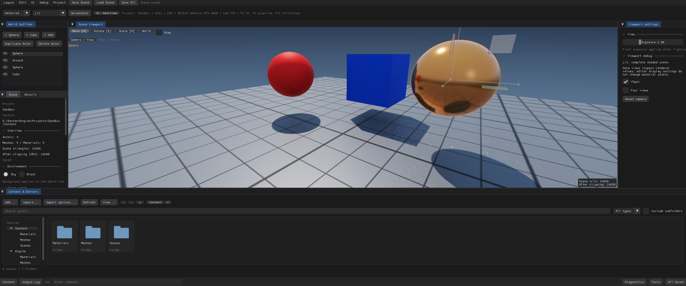

<p align="center">
  
</p>

<h1 align="center">RestArtEngine</h1>

<p align="center">
  面向技术美术的 C++20 / DirectX 11 场景渲染引擎与编辑器<br>
  A C++20 / DirectX 11 scene rendering engine and editor for technical artists
</p>

<p align="center">
  
  
  
  
  
</p>

> **命名约定**：产品与所有工程文件使用全称 **RestArtEngine**——`RestArtEngine.exe`、`RestArtEngine.sln`、`RestArtEngine.vcxproj`、`RestArtEngine.rc`、`RestArtEngineProject.json`、`include/RestArtEngine/`。只有**文件扩展名与格式标识**保留 `RA` 缩写：`.raproject`、`.rascene`、`.ramat`、`.rasset`、`.raeengine`，JSON `format`（`RAEngine.Project` / `RAEngine.Engine` / `RAEngine.Scene` / `RAEngine.Material` / `RAEngine.Asset` / `RAEngine.EngineRegistry` / `RAEngine.ProjectBuild` / `RAEngine.GarbageCollection`），以及命名空间 `rae` 与引擎注册表目录 `%LOCALAPPDATA%\RAEngine`。

---

RestArtEngine 是一个**单可执行文件**的 Windows 引擎：编译 `RestArtEngine.vcxproj`（或 CMake 目标 `RestArtEngine`）得到 `RestArtEngine.exe`，它同时扮演两个角色——

- **Project Manager**：不带参数启动时显示，用于创建 / 打开 / 选择 `.raproject` 工程；
- **场景编辑器**：带 `--project` 启动时直接进入，编辑 Actor、静态 Mesh、材质与 HLSL。

工程（`.raproject`）是**纯数据**：`Content/` 场景与材质、工程自己的 `Shaders/`。它不包含 C++ 代码，也不生成自己的 `.sln`；编译引擎永远只打开仓库根目录的 `RestArtEngine.sln`。

渲染侧并行存在三条光线路径，用途不同、互不等价：

| 路径 | 后端 | 用途 |
| --- | --- | --- |
| 解析式 GPU 光追 | DX11 像素着色器 | 内置图元精确求交 + 三角形缓冲，做一次弹射反射与解析阴影，**不是 DXR** |
| 硬件光追通道 | DX12 / DXR 1.1（同适配器） | 场景反射、所有投影灯阴影、路径追踪 GI 的求交底座 |
| 路径追踪 GI | 复用 DXR 通道的 compute | 渐进累积或实时间接光；Forward / Deferred 消费其间接光 |

引擎长期目标是同时支持 **PBR 与 NPR 两套渲染体系**：共享适用的管线基础，并保留各自的着色与 Feature 差异。当前已有 PBR 着色基础，NPR 体系及双体系组合尚未实现；完整目标与边界见 [渲染开发要求](docs/RenderingDevelopment.md#pbr-与-npr-双体系目标)。

## 截图

<p align="center"></p>

<p align="center"><sub>编辑器工作区：World Outliner / Scene + Details / Viewport settings / Content &amp; Editors / Scene Viewport，
底部为固定状态栏与命令输入。画面为 Sandbox 工程，Deferred + 实时 GI，工具栏显示当前渲染路径、检查视图、GI 状态与帧率。</sub></p>

### 示例工程

| Sandbox | PathTracing — Cornell Box |
| --- | --- |
|  |  |
| 实时 GI：4 samples/frame、512 目标样本，间接漫反射与镜面随相机持续更新；金属球反射由同一路径给出 | 渐进路径追踪：16 samples/frame、65536 目标样本、12 次表面着色，矩形顶灯走面积采样 + BRDF MIS |

### 四分屏相机

<p align="center"></p>

<p align="center"><sub>Four views：Perspective + Top / Front / Right，每格保留自己的相机、镜头与曝光；只有活动格承载 DXR / GI 历史，其余格为光栅预览。</sub></p>

<sub>截图由当前构建以 `--capture-dir` 实拍（BMP 原图），再裁去窗口边框并缩放到文档尺寸；画面比例取决于运行时的窗口尺寸，取景以场景内容为准。</sub>

## 目录

- [截图](#截图)
- [特性](#特性)
- [环境要求](#环境要求)
- [构建](#构建)
- [生产与性能](#生产与性能)
- [快速开始](#快速开始)
- [场景操作](#场景操作)
- [工程与引擎](#工程与引擎)
- [渲染管线](#渲染管线)
- [编辑器工作流](#编辑器工作流)
- [启动加载界面](#启动加载界面)
- [源码结构](#源码结构)
- [开发与迭代](#开发与迭代)
- [测试与验证](#测试与验证)
- [命令行参数](#命令行参数)
- [当前边界](#当前边界)
- [第三方依赖与许可](#第三方依赖与许可)
- [文档](#文档)

## 特性

**渲染**

引擎同时保留两条光栅路径。Forward 在几何绘制时直接着色，Deferred 先写三张 G-buffer 再做一次全屏光照。两条路径共用同一套材质参数、光照与色调映射定义，所以切换路径通常只换常量，不动资产；但 Deferred 是从 G-buffer 反推表面，拿不到 UV 和像素导数，依赖这两者的材质换到 Deferred 会明显不同。`--editor-self-test` 比的是固定场景的平均像素差，不是逐像素相等——这一点常被误解成缺陷。

阴影有九种接法，切换只改常量，不重建资源。光栅的五种（2×2 PCF、硬比较、3×3 PCF、PCSS、两级 CSM）共用一张 2048² × 2 切片深度数组；GTAO 和 Deferred Contact Shadow 只作用于延迟路径，Forward 下自动退回阴影贴图；解析光追完全不跑阴影 Pass；`Disabled` 连贴图都不采样。需要留意的是：光栅路径里只有第一盏开启投影的方向光能吃到阴影贴图，其余灯要么换解析光线，要么走硬件光追。

光线部分按需叠加，三条路径定位不同。解析光追跑在像素着色器里，内置球/平面/立方体用精确求交（上限 32 个图元），其余网格走 `StructuredBuffer<RayTriangle>`，只做一次弹射反射和解析阴影，和 DXR 没有关系；硬件光追是同一适配器上的 DX12/DXR 1.1 通道，用内联 `RayQuery` 遍历 TLAS，负责反射、所有投影灯的阴影，以及路径追踪 GI 的求交；路径追踪 GI 复用这条通道做单向前向积分，矩形灯有 NEE 与 MIS，既能渐进累积整帧，也能只输出间接光供光栅消费。三者不是画质档位，选错不会自动降级——失败原因在 GI 状态入口和诊断面板里。

灯光最多 32 盏可见直接光，天光单独累加。矩形光在光栅端是确定性的四点积分，近距离能看出采样痕迹；只有路径追踪里才用面积/BRDF 采样与 MIS，所以同一盏灯在两种路径下的柔度和衰减并不相同。曝光只影响显示，重算 HDR 时不清 GI 历史。

检查视图有 11 种，从 Lit/Unlit 一直排到 Albedo、法线、位置、Roughness、Metallic、Specular F0、线性深度和直接漫反射/直接高光分量。它们读的是 Shader 求值后的有效数据，包含尚未 Apply 的材质草稿，而不是 CPU 侧的资产字段。

景深分两种实现。光栅端对最终颜色和深度做屏幕空间 gather，最大 24 px 半径，恢复不了被前景挡住的背景；渐进路径追踪则在主光线上按圆形光圈采样，遮挡正确，也随样本收敛。正交相机、`focus ≤ 焦距` 和数据视图都会自动关掉它。

材质不止调颜色。`Cull`（Off/Front/Back）、`ZTest`（九种比较模式，含 Disabled）、`ZWrite` 都按材质生效，光栅、阴影、解析/三角形光追、DXR 和 GI 读的是同一份状态；镜像缩放会翻转绕序，背面法线也会跟着翻。旧 `twoSided` 数据仍按双面读，但新资产建议直接用 Cull。

剔除只做到视锥这一层：主视图和每个阴影级联各自测包围盒，DXR 场景不剔——屏幕外的物体仍可能贡献阴影、反射或间接光。规模验收要求视锥内一千万三角形、硬件光追和实时 GI 同时开着，`--render-scale-test` 会导出 JSON、BMP 和 CPU Trace。

诊断分三层。CPU Trace 记录提交、上传、读回的嵌套事件，可导出 Chrome Trace JSON；GPU Pass 计时用异步 query，不阻塞渲染；Frame Inspector 冻结一帧的真实资源和事件，能按通道看图、读单像素，也能导出元数据。管线声明和特性状态也在这里显示，细节见 [渲染管线组合层](docs/RenderPipeline.md)。

一帧的 Pass 顺序和资源依赖由 `RenderPipeline` 声明，执行、诊断和测试读的是同一份数据——这是引擎里少数不允许「三处各写一遍」的地方。

**相机与视图**

相机的数据模型是 Pose + Lens，不依赖图形 API。自由视图支持右键或 Alt+左键环绕、中键平移、滚轮推拉、WASD 飞行和 F 聚焦；Camera Actor 可以从当前视图创建，选中后用 View 跟随或 Pilot 驾驶，Pilot 的连续操作只记一条撤销。

四分屏不是把一张画面切四块。四格各自持有相机、镜头和曝光，激活格承载 DXR/GI 历史，其余格是光栅预览，可能慢一帧；`--quad-view` 直接进四格。

打开视角是显式书签，`Store` 才写入，导航不会改动它。Camera Actor、默认输出相机和扩展书签落在场景 v6，非默认景深落在 v7。

**编辑器**

工作区是六个固定面板加一个独立材质窗口，可以停靠、并标签，也可以拖出主窗口变成系统窗口。顶栏是菜单、保存状态和渲染路径、检查视图、GI 状态；底部状态栏是 Content、Output Log、命令输入和诊断入口。

命令输入复用了编辑器的命令注册表，`scene.save`、`save.all`、`gc.collect`、`debug.profiler` 都能直接敲，Tab 补全，上下键找回半截输入。它不是 shell，不抓 stdout，历史只在当前会话。

场景编辑是选择驱动的：Outliner 或视口选 Actor，Details 改变换、Mesh 和材质槽；Gizmo 支持世界/局部和吸附，Alt+拖动复制整组。多选下的整组变换和批量删除各记一条撤销。

材质编辑器是一个独立系统窗口：160 px 球体实时预览，改参数立刻反映到所有引用该材质的 Actor；Apply 提交到内存，Save 才落盘，Discard 回到上次提交。Shader 页编辑工程自己的 `Standard.hlsli`，Apply 时 2 个 VS + 7 个 PS 作为候选整体编译、反射校验、建 GPU 对象，全过才替换，失败保留上一版。

撤销覆盖 Actor 增删复制、Gizmo、Details 数值、Mesh/材质槽赋值、可见性、背景、相机和灯光参数，默认 64 步；材质/Shader 草稿、Actor 改名和打开视角不在里面，这是已知缺口。

选中描边是编辑器专用的遮罩与合成通道：可见部分实线，被挡住的部分虚线，半径和「前方物体是否描边」都可调；无选中时整个 Pass 不跑。

主题在 Black 与 Dark Blue 之间切换，偏好写在本机 ini；资源 GC 按周期回收闲置的顶点/索引缓冲、光追三角形缓冲和字体 atlas，也能手动 `Collect now`，不碰场景、资产和撤销历史。

**资产与导入**

`.rasset` 是带清单和二进制块的容器，64 位 GUID，缩略图 64² 存在容器里；场景仍是 JSON，缩略图是单独的 `.rthumb` sidecar。旧的 `.raasset`/`.ramat` 只读，写出统一成 `.rasset`。

引擎自带一个默认材质和六个基础网格，只读，新 Actor 默认引用它们；材质的 `Copy to Project` 会生成新 GUID 的副本，网格没有复制入口。

导入支持 OBJ 和 FBX（内置 ufbx），面材质 ID 变成可绑定的 Slot，连续三角形组成 section；FBX 最多四套 UV，OBJ 一套。重导入保留 GUID 和名称，按 sourceKey 迁移默认材质，替换前核对源文件大小和时间。整个流程是事务性的：解析、校验、临时文件、排他发布，失败不留半成品。

Content 浏览器分 Project/Engine 两个来源，支持面包屑、前后退、搜索、类型筛选、子目录、网格/列表、48–128 px 缩略图和排序。拖到文件夹是移动，拖到视口是放置网格或给命中槽赋材质。删除会检查引擎资产、当前/启动场景、已保存场景引用和材质草稿，通过后清空撤销历史。

**工程与分发**

工程是纯数据。`.raproject` 只记引擎关联、版本与 hash、相对 `engineRoot` 和渲染配置；引擎身份在 `Engine.raeengine`，注册表在 `%LOCALAPPDATA%\RAEngine\engines.json`。工程搬家或换机器时先按关联恢复，失败才让人选；跨盘符不写绝对路径。

## 环境要求

- Windows 10 / 11（x64）
- Visual Studio 2022，需勾选「使用 C++ 的桌面开发」（MSVC v143 + Windows SDK）
- CMake **3.24+**（仅 CMake 构建方式需要）
- Premake **5.0**（仅 Premake 生成 solution 方式需要；`premake5.exe` 随仓库在 `scripts/premake/`）
- Git（第三方依赖是 submodule，首次需 `git submodule update --init`）
- 支持 D3D11 Feature Level 11.0 的显卡；硬件设备创建失败时自动回退 WARP 软件渲染（性能较低）
- 硬件光追与路径追踪 GI 额外需要 DXR 1.1、Shader Model 6.5、同适配器 DX12 与 `dxcompiler.dll` / `dxil.dll`；不满足时保留光栅画面并报告原因

## 构建

### 前置：检出第三方依赖

```powershell
git submodule update --init
```

### 方式一：Premake 生成 solution（Rider / Visual Studio）

```powershell
.\scripts\GenerateWIN.bat
# 等价命令：.\scripts\premake\premake5.exe --file=Build.lua vs2022
```

1. 打开生成的 `RestArtEngine.sln`
2. 选择 `Debug | x64` 或 `Release | x64`
3. 构建并运行目标 `RestArtEngine`

生成的工程同时列出 `Shaders/` 下的 HLSL 文件（`.hlsl` / `.hlsli`，标记为 `None`），用于在 Rider / Visual Studio 里直接编辑；它们不参与构建，运行时由引擎编译。改动 shader 后无需重新生成 solution。

输出（`bin/<system>-<arch>/<config>/`）：

```text
bin/windows-x86_64/Debug/RestArtEngine.exe
bin/windows-x86_64/Release/RestArtEngine.exe
```

### 方式二：CMake

```powershell
cmake --preset windows-vs2022
cmake --build --preset windows-debug
.\build\cmake-vs2022\Debug\RestArtEngine.exe
```

Release 用 `cmake --build --preset windows-release`，输出 `build/cmake-vs2022/Release/RestArtEngine.exe`。

CMake 目标：

| 目标 | 说明 |
| --- | --- |
| `RestArtEngine` | 引擎可执行文件（Project Manager + 编辑器） |
| `DearImGui` | 随仓库构建的 ImGui 静态库 |
| `RenderPipelineTests` 等 | CPU 单元测试目标，由 CTest 运行 |

Premake 还会在项目 `.idea/` 下生成 RestArtEngine 与 RefreshConfig 运行配置；C++ 配置启动前构建，并从调试宏选择对应配置的可执行文件。已打开的 Rider 可能需要重新打开 solution 才能加载新增配置。

两种构建方式共享源码，输出目录互相独立（CMake 输出到 `build/`；Premake 输出到 `bin/` 与 `settings/`，solution 由 Premake 生成、不提交）。

修改 Premake 配置后先运行 `scripts/GenerateWIN.bat`，再让 IDE 重新加载工程并执行 Rebuild。静态库只归档自身对象，系统导入库由最终程序链接；依赖与警告处理规范见 [Architecture](docs/Architecture.md#构建依赖与警告)。

> 应用图标：项目 logo 为 [`assets/icons/RAEngine.png`](assets/icons/RAEngine.png)，构建时通过 [`RestArtEngine.rc`](RestArtEngine.rc) 嵌入由它生成的 `assets/icons/RAEngine.ico`，因此任务栏与窗口标题栏显示引擎 logo。

## 生产与性能

先把运行时的真实约束说清楚。编辑器窗口按主屏 80% 打开，场景颜色是 RGBA8，不跑 MSAA；G-buffer 三张 RGBA16F；GI 在 DXR 通道下按视口吃 60 字节/像素，4K 约 475 MiB，加速结构、上传缓冲和光栅目标还没算进去。实时 GI 是持续更新，不是「稳定 60 帧」；渐进模式收敛多久取决于 GPU、分辨率和场景，工程里能调的只有每帧样本、目标样本和反弹数。

规模基准是 `--render-scale-test`：一千万个非退化三角形、硬件光追和实时 GI 同时开、1920×1080，导出 JSON、BMP 和 CPU Trace。它分别记录首次准备、暖机、稳态同步帧时间，以及 DXGI 的 local/nonlocal 内存；同步帧时间包含 CPU 提交到 GPU 完成，不含 Present 和编辑器 UI，不要拿它当 GPU 执行时间。

诊断本身有成本。GPU 计时是异步 query，读不到就留到下一帧，不自旋；Frame Inspector 的资源副本上限 256 MiB，像素读回会阻塞，别把读像素挂在鼠标悬停上。资源 GC 默认 60 秒扫一次，闲置 60 秒的资源才回收，临时截图保留一小时。

打包分发只需要 `RestArtEngine.exe`、引擎 `Content/`、`Engine.raeengine` 和 DXC 运行库（`dxcompiler.dll`、`dxil.dll`）。工程目录可以单独拷贝，换机器后靠 `engineAssociation` 和注册表重新绑定；跨盘符不会写死绝对路径。

出问题先看状态栏和 GI 状态入口，不要先怀疑画面。常见的几类：DXR 通道不可用（层级、SM 6.5、DXC DLL、同适配器或共享 fence 任一不满足），此时保留光栅画面并显示原因；硬件通道整帧停用（可见材质用了非 Less/LessEqual 的 ZTest 或 ZWrite Off）；GI 不亮（方法没开、硬件没开、两个贡献开关都关了，或者当前在非 Lit 数据视图）；局部光没有阴影（光栅只给第一盏方向光贴图，其余要解析光线或硬件光追）；缩略图没更新（场景缩略图只在保存场景时重画）。

## 快速开始

```powershell
# 1) 打开工程管理器
.\build\cmake-vs2022\Debug\RestArtEngine.exe

# 2) 直接打开示例工程（等价写法：--project Projects\Sandbox\Sandbox.raproject）
.\build\cmake-vs2022\Debug\RestArtEngine.exe Projects\Sandbox\Sandbox.raproject
```

进入编辑器后：

- Outliner 或视口选 Actor，在左侧 Details 修改变换与 Mesh / Material；
- 底部 Content 支持文件夹导航、名称／路径搜索、类型筛选、排序、可调缩略图与 OBJ／FBX 静态网格导入；`Import...` 多选和外部拖入当前 Content 目录共用[统一导入规范](docs/Importing.md)，不支持或损坏的文件会提示拒绝。选择场景中的具体 Actor 后，左侧 Details 显示该实例的网格与当前材质。点击材质或 Details 的 `Edit assigned material`，在独立系统窗口编辑材质与 HLSL；
- `Save Scene` 写场景，`Save All` 同时落材质、Shader 与场景。

编辑器使用 Dear ImGui 官方 Docking 分支，由 `EditorDockManager` 统一管理六个工作区面板。拖动面板标签或悬浮窗口标题栏，按停靠预览将面板放到目标区域的边缘可左右/上下分割，放到中央可合并为标签；拖离停靠区域可成为独立系统窗口（也可继续在主窗口内悬浮）。拖动分隔条调整相邻区域，视口随布局更新。材质编辑器单独使用系统窗口。

顶部左侧 `Layout` 菜单可以聚焦面板，`Restore default layout` 恢复左上 Outliner、左下 Scene / Details 页签、右侧 Viewport settings、底部 Content & Editors 和中央 Scene Viewport。原生 Dock 树及窗口位置、尺寸由本机 `RestArtEngine.imgui.ini` 保存。Scene Viewport 显示场景渲染纹理，拾取和 Gizmo 使用本帧图像内容矩形；底部 Content 提供资产文件夹树和列表/网格浏览，材质参数和 Shader 编辑页位于独立窗口。首次使用 Docking 时建立默认布局；已有五面板布局只在原 Details 所在组补入 Scene，保留其他区域安排。

## 场景操作

| 操作 | 效果 |
| --- | --- |
| 左键点击视口网格 | 选择 Actor，并显示变换手柄 |
| Ctrl / Shift + 点击 | 切换多选成员（Shift 暂不做连续范围） |
| W / E / R / Space | 切换移动 / 旋转 / 缩放工具（Space 循环） |
| 拖动变换手柄 | 修改选中 Actor 的 Transform |
| Alt + 拖动变换手柄 | 复制选中 Actor（支持整组）并移动副本，整次操作可一次撤销 |
| 工具栏 World / Local、Snap | 切换坐标模式、开关步进吸附 |
| Delete | 删除选中 Actor，保留共享 Mesh / Material 资产；文本编辑时屏蔽 |
| 右键拖动视口 | 环绕旋转相机 |
| Alt + 左键拖动（手柄以外） | 环绕旋转相机（与右键一致） |
| 中键拖动视口 | 平移相机焦点 |
| 视口滚轮 | 推拉相机距离 |
| 选中 Actor 后按 F | 相机聚焦该 Actor 并适配其包围盒 |
| G / H | 切换选中描边 / 切换选中 Actor 可见性（H 可撤销） |
| Ctrl + Z / Ctrl + Y / Ctrl + Shift + Z | 撤销 / 重做 |
| Ctrl + D / Ctrl + S | 复制选中 Actor / 保存场景 |
| Ctrl + Space / Ctrl + &#96; | 聚焦 Content / 聚焦命令输入 |
| F1 | 显示 / 隐藏控制面板（同时退出 F11 全屏） |
| F2 | 切换 Forward / Deferred |
| F3 | 打开项目配置 |
| F11 | 视口全屏（无边框覆盖显示器并隐藏编辑器面板；再按或 Esc 恢复） |
| F9 / Screenshot 按钮 | 保存当前画面（系统另存为对话框，BMP） |
| Esc / 关闭窗口 | 退出（有未保存修改时会询问） |

文本输入时 W / E / R / Space / Delete 不会作用于场景。选中 Camera Actor 后，Details 提供 `View`（锁定到该相机）与 `Pilot`（用它驾驶并写回 Actor）两种模式；`Align camera to current view` 把透镜与位姿同步到当前视图。

Scene 面板调整背景、阴影方案、默认输出相机与打开视角；存在 Light Actor 时，旧的 Key light / 矩形光控件自动禁用，改由灯光 Actor 提供照明。Viewport settings 调整 Exposure、VSync、四分屏、最大化活动视图，并列出当前检查视图的说明；`Reset camera` 同时复位焦点。

## 工程与引擎

```text
RestArtEngine.sln                 <- 唯一的编译入口
RestArtEngine.vcxproj             <- 产出 RestArtEngine.exe
RestArtEngine.rc                  <- 图标与版本资源
Content/                          <- 引擎自带只读资产（DefaultMaterial + 六个内置网格）
Projects/Sandbox/                 <- 纯数据示例工程
  Sandbox.raproject
  Content/Scenes/Default.rascene
  Content/Materials/*.ramat|.rasset
  Shaders/Materials/Standard.hlsli
Projects/PathTracing_CornellBox/   <- 渐进路径追踪示例
  PathTracing_CornellBox.raproject
  Content/Scenes/CornellBox.rascene
  Content/Materials/*.rasset
```

`.raproject` 示例：

```json
{
  "format": "RAEngine.Project",
  "version": 3,
  "name": "Sandbox",
  "engineRoot": "../..",
  "engineAssociation": "0.2.0",
  "engineVersion": "0.2.0",
  "engineHash": "dev-0.2.0",
  "contentRoot": "Content",
  "shaderRoot": "Shaders",
  "defaultScene": "Content/Scenes/Default.rascene",
  "rendering": {
    "hardwareRayTracing": true,
    "globalIllumination": {
      "method": "pathTracing",
      "mode": "realtime",
      "indirectDiffuse": true,
      "indirectSpecular": true,
      "samplesPerFrame": 4,
      "targetSamples": 512,
      "maxBounces": 4
    }
  }
}
```

- `engineAssociation`：命名的引擎版本关联（UE `EngineAssociation` 的对应物），由 Project Manager 通过引擎注册表解析到具体安装目录。
- `engineRoot`：缓存 / 回退路径，保证 `--project` 直接打开时无需注册表；工程移动后由自动恢复重写为相对路径，跨盘符时省略该字段。
- `engineVersion` / `engineHash`：绑定身份，与引擎根目录的 `Engine.raeengine` 比对。恢复只接受版本匹配的引擎，切换版本仍需在 Project Manager 中显式确认。
- `rendering`：工程级渲染配置（硬件光追开关、反射 / 阴影开关、GI 方法 / 模式 / 采样与反弹数），随工程保存。
- 场景文件是 `RAEngine.Scene`。v1 内嵌资产，之后材质引用、网格引用、灯光、材质槽覆盖、Camera Actor、景深各占一个版本，保存时按内容自动选到 v3–v7；旧版本只读兼容，读取时先构建候选 World，引用全部校验通过才替换当前场景。

Project Manager 递归扫描 `Projects/**/*.raproject` 并列出可打开的示例工程：

| 工程 | 用途 |
| --- | --- |
| `Projects/Sandbox` | 实时 GI 演示：球 / 立方体 / 平面网格、程序化网格材质、金属反射与 2048² 阴影。工程启用硬件光追 + 实时 GI（4 / 512 / 4）。 |
| [`Projects/PathTracing_CornellBox`](Projects/PathTracing_CornellBox/README.md) | 渐进路径追踪：红 / 绿侧墙、白色地面与顶面、矩形顶灯、三颗不同粗糙度金属球。工程启用硬件光追 + progressive GI（16 / 65536 / 12），并保存初始视角与曝光。 |

## 渲染管线

这套结构不是一次设计出来的。Forward 的几何直接着色和 Deferred 的全屏光照共享同一份材质求值，阴影、光线和后期都是可选 Pass；把它们写成一个固定的 `render()`，加一个特性就要在几百行里找插入点，诊断标签和计时还得手写。现在顺序由声明描述，执行、诊断和测试读同一份数据，所以同一张 Pass 表能同时出现在 Profiler、文档和 CPU 测试里。

```text
[帧输入] 相机 / 场景常量 b0 / 灯光 b7 / 三角形场景 b2+t4
        ↓
[阴影]   方向光深度 1~2 级联 → 2048² × 2 Texture2DArray
         （AnalyticRay / Disabled 不产生该 Pass）
        ↓
[硬件]   DXR 1.1 compute：反射 / 阴影 / GI → 图像与间接光 t9（可选）
        ↓
Deferred: G-buffer ×3 → 全屏光照（GTAO / Contact Shadow / 解析光追阴影可选）
Forward : 背景 + 几何 → 绘制时直接着色
        ↓
        DOF（可选，屏幕空间）→ 选中描边（仅编辑器）→ 帧捕获
        ↓
        编辑器：场景渲染纹理 → ImGui 视口与面板 → Present
        无 UI：直接绘制到交换链 → Present
```

`RenderPipeline` 把上面的顺序声明成 Pass 列表（读 / 写资源位），`SceneRenderer` 按列表执行；诊断面板显示同一份声明与「本帧实际执行」的差别。当前执行层仍是 DX11 即时上下文：没有 Render Graph、自动屏障或 RHI 资源抽象。

- 常量缓冲契约（CPU / HLSL 双向锁定，候选管线创建时用 `D3DReflect` 校验）：

| 槽 | 缓冲 | 字节 | 内容 |
| --- | --- | --- | --- |
| `b0` | `SceneConstants` | 176 | viewProj、相机位置 / 正交标记、主光、粗糙 / 金属 / 曝光 / 光追开关、viewport debug、near/far、tanHalfFov |
| `b1` | `ObjectConstants` | 160 | world、normalMatrix、baseColor + UV mask、roughness / metallic / flags |
| `b2` | `RayConstants` | 5136 | 解析图元计数 + 32 个 `RayObject` |
| `b3` | `ShadowConstants` | 160 | 两级光矩阵、阴影方案参数、级联参数 |
| `b4` | `OutlineConstants` | 32 | 描边颜色、半径、1/w、1/h、前方描边开关 |
| `b5` | `HardwareConstants` | 208 | DXR 帧参数（仅硬件通道） |
| `b6` | `GlobalIlluminationConstants` | 16 | GI 视口与启用状态 |
| `b7` | `LightingConstants` | 3104 | 光源计数 / 阴影索引 / 天光 + 32 × 96 B `GpuLight` |
| `b8` | `DepthOfFieldConstants` | 32 | 焦点、CoC 缩放、最大半径、视口 |

- 资源绑定：`t0..t2` G-buffer、`t3` 阴影数组、`t4` 三角形缓冲、`t5` 描边遮罩、`t6` 深度、`t9` 间接光、`t10/t11` UV 顶点 / 三角形、`t12` 景深输入；`s0` 点采样 + Clamp，`s1` 比较采样。硬件通道另有 `t7` TLAS、`t8` 平滑法线与 `u0..u4` UAV。新增绑定必须同时更新校验器的允许清单。
- 阴影方案：

| 方案 | 说明 |
| --- | --- |
| `ShadowMap`（默认） | 2×2 PCF，共享深度数组 |
| `ShadowMapHard` | 单次比较，最锐利也最易锯齿 |
| `ShadowMapPCF9` | 3×3 PCF |
| `ShadowMapPCSS` | blocker search + 可变半影 |
| `ShadowMapCSM2` | 两级级联，按 10% 近远距离切分 |
| `GTAO` | 仅 Deferred；乘在环境光上，Forward 回退到阴影贴图 |
| `ContactShadow` | 仅 Deferred；缩放直接光可见度，Forward 回退 |
| `AnalyticRay` | 4 条抖动光线，所有开启投影的灯光都可投影；不使用光栅阴影 Pass |
| `Disabled` | 不采样阴影贴图，也不投射解析阴影 |

- 材质唯一开放入口是工程 `Shaders/Materials/Standard.hlsli` 的 `EvaluateMaterial(worldPosition, normal, Surface)`；`Surface` 提供 albedo / roughness / metallic / grid 与 `uv0..uv3`、`uvMask`。入口签名固定，反射校验会拒绝不兼容的签名或绑定。
- 光栅阶段的 Shader 共 9 个（2 个 VS + 7 个 PS，含景深），作为一次候选整体发布：要么全部成功，要么保留上一版可用管线。
- 前向 / 延迟一致性：`--editor-self-test` 比较两条路径在固定场景的平均像素差，而不是逐像素相等；依赖 UV 或像素导数的材质在 Deferred 下本就与 Forward 不同。

## 编辑器工作流

| 操作 | 运行中预览 | 磁盘 |
| --- | --- | --- |
| 编辑材质参数草稿 | 所有引用该材质的 Actor 实时预览，拖动中持续更新 | 不变 |
| Apply material | 将当前预览提交为资产参数，画面保持一致 | 不变 |
| Discard draft | 恢复最近 Apply 的材质参数 | 不变 |
| Save material assets | 不变 | 写 `Content/Materials/*.rasset`（旧 `.ramat` 保留） |
| 编辑 Shader 草稿 | 不变 | 不变 |
| Shader Apply / Compile | 2 VS + 7 PS 全部通过编译、反射与 GPU 创建后整体替换 | 不变 |
| Shader 编译失败 | 保留上一版可用 Shader + 诊断 | 不变 |
| Save shader | 不变 | 写工程 `Shaders/Materials/Standard.hlsli` |

材质编辑器的球体预览、资产详情预览、场景缩略图与相机预览各自持有独立离屏纹理与读回入口，渲染其中一个不会替换另一个的图像；创建或渲染失败时保留上一份可用图像。

## 启动加载界面

打开工程 / 引擎启动期间，窗口会显示 `assets/load/load.png` 加载界面，完整图片铺满独立无边框加载窗口；加载完成后切换到按主屏 80% 大小居中的编辑器窗口。布局使用主 viewport 的本帧工作区位置与尺寸，支持启用多窗口后的桌面坐标；窗口偏离桌面原点不会裁掉背景或进度文字。底部的文案、百分比与进度条全部按**图片的相对比例**定位，替换图片不需要改代码：

| 元素 | 相对位置 |
| --- | --- |
| 左右内边距 | 宽度 × 5.5% |
| 文案行（左）与百分比（右） | 高度 × 87.2%，同一基线、同行两端对齐 |
| 进度条 | 高度 × 92.1%，高度 × 0.42%（最小 3px），圆角端 |
| 进度条颜色 | 已加载 `#7EC8FF` 浅蓝，未加载 `#7E848E` 灰 |
| 字号 | 高度 × 2.1%，夹在 13~26px |

图片通过 Windows Imaging Component 解码并作为 GPU 纹理上传；图片缺失或解码失败时回退为纯色背景并继续启动，不会阻塞。

## 源码结构

| 路径 | 职责 |
| --- | --- |
| `include/RestArtEngine/` | 公共头文件（Assets / Camera / Core / Editor / ImGui / Project / Renderer / Scene） |
| `src/Scene/World.cpp` | Actor、Transform、网格 / 灯光 / 相机组件、场景 JSON v1–v7 读写（事务性） |
| `src/Assets/` | 资产容器与注册表、内置 Mesh、OBJ / FBX 导入、材质参数、缩略图、重导入与删除保护 |
| `include/RestArtEngine/Camera/Camera.h` | Pose / Lens / View / Ray、透视与正交投影、屏幕射线；头文件实现，不依赖 DX11 或编辑器 |
| `src/Project/Project.cpp` | `.raproject` / `Engine.raeengine`、兼容性检查、引擎注册表 |
| `src/Renderer/SceneRenderer.cpp` | DX11 设备、交换链、G-buffer、阴影、光照、GI / DXR 接线、截图 |
| `include/RestArtEngine/Renderer/RenderPipeline.h`、`src/Renderer/Pipelines/` | 一帧的 Pass 顺序、资源依赖与校验 |
| `src/Renderer/Passes/` | 抽出的渲染阶段（当前为阴影深度图） |
| `include/RestArtEngine/Renderer/RenderFeatures.h` | 特性三层状态与阻塞原因 |
| `src/Renderer/D3D12/HardwareRayTracing.cpp` | 独立 DX12 / DXR 1.1 通道、BLAS / TLAS、路径追踪 dispatch |
| `src/Editor/SceneEditor.cpp` | Outliner / Scene / Details / Content、材质与 Shader 草稿 |
| `src/Editor/EditorStatusBar.cpp`、`EditorConsole.cpp` | 固定状态栏、命令解析与补全、Output Log |
| `src/Editor/DiagnosticsPanel.cpp` | Profiler / Trace、GPU Pass 计时、Frame Inspector |
| `src/Editor/ViewportInteraction.cpp` | 视口拾取、变换手柄、相机导航（环绕 / 平移 / 聚焦 / Pilot） |
| `src/Editor/EditorDockManager.cpp` | 面板身份、默认 Dock 树与布局恢复 |
| `src/Editor/LoadingScreen.cpp` | 启动加载界面：背景图解码 + 底部相对定位的进度层 |
| `src/ImGui/ImGuiLayer.cpp`、`EditorTheme.cpp`、`WindowChrome.cpp` | ImGui 上下文与 Win32 / DX11 适配、双主题、自定义标题栏 |
| `app/MinimalApp.cpp` | 引擎可执行入口：Win32 窗口、消息循环、Project Manager、编辑器启动、加载界面 |
| `app/EditorSmoke.cpp` 等 `*Smoke.cpp` | GPU 自测：真实 UI 输入注入、GI、硬件光追、灯光、相机、网格属性等 |
| `scripts/` | 引擎验证脚本：`Validate-Render.ps1`、`Test-Window.ps1`、`Test-WindowChrome.ps1`、`Test-Capture.ps1` |
| `Shaders/Private/` | 引擎公共管线：`Scene.hlsl`、`Lighting.hlsli`、`PathTracing.hlsli`、硬件光追与景深 |
| `Shaders/Materials/Standard.hlsli` | 默认材质入口模板；工程持有自己的可编辑副本 |
| `vendor/` | Dear ImGui、ImGuizmo、nlohmann/json、ufbx |

## 开发与迭代

引擎接口在 `include/RestArtEngine/`，实现在 `src/`，可执行入口在 `app/`。新增可复用功能放进对应模块，不要堆进入口文件；工程只承载数据。

每次功能迭代走同一条路：先把 Pass 和资源依赖写进 `RenderPipeline` 声明，再补特性状态，最后才写执行代码。声明错了，校验器会在帧开始时直接报错；声明对了，诊断标签、测试和文档表格会自动对上。新增 Pass 和新增特性的分步说明在 [渲染管线组合层](docs/RenderPipeline.md)，不要绕过它直接往 `render()` 里加分支。

渲染之外的新功能有各自的入口：新灯型改 `Scene/Light.h` 的枚举、序列化、`Renderer/Lighting.cpp` 的打包和两份 HLSL 估计器；新阴影方法按 `ShadowMethods` 列出的落点接；新 GI 算法从 `GlobalIlluminationMethod` 和 DXR dispatch 分支开始；相机镜头改 `Camera.h` 和 b0 契约，记得同步 `static_assert` 与反射校验。

验证先于文档。改动至少跑对应专项自测，涉及管线或特性时补 CPU 测试；测试一律用隔离工程，不要拿真实工程当靶子。截图和文档与功能同一次提交更新，宁可写得少，也不要留下与代码不符的描述。

路线图按缺口排，不按愿望排：近期是 NPR 体系（材质入口、专属 Pass 与 Feature 矩阵）、资产侧的纹理与切线、局部光栅阴影、GI 的时间降噪与重投影；中期是完整后端抽象（DX12/Vulkan/OpenGL）和多 GI 历史。每条的具体缺口都在对应文档的「边界」里，动手前先读那一节。

目录归属、常见改动落点、必须守住的常量缓冲 / 资源 / 事务性约定，以及提交前的验证命令，汇总在 **[架构文档 · 开发指引](docs/Architecture.md#开发指引)**。

## 测试与验证

```powershell
# CPU：渲染管线组合、资源边与特性三层判定
ctest --test-dir build/cmake-vs2022 -C Debug --output-on-failure

# GPU：编辑器全流程（真实鼠标/键盘注入）
.\build\cmake-vs2022\Debug\RestArtEngine.exe --editor-self-test --capture-dir artifacts\editor-validation

# GPU：前向 / 延迟一致性、光追开关、Unlit、法线与 UI 截图
.\scripts\Validate-Render.ps1

# 窗口生命周期、缩放、最小化恢复
.\scripts\Test-Window.ps1
```

专项 GPU 自测（均可用 `--capture-dir` 输出 BMP）：

| 参数 | 覆盖范围 |
| --- | --- |
| `--self-test` | 前向 / 延迟、光追开关、检查视图与 UI 的基准截图 |
| `--editor-self-test` | Actor 变换、材质 / 网格赋值、Shader Apply 成功与失败回滚、资源契约校验、Shader 保存/重载、场景存读回环、拾取、手柄拖拽、相机环绕/平移/聚焦、删除与文本输入隔离、Dock 布局与主题 |
| `--gi-self-test` | 间接颜色、收敛、历史生命周期、曝光不重置历史 |
| `--hardware-rt-self-test` | 硬件执行、参数、Shader 与工程配置的保存 / 重载 |
| `--lighting-self-test` | 五类灯光、有限阴影、矩形光 MIS 与 GI 历史 |
| `--camera-self-test` | 投影、景深、预览与 GI 交互 |
| `--mesh-attributes-self-test` | 多 Slot 与四套 UV 的 GPU 输出 |
| `--material-render-state-self-test` | 深度、面剔除与视锥的 GPU 行为 |
| `--render-scale-test` | 1000 万三角形 + 硬件光追 + 实时 GI 的规模基准（导出 JSON / BMP / CPU Trace） |
| `--gc-self-test` | 资源回收与重建、GC 设置界面 |

窗口外框回归：`powershell -ExecutionPolicy Bypass -File scripts/Test-WindowChrome.ps1`（可通过 `-Executable` 指定构建）。脚本复制 Sandbox 到独立输出目录，隔离布局、主题与场景修改，仅控制自己启动的测试进程；验证场景编辑器与 Project Manager 的标题 / 边角 / 系统菜单命中、最小化、最大化工作区、还原、双击标题以及干净关闭的明确零退出码。场景编辑器另测 F11 / Esc、缩放、实际 F9 截图，以及脏场景点击关闭后保留进程和场景文件。脏关闭用例最后只终止测试进程，不保存测试编辑。

Capture 外框回归使用 `scripts/Test-Capture.ps1`：从桌面合成画面读取测试窗口，保存弹框前／弹框中／取消后的 PNG 并检查标题背景像素；仅使用 DX11 截图无法检测系统覆绘。覆盖 Black / Dark Blue、F9、点击 Capture、嵌套覆盖确认、owner 禁用与取消恢复，以及 Unicode 保存／覆盖语义。

编辑器自测检查 Layout / Edit / UI 菜单可达、弹出位置、标题栏／工具栏／DockSpace 边界、主题和字体／样式缩放。系统吸附弹窗、跨显示器拖动与 DPI 变化需另做实际交互验收，不能由命中值或字体缩放测试推断通过。

## 命令行参数

| 参数 | 说明 |
| --- | --- |
| `RestArtEngine.exe` | 打开 Project Manager |
| `RestArtEngine.exe <path>` | 裸路径等价 `--project`，可传 `.raproject` 或工程目录 |
| `--project <path>` | 直接打开工程 |
| `--engine <path>` | 指定引擎根目录启动 Project Manager |
| `--forward` / `--deferred` | 选择渲染路径 |
| `--rt` | 开启解析光追反射（阴影仍需 Shadow method = Analytic rays） |
| `--hardware-rt` / `--no-hardware-rt` | 本次启动覆盖工程的硬件光追开关 |
| `--path-tracing` | 本次启动启用路径追踪 GI 并强制打开硬件光追 |
| `--quad-view` | 以四分屏启动编辑器 |
| `--no-ui` | 不绘制编辑器面板，直接输出场景画面（批量截图用；窗口 chrome 仍由原生窗口绘制） |
| `--frames N` | 运行 N 帧后退出（配合 `--capture-dir` 保存末帧） |
| `--capture-dir <path>` | 批量运行 / 自测的截图输出目录（BMP） |
| `--capture-temp` | 末帧写入受管临时缓存（需 `--frames`，排除 `--capture-dir` 与自测） |
| `--trace-output <path>` | 记录应用帧到 Chrome Trace JSON |
| `--self-test` | 渲染自测 |
| `--editor-self-test` | 编辑器全流程自测 |
| `--hardware-rt-self-test` | 硬件光追自测 |
| `--gi-self-test` | 全局光照自测 |
| `--lighting-self-test` | 灯光自测 |
| `--camera-self-test` | 相机与景深自测 |
| `--mesh-attributes-self-test` | 材质分区与四套 UV 自测 |
| `--material-render-state-self-test` | 深度 / 面剔除 / 视锥自测 |
| `--render-scale-test` | 1000 万三角形规模基准 |
| `--gc-self-test` | 资源回收自测 |
| `--gc-settings <path>` | GC 设置文件（默认当前目录 `RestArtEngine.gc.json`） |
| `--gc-interval` / `--gc-idle` / `--gc-capture-age <s>` | 覆盖检查周期 / 闲置时间 / 临时截图保留时间 |
| `--no-gc` | 本次启动关闭后台 GC |
| `--help` | 打印参数摘要 |

手动点击 Screenshot 或按 F9 会打开系统“另存为”对话框，选择位置与文件名后保存 BMP；取消不生成文件，也不默认写入项目。初次默认打开系统“图片”目录，同次会话记住上次选择的目录。`--capture-dir` 只控制批量／自测输出，不能跳过手动保存对话框；单独 `--frames N` 只运行并退出，不自动截图。自测未指定目录时输出到系统临时目录的 `RestArtEngine/Validation`。`Debug > Capture next scene frame` 则捕获帧事件及资源，与窗口截图分开。

## 当前边界

- 编辑器与光栅场景使用 **DirectX 11**，硬件光追使用同适配器 DX12／DXR 1.1 通道；`RenderBackend` 中的 OpenGL / DX12 / Vulkan / Null 仍是生命周期骨架，尚不支持完整场景后端切换。当前没有 Render Graph、自动屏障或 RHI 资源抽象，管线仍按 DX11 即时上下文执行。
- 场景颜色是 RGBA8；没有 HDR 交换链、MSAA、Bloom / SSAO 等通用后处理栈。GTAO 与 Contact Shadow 是延迟光照内部的着色项，景深是唯一的独立显示阶段 Pass。
- 光栅路径只有首个投影方向光使用阴影贴图；其余方向光与局部光需要解析光追或硬件光追才能投影。矩形光是四点积分，不是 LTC。
- 路径追踪 GI 只存在于 DXR 通道：没有软件回退，预览与缩略图永不显示 GI；没有降噪器、运动重投影或其他 GI 算法。实时模式是持续更新而非固定帧率；渐进模式需要足够样本，噪点不属于缺陷。
- 解析光追是一次弹射反射 + 解析阴影，32 个内置图元之外走三角形遍历；它不是完整的路径追踪，也不参与 GI。
- 硬件通道要求 DXR 1.1、SM 6.5、`dxcompiler.dll` / `dxil.dll` 与同适配器 DX12；不可用时保留光栅画面并报告原因。可见材质若使用 `ZTest` 非 Less / LessEqual 或 `ZWrite Off`，该帧硬件通道整体停用。
- 位置／法线顶点保持 24 字节，最多四套可选 UV；尚无切线、顶点色、纹理采样、MTL／DCC 材质图转换、骨骼动画与蒙皮导入。
- 最多 32 盏可见直接灯，天光单独累加；矩形光是唯一可用的解析发光面，没有发光材质、透明、折射或体积散射。
- 场景只有 static mesh / light / camera 三类 Actor，没有父子层级、通用组件系统、标签 / 图层或 Prefab。
- 撤销历史默认 64 步且不持久化；材质 / Shader 草稿、Actor 改名与打开视角书签不在撤销范围内；批量 Ctrl+D 目前每个 Actor 记一条。
- 六个工作区面板可停靠与浮动，但面板身份固定，没有动态插件面板、命名布局或逐显示器字体 DPI 适配。
- 材质编辑器是参数式，没有节点图 / 材质继承；命令输入不是 shell，不捕获 stdout，历史仅当前会话。
- 资产类型只有 `staticMesh` 与 `material`；容器写入不是原子的（导入 / 重导入走临时文件 + 排他发布），场景保存是事务性的。
- 视锥剔除已实现，遮挡剔除未实现；DXR 场景在几何或实例变换变化时重建世界空间数据。
- 四分屏只有活动格承载 DXR / GI 历史；非活动格是光栅预览，可能滞后一帧；相机预览为光栅且最长边 1024 px。
- 场景缩略图（`.rthumb`）只在保存场景时刷新，普通材质 / 网格修改不会触发重绘。
- 移植性：目前只有 Windows 实际可用；Linux / macOS、统一 RHI 与编辑器跨平台适配仍在设计范围内。

## 第三方依赖与许可

| 依赖 | 版本 | 许可 | 位置 |
| --- | --- | --- | --- |
| Dear ImGui | v1.91.9b-docking | MIT | `vendor/imgui/LICENSE.txt` |
| ImGuizmo | `105e4fde45e4e74aae8973d98750820ef7aca7e2` | MIT | `vendor/ImGuizmo/LICENSE` |
| nlohmann/json | v3.12.0 | MIT | `vendor/nlohmann/LICENSE.MIT` |
| ufbx | 0.23.1（内置） | MIT | `vendor/ufbx/LICENSE` |

第三方依赖以 **git submodule** 提供（见 `vendor/README.md` 与 `docs/vendor/`）；首次克隆后运行 `git submodule update --init` 检出，之后构建**不需要联网**。

RestArtEngine 自身以 **MIT** 许可发布，完整条款见 [LICENSE](LICENSE)。第三方依赖各自保留其原始 MIT 许可（见上表）。

## 文档

- [资源 GC](docs/GarbageCollection.md)：回收范围、配置、临时截图保护及验证入口
- [渲染开发要求](docs/RenderingDevelopment.md)：热编译、实时参数、跨平台目标与现状缺口
- [渲染管线组合层](docs/RenderPipeline.md)：Pass 声明与校验、资源依赖、特性三层策略与阅读指南
- [引擎诊断工具](docs/Diagnostics.md)：Profiler / Trace、Frame Inspector、GBuffer 与视口诊断设计和边界
- [架构文档](docs/Architecture.md)：目录职责、**开发指引**（落点 / 约定 / 验证）、数据关系、UE 概念对照
- [编辑事务](docs/UndoTransactions.md)：Godot UndoRedo / UE 事务研究与本仓库实现边界
- [GUI 设计规范](docs/GuiDevelopment.md)：面板职责、视觉规则、交互契约与验收方法
- [资产格式](docs/AssetFormat.md)：`.rasset` 容器、GUID、缩略图、场景 v1–v7 与旧格式兼容
- [网格导入](docs/Importing.md)：OBJ / FBX 支持范围、材质槽、UV 与重导入规则
- [灯光模块](docs/Lighting.md)：五类 Light Actor、编辑与持久化、光照来源和阴影支持范围
- [全局光照](docs/GlobalIllumination.md)：路径追踪采样、渐进 / 实时模式、历史与滤波
- [硬件光追](docs/HardwareRayTracing.md)：DXR 通道、数据契约、能力要求与回退
- [工程管理](docs/ProjectManagement.md)：引擎身份、工程链接、Project Manager 流程
- [引擎分发](docs/EngineDistribution.md)：发布目录、工程打包与迁移
- [编辑器指南](docs/EditorGuide.md)：Actor / Mesh / Material / Shader 操作细节
- [相机系统](docs/Camera.md)：四分屏、Camera Actor、视角与操纵、景深与 v7 场景兼容
- [阴影方案](docs/ShadowMethods.md)：各方案资源路径、取舍与验证矩阵
