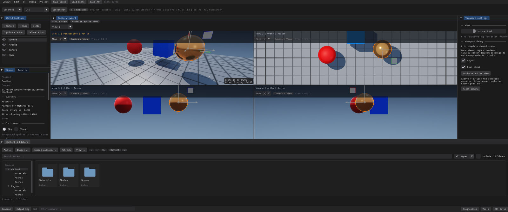

# Camera 系统

视口、场景相机和工具预览共用平台无关的相机求值。Camera Actor 沿局部 `-Z` 观察，`+Y` 向上；Actor 的缩放不改变镜头。当前运行后端为 Windows DX11 与可选 DX12/DXR，其他平台和完整 RHI 后端尚未接通。

*Sandbox 的四分屏：Perspective + Top / Front / Right，每格独立保留相机与曝光；激活格承载 DXR / GI 历史，其余格标注 `Raster`。*

## 使用

- Outliner 的 `+ Add` 菜单创建相机；从当前视图创建会复制当前位置、朝向与镜头。选中相机在 Details 中编辑透视/正交、垂直 FOV、正交高度、近远裁剪和宽高比。
- Scene Viewport 相机菜单选择自由视图、场景相机以及正交方向。自由视图支持 Orbit/Fly，保留右键环绕、Alt+左键环绕、中键平移、滚轮缩放和 F 聚焦；Fly 通过右键观察及 WASD/QE 移动，Shift 加速。
- `View camera` 只读跟随相机，`Pilot camera` 显式操纵 Camera Actor。一次连续导航记录一条撤销；返回自由视图恢复进入前的位置和镜头。相机删除或失效后自动退出绑定。
- `Align camera to current view` 把当前视角复制到选中相机。`Set default output camera` 设置场景默认输出；`--no-ui` 启动使用该相机，编辑器启动继续使用独立的 Opening view 书签。
- 宽高比为 0 时适应视口；正值锁定画幅并显示黑边。拾取、拖放与 Gizmo 使用画幅内部矩形，黑边不接受场景操作。
- `Open camera preview` 打开独立的光栅预览，可与主视口同时观察不同相机。预览窗口明确标注 `Raster preview`，不会消耗主视口的 DXR/GI 历史。

自由导航不标记场景未保存；相机 Actor 及镜头编辑、默认相机设置和显式保存开场书签属于场景修改。镜头参数实时反馈，无需重新编译 Shader。

## 四分屏

在 `Viewport settings` 勾选 `Four views`，或用 `--quad-view` 启动编辑器。初始四格为透视、顶、前、右视图；每格独立保留相机、镜头、导航和查看/操纵状态。点击、滚轮或资源拖入某格可激活该格，键盘和Gizmo只由激活格处理，连续导航或变换期间不跨格转移手势。Actor选择和撤销仍由整个场景共享。

顶栏可选择 `View 1–4`、最大化当前格、恢复四格或返回单视图。区域过小时显示激活格，仍可用选择器切换其余格；放大区域后恢复四格。四格布局与自由视角是当前编辑会话状态，保存场景时只保存明确存储的 Opening view 和场景Camera。

激活格沿用所选渲染路径与DXR/GI设置，其他三格标记为 `Raster`，输出到独立纹理。切换激活格改变稳定ViewId，重新建立主时间历史；当前没有四套同时常驻的DXR历史。非激活格的场景编辑画面最迟在下一帧更新。

## 景深

Camera Details 和自由视图的 `Camera / View` 菜单提供 `Enable depth of field`、`Focus distance (m)`、`Aperture (f-stop)` 与 `Sensor height (mm)`。对焦距离沿相机前方量取；较小f-stop产生更浅景深。垂直FOV仍决定构图，焦距由传感器高度和FOV推导。关闭效果保留参数；Camera Actor编辑支持撤销与保存。

| 模式 | 实现与边界 |
| --- | --- |
| Forward / Deferred / Realtime GI | 对最终颜色及光栅深度做景深后处理，在显示线性光空间混合，最大半径24像素；无法恢复被前景遮住的背景。 |
| Progressive Path Tracing | 圆形孔径薄透镜采样，射线汇聚到焦平面；包含遮挡与可见发光面，随样本数收敛，不再叠加屏幕模糊。 |
| 正交、Albedo等数据视图 | 保留景深请求但不应用；Lit与Unlit颜色视图支持屏幕景深。 |

焦点不超过推导焦距时停用效果并显示提示，不破坏几何投影。拾取与Gizmo始终使用清晰的几何射线，编辑器描边在景深之后绘制。Progressive景深或焦点/光圈变化重置累积；Realtime后处理参数不重置GI。

屏幕景深依赖实际深度缓冲；`ZWrite Off` 等不写表面深度的特殊材质不保证正确对焦，精确孔径遮挡应使用Progressive模式。

参数范围：对焦距离0.01–1,000,000米，f-stop 0.7–128，传感器高度1–100毫米，所有值必须有限。

## 数据与渲染边界

`Camera/Camera.h` 定义 `Pose`、`Lens`、`Camera` 和 `View`，不依赖图形 API 或窗口。`evaluate` 返回统一的视图/投影及逆矩阵、相机基向量；`screenRay` 生成经过近远裁剪的透视或正交射线。规范矩阵为右手、行向量、行主序、深度 `[0,1]`；后续后端需要在适配层完成坐标约定转换。

`SceneSettings.cameraLens` 与可选 `cameraPose` 表达当前相机。无显式姿态时 `resolveCamera` 从兼容的 yaw/pitch/distance/target 轨道参数求值；显式姿态优先。`CameraNavigation` 共用导航数学，主应用隐藏 UI 时也使用此入口。

SceneConstants 为 **176 字节**，在原字段后追加相机前向/正交标志和镜头参数，CPU/HLSL 反射一并验证。正交观察方向、线性深度、CSM 切片、光追主射线及 GI 像素范围均从相机数据派生。曝光只影响显示，不清除线性 GI 累积；位置、镜头、尺寸或 ViewId 变化会使主视图历史失效。

当前一个激活视图拥有时间历史，四分屏非激活视图与相机/材质/资产预览拥有不同的输出纹理槽并使用光栅。ViewId 防止不同视图错误复用同一份历史；尚无多份常驻 DXR 历史。预览借用场景目标绘制后复制到其输出纹理，必须在主场景帧之前调用。替换后的预览纹理在UI提交安全边界退役。

屏幕景深源码为 `Shaders/Private/DepthOfField.hlsli`，Pass实现在 `src/Renderer/DepthOfField.inl`，使用独立32B的b8常量；编译、反射和候选发布与主管线一并完成。Progressive在 `PathTracing.hlsli` 生成孔径射线，b5 HardwareConstants为208B。

## 保存兼容

Camera Actor、默认相机引用或扩展镜头/姿态书签使用 `.rascene` **v6**。无这些数据时继续选择 v3（普通网格）、v4（灯光）或 v5（材质槽覆盖）。v1–v5 仍可读取，旧 `camera` 字段保留开场书签语义，不自动生成相机 Actor。新书签额外保存镜头与可选姿态。

任何镜头包含非默认景深数据时使用 **v7**，Camera对象或开场书签lens下写入完整 `depthOfField` 对象（enabled、focusDistance、fStop、sensorHeightMm）。即使enabled为false，非默认调参仍保存。默认景深不写额外字段，保持旧版本格式；v1–v6读取时默认关闭景深，拒绝以旧版本号夹带景深字段，避免旧读取器静默丢失设置。

镜头与默认引用严格校验；场景解析到候选 World，全部成功才替换当前数据。Camera Actor 不引用网格/材质；默认相机被删除时清除引用，编辑器撤销同时恢复 Actor 和引用。资源删除的已保存场景依赖扫描识别到 v7。

为保持浮点投影可逆，`far / near` 不超过 `10^6`，远裁剪面不超过 `10^7`；固定宽高比范围为 `0.001–1000`，0 表示适应视口。非有限数和超出支持范围的数据会被拒绝保存或加载。

## 验证入口

`CameraMathTests` 验证投影、射线、旋转和数值边界；`CameraPersistenceTests` 验证往返、旧版本和失败原子性。`--camera-self-test --capture-dir <目录>` 执行真实 GPU 投影、裁剪、预览、景深焦平面/光圈、四路输出及 GI 历史检查；`--editor-self-test` 覆盖 Camera 创建、镜头控件、查看/操纵、撤销、正交拾取、预览、四格输入/最大化和保存重开。测试应使用隔离工程。

## 扩展与迭代

相机数据在 `Camera.h` 里是纯数学：`Pose`、`Lens`、`View`、`Ray`。新增镜头字段从 `evaluate()` 和 `screenRay()` 开始，再到 `SceneConstants`（b0，176 字节）与 HLSL 镜像，最后补 `static_assert` 和反射校验。视口相关的功能走 `SceneEditorViewports.inl`：四格的相机、镜头、曝光和 `viewId` 都在那里分配，新增视图要先决定它是否拥有 GI 历史——当前只有激活格有。

景深扩展要分清两条实现。光栅端改 `DepthOfField.hlsli` 与 b8 常量（32 字节），路径追踪端改 `PathTracing.hlsli` 的孔径采样；只改一边不能算支持景深。

还没做的：每视图独立的 DXR 历史、相机动画与轨道、镜头畸变、逐显示器字体 DPI。做多历史之前先解决内存和失效键的组织方式，否则每次切格都会重置累积，渐进模式永远停在开头。
