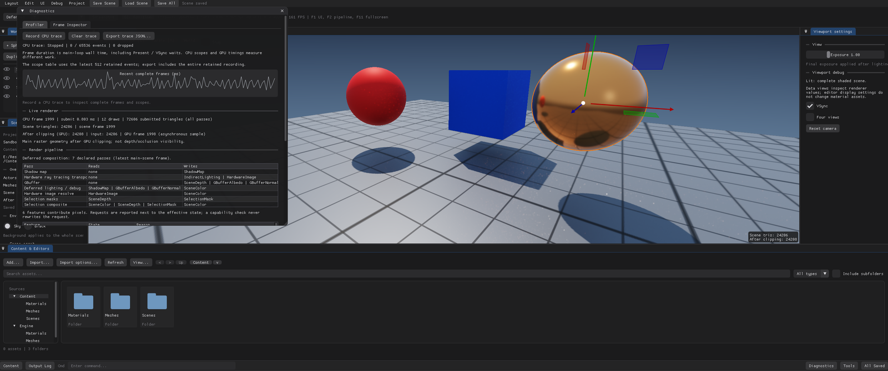

# 引擎诊断工具

RestArtEngine 的诊断工具覆盖性能、帧执行、画面资源和运行时消息。它们共享应用帧与线程身份，界面统一从 `Debug` 进入。

*`Debug → Diagnostics` 的 Profiler 页：CPU Trace 控制与最近 120 帧 wall time、Live renderer 统计（帧号、提交时间、draw 数、提交三角形），以及当前主场景帧的 Pass 声明表与生效特性计数。关闭窗口后不再持续复制渲染资源。*

CPU Trace、Runtime 消息、Frame Inspector、GPU Pass 计时已接入 D3D11 与实验性原生 D3D12 路径。Inspector 提供详细 Draw 状态、选定 Pass 边界快照和带资源载荷的离线捕获包；它不提供任意图形 API 拦截、逐 Draw 重放或 CPU 断点调试。下文描述实现契约和验证入口，不能替代具体后端的实际验收结果。各后端能力以[后端说明](RenderBackends.md)为准；Vulkan、OpenGL 尚未接入场景渲染。

## 工具的职责

| 工具 | 回答的问题 | 当前行为 |
| --- | --- | --- |
| Profiler / Trace | 哪一段工作耗时，卡顿发生在哪一帧？ | CPU 线程时间线、嵌套 Scope、包含/自身耗时聚合、帧耗时和 Trace JSON；D3D11 / D3D12 实际 GPU Pass 时间戳。 |
| Frame Inspector / 帧检视器 | 这一帧执行了哪些 Pass / Draw，使用什么状态和资源？ | 捕获下一主场景帧；检查 Draw、PSO、Shader、绑定、常量版本、终帧或选定 Pass 边界资源，保存/打开离线捕获包。 |
| Runtime | 运行时发生了什么错误，程序使用了多少内存？ | 有界结构化消息、图形 Debug 消息、实际后端状态、进程内存及明确标注的逻辑缓存估算。 |
| Viewport Debug | 某个表面、光照或缓冲为什么呈现为当前结果？ | 扩展现有实时显示模式，检查材质有效值、法线、位置和深度。 |

典型路径：从帧耗时发现异常 → 捕获问题帧 → 查看 Pass / 资源 → 用实时视口模式定位表面数据。录制和帧捕获分别开启；诊断关闭后不应持续复制完整渲染资源。

`Frame Inspector` 是引擎自己的帧检查器名称。它记录本引擎已知的绘制事件与资源。RenderDoc 是独立的外部工具，其[事件浏览器](https://github.com/baldurk/renderdoc/blob/v1.x/docs/window/event_browser.rst)、[管线检查](https://github.com/baldurk/renderdoc/blob/v1.x/docs/window/pipeline_state.rst)与[纹理查看器](https://github.com/baldurk/renderdoc/blob/v1.x/docs/window/texture_viewer.rst)用于参考调试任务划分；自研 Inspector 的通过结果不代表已完成外部 RenderDoc 抓帧验收。

## 性能数据的含义

命令行可用 `--trace-output <文件.json>` 自动录制主应用循环并在正常退出时导出 Chrome Trace。例如 `RestArtEngine --project <工程.raproject> --no-ui --frames 60 --trace-output <输出.json>`。录制从加载完成后的主循环开始；比较稳定帧时还应排除资源首次上传／光追结构首次构建的预热帧，保持项目、分辨率、VSync 和采样设置一致。`Mesh geometry upload`、`Software ray scene rebuild`、`DXR scene rebuild` 标识缓存失效时的 CPU 工作，不代表 GPU 执行耗时。

CPU 帧耗时使用单调时钟，包含采集范围内的等待。CPU Scene Submit 衡量 CPU 提交渲染命令的时间；Present scope 可以包含 VSync 等待。它们均不能代替 GPU 执行时间。嵌套事件的耗时是包含子事件的 wall time，不能将所有行简单相加得到帧耗时。

Trace 记录事件名、分类、线程、帧及父事件，最多保留 65,536 个事件，满后统计丢弃而不覆盖旧录制。Start 清空并开始新录制，Stop 保留数据，Clear 清空事件但保留录制开关。120 帧 wall time 历史独立于录制状态。界面取最近 4096 个已完成事件，按实际起止时间绘制线程时间线，支持选择 Scope 和按名称/分类聚合；保留事件表每帧最多显示 256 行。自身耗时以同线程直接子 Scope 的区间并集扣除，不累减嵌套的所有行；若最近窗口、溢出或缺失子事件使记录不完整，显示保留范围内的自身耗时，不冒称完整采样结果。

Trace JSON 导出全部已保留 CPU 事件，不包含 GPU query 结果。录制热路径不写磁盘；导出由用户显式选择位置。格式使用 Chrome Trace JSON 基础事件；Perfetto 提供[该格式导入](https://perfetto.dev/docs/getting-started/other-formats)，其 JSON 兼容是 [best effort](https://perfetto.dev/docs/faq)，并非原生 Perfetto SDK 集成。

DX11 GPU 计时使用每帧 disjoint query 和 Pass 边界 timestamp；仅可靠且频率有效的数据转换为毫秒。[Microsoft query 定义](https://learn.microsoft.com/en-us/windows/win32/api/d3d11/ne-d3d11-d3d11_query)说明了时间戳与频率/有效性关系。结果延迟读取并保留原 GPU Frame ID，`Pending`、`Unavailable`、`Disjoint` 不显示为 0 ms。[GetData](https://learn.microsoft.com/en-us/windows/win32/api/d3d11/nf-d3d11-id3d11devicecontext-getdata) 与 [DONOTFLUSH](https://learn.microsoft.com/en-us/windows/win32/api/d3d11/ne-d3d11-d3d11_async_getdata_flag)用于非阻塞检查；未就绪时留到后续帧，不自旋等待。

D3D12 计时使用主队列的 timestamp query heap、`EndQuery` / `ResolveQueryData`、队列时间戳频率和 readback；只有相应提交的 fence 完成后才读取。四槽查询池有界，轮询未就绪时不等待或复用仍在消费的槽，原 Frame ID 随结果保留。一次样本可跨同一主队列的多次命令列表提交；这些数值来自 GPU 时间戳，不是 CPU submit 时间的改名。

GPU scope 以主场景 Pass 为范围，不自动包括 ImGui 平台窗口、Present 或独立 DXR 队列。CPU/GPU 尚无绝对时钟校准时，只关联 Frame ID 与持续时间，不伪造精确重叠时间轴。捕获中的 GPU 样本初始可以为 Pending；仅在相同捕获 Frame ID 的结果到达时补入该帧，不把其他 Live 帧的时间移作捕获结果。离线打开后的样本不再被 Live 查询替换。启用资源捕获、显式像素读回或高密度事件会影响性能；比较数据时记录构建类型、设备、分辨率、管线、VSync 和诊断开关。

## 程序消息与内存

Runtime 消息包含单调递增 ID、应用 Frame ID、进程内稳定线程 ID、单调时钟时间、Info/Warning/Error、分类和文本。Trace 与 Runtime 共用线程 ID；它们的时间起点不同，仅按 Frame/Thread 关联，不直接拼接为同一时间轴。日志最多保留最新 512 条，溢出统计被移除的条数；分类限制 128 字节，文本限制 8192 字节并附截断提示，截断保持完整 UTF-8 字符边界。Clear 清空消息和丢弃计数，不复用 ID，也不清空 Console 历史或 Trace。

Console 每条实际追加的输出镜像到 Runtime，Shader 编译结果和 Frame Inspector 成功/失败也写入结构化消息；图形消息单独读取当前 D3D11 / D3D12 Debug InfoQueue 的最近 128 条，保留严重性、消息编号和描述。它不是 stdout/stderr 的全量重定向。日志写入失败不能替换原应用错误；CPU 断点、调用栈检查、变量单步、采样式 CPU 分析及全分配追踪尚未实现。

Windows 进程 working set 和 private committed memory 来自 `K32GetProcessMemoryInfo`，不可用时标记无数据。Mesh/软件射线缓存字节数是引擎逻辑分配估算，不是 GPU 驱动驻留、总显存或进程 working set，不能相加。RHI 创建/上传/Pass/Draw 计数是累计执行量，不是当前存活资源数或本帧耗时。

## 视口数据契约

### 场景与视口面数

Scene 的 Overview 与 Scene Viewport 的只读统计显示两种三角面数；Profiler 的 Live renderer 也展示相同数据：

- **Scene triangles / Scene tris**：按场景 Actor 实例累加所引用 Mesh 的 `indices.size() / 3`，包含隐藏实例，共享一个 Mesh 的多个实例分别计数。未被实例引用的资产、缺失的 Mesh 不计入；材质缺失不改变这项拓扑总数。
- **After clipping (GPU)**：仅测量主视角 Forward geometry 或 GBuffer 通道的 GPU 裁剪输出，不累计阴影、描边、全屏三角形或工具预览。当前 DX11 使用独立四槽 `D3D11_QUERY_PIPELINE_STATISTICS` 查询的 `CPrimitives`，同时保留 `IAPrimitives` 输入量与原始主场景样本序列。按 [Microsoft 的字段定义](https://learn.microsoft.com/en-us/windows/win32/api/d3d11/ns-d3d11-d3d11_query_data_pipeline_statistics)，裁剪可拆分三角形，因此输出可能多于输入；这不是深度测试或遮挡之后的可见三角面数。

场景总数读取最近主场景提交的快照，GPU 结果额外异步延迟；提示与 Profiler 标明样本序列，使用 `GetData(...DONOTFLUSH)`，查询未就绪时不等待 GPU，环满时跳过当前采样。统计不依赖打开 Profiler，未就绪／不可用／视口未绘制均显示相应状态，不用 0 冒充有效结果；空场景的有效查询可以为 0。场景视口隐藏仍更新拓扑总数，resize、窗口切换和显示路径切换废弃旧查询；材质球、资源详情和场景缩略图不改变主场景统计。

完整硬件光追图像覆盖光栅输出时，裁剪统计显示 **N/A**；光追回退至光栅、以及使用光栅主可见性的 Realtime GI 路径仍能统计。Profiler 原有的 **submitted triangles (all passes)** 是全部已记录绘制通道的提交量，可能重复计算同一实例，不能替代上述两项。开启 CPU 视锥剔除时，被拒绝的实例不会进入 GPU 输入；关闭该剔除后，统计仍直接测量 GPU 裁剪结果，不以提交量估算。

### GBuffer 与实时显示模式

当前 Deferred 的三张 GBuffer 均为 RGBA16F：

| 资源 | RGB | Alpha |
| --- | --- | --- |
| GBuffer0 | `EvaluateMaterial()` 后的 Base Color | 有效 Roughness |
| GBuffer1 | World Normal，保留有符号值 | 有效 Metallic |
| GBuffer2 | World Position | 几何有效标记 |

材质查看应使用 Shader 最终有效数据，包含工程材质 Shader 与未 Apply 的实时预览，而非只显示 CPU 资产字段。当前 Roughness 最低钳制为 0.045，Metallic 为 0–1。

当前材质模型没有独立 Specular 参数：`F0 = lerp(0.04, albedo, metallic)`。`Specular F0` 表示法向入射基础反射率；`Direct Specular` 表示直射高光贡献；环境高光和光追反射另有各自的路径。名称必须区分这些含义。

| 分组 | 模式与检查内容 | 实施边界 |
| --- | --- | --- |
| 基础 | Lit、Unlit、Base Color | 复用当前模式与材质求值。 |
| 材质 | Roughness、Metallic、Specular F0 | 首版扩展；前两者为标量灰度，F0 为 RGB 并使用显示 gamma，均不受美术曝光影响。 |
| 几何 | World Normal、World Position、Linear Depth | 法线 XYZ 映射到 0–1；位置周期色仅供结构观察，原始值从资源检查读取；深度为正向 view-space Z（`-viewZ`）除以 100，并钳制到 0–1，非到相机的径向距离。 |
| 缓冲 | GBuffer0/1/2、主深度 | 首版在冻结帧资源中检查。Forward 帧只列实际生成的资源，不读取旧 Deferred 附件。 |
| 光照 | Direct Diffuse / Specular、Ambient / Environment、Shadow Visibility、AO | 首版已提供直射 Diffuse / Specular：从实际光照计算拆出，使用曝光和显示变换；Ambient / Environment、Shadow Visibility、AO 诊断待后续接入，非独立附件时需注明 Shader 派生。 |
| 身份 | Actor / Material ID、选中遮罩 | 后续需新增或暴露对应的 GPU 输出，不以 CPU 拾取代替像素身份。 |
| 成本与错误 | Wireframe、Overdraw、复杂度、NaN / Inf、越界与无效法线 | 后续分别实现实际测量或检测；启发式成本图须注明估算，不能称为 GPU 耗时。 |
| 新材质数据 | UV、Tangent、AO 输入、贴图 mip、Motion Vector 等 | 尚未提供相应视口诊断模式；Draw 详情可以检查当前顶点/UV 流的绑定与 stride，但不等于已提供 UV、切线或运动矢量的逐像素输出。 |

Surface 模式可由 Forward 和 Deferred 共用材质求值；Raw GBuffer 只适用于真正生成附件的路径。不为显示一个模式静默切换用户的渲染管线。未来能力查询应返回用户请求、实际模式和禁用/降级原因。

纹理显示与原始值读取分开：有符号法线映射到可见范围，位置/深度注明显示变换，RGB/R/G/B/A 通道选择不改动原数据。相机深度预览用捕获时的透视/正交投影和 near/far 还原 view-space Z，再除以 100；冻结 Depth 的原始值仍为 device depth 0–1。阴影层是 light-space device depth，直接显示 0–1，不套用主相机 near/far。F0 模式的 SceneColor 已经过显示 gamma；原始 F0 可由 GBuffer albedo 与 metallic 推导。

像素检查显示资源名、纹素坐标及原始值。读取和首次生成显示纹理可显式触发同步 GPU readback；D3D12、离线资源与深度显示在按需转换后上传独立 RGBA8 纹理，D3D11 其余本地冻结纹理使用显示转换 Shader。相机深度的 RGB 是灰阶预览，R 单通道显示线性深度，G/B/A 仍保留原存储通道语义。公共 `readCapturedPixel` 返回 raw，`readCapturedDisplayPixel` 回读实际缓存的 RGBA8 显示像素，两者不可混用。不能将这部分复制/转换延迟计为普通渲染成本，也不应每帧跟随鼠标持续读回。

## 帧捕获与生命周期

捕获默认针对下一次有效主场景渲染，材质球、Asset Details 和场景缩略图不消费该请求。一次 `render()` 调用并不等于应用的一帧；工具预览复用场景渲染器，必须保留用途边界。

捕获保留：

- Frame ID、后端、管线、Shader revision、尺寸、相机投影/裁剪范围和捕获状态，以及捕获时的材质/管线 Shader 源码。
- Pass 名称、帧内 CPU 起点/提交时间、读写资源声明和事件范围；Draw 唯一 Event ID、Pass index、Actor / Mesh / Material 的 ID 与名称、索引/顶点数、first index、base vertex、材质 slot。
- 已记录的实际 RHI Draw 状态：VS/PS 身份、PSO 深度/剔除/绕序、viewport、颜色/深度附件、采样纹理槽、顶点/索引流及 stride/offset、VS/PS 常量槽的独立字节与上传版本。常量窗口同时显示原始十六进制和 float32 位解释，后者不是完整 Shader 反射变量。
- 捕获资源的 Pass、Before/After/Final 边界、事件位置、格式、尺寸与层号，以及独立 raw 副本。Shadow CSM 的每层单独保留，不以首层内容代替其他层。
- 最近保留的 CPU Trace 快照和独立标记的同帧 GPU 计时状态。捕获发生在主场景提交期间，未结束的 CPU Scope 不会伪装为已完成事件；这不是整个应用帧结束后的全线程快照。

默认只保留一帧。Capture settings 可选最终帧输出或某个实际逻辑 Pass；选择 Before/After 时，Before 只复制本帧此前已初始化且该 Pass 声明读写的资源，After 复制所选 Pass 的受支持输出。它不是“所有附件始终成对存在”；本帧尚未产生的资源、没有受支持附件的 Pass 都不能编造图片。

UI 原始资源预算可设 16–256 MiB；API 将预算限制在 1 字节至 256 MiB。raw 副本与缓存显示纹理的硬限制合计 256 MiB。Draw 事件最多 65,536 条，记录器另限制常量快照字节为 8 MiB；未观察到、未经过共同 RHI 或因预算遗漏的详细状态明确标为不完整，不能继承旧 Draw 的状态当作新结果。替换候选和 UI 安全退役期间新旧副本可短暂并存，CPU 元数据、上传/读回和显示转换还会占用内存；这些预算不是进程或诊断功能峰值 GPU 内存的上限。

快照不是借用 Live SRV；后续渲染、工具预览、resize、GC 或 Shader 更新不能把旧捕获变成新内容。创建失败保留上一次有效捕获并报告错误。清理捕获只释放诊断数据，不修改工程资产。

选择事件行查看该 Draw 的记录状态，资源图像始终属于自己的指定 Pass/边界。选择 Draw N 不会重建其执行后的输出，单靠前后图像也不能断言某像素因 depth/stencil/discard 失败。中途覆盖而未留存的目标无法从最终副本恢复历史。

### 离线捕获包与元数据导出

`Export metadata JSON...` 保留基本事件和资源描述，不含图像载荷，不能重新打开为完整捕获。`Save frame package...` 则生成 `.raframe`：版本化二进制容器包含严格校验的 JSON 描述及各资源原始字节，保留 Draw/常量/Shader/Pass/Trace 数据；`Open frame package...` 不依赖原项目资产即可查看这些冻结资源。当前仍需一个初始化的渲染会话来创建工具窗显示纹理，离线浏览不会编译或执行包中的 Shader，也不会修改 Live 场景。

容器限制 metadata 为 16 MiB、payload 总量为 256 MiB、数量为 4096；源文件长度、版本、字段/数值/格式/范围、声明尺寸与实际载荷大小均需一致。metadata 与各 payload 的校验值用于识别意外损坏，不是签名或来源认证。截断、尾随数据、无效版本、超预算、校验或语义错误使加载失败，且保留上一次有效捕获。保存先写同目录独立临时文件，完整 flush 后才原子替换目标，失败不删除旧文件。文件不展开路径、不提取脚本、不自动创建工程资产。

`.raframe` 是资源和状态的快照包，不是 GPU 可回放文件。完整初始资源、命令、更新与队列同步序列、计算/DXR 状态、Shader 字节码重建及 Pixel History / Shader 单步仍未实现；不能将“能离线打开”称为“能逐事件重放”。

## 界面与工程边界

`Debug` 提供 Profiler、Frame Inspector 和捕获入口。Diagnostics 是按需打开的可关闭工具窗，复用 Black / Dark Blue 主题与原生 Docking；已有布局身份保持稳定。现有 Screenshot / F9 继续保存合成后的窗口图片，与帧资源捕获分开。

Diagnostics 提供 Profiler、Frame Inspector、Runtime 页签。Profiler 显示当前录制状态、最近完成帧、线程时间线和 Scope 聚合；Frame Inspector 提供 Pass/预算设置、事件筛选与选择、Draw 状态、资源/通道/像素和冻结的 CPU 数据；Runtime 按严重性/分类/文本筛选消息。窗口保留双主题与原生 Docking，窄窗口中的工具按钮换行。

Frame Inspector 持续显示 `Captured` 与捕获帧身份，离线包明确标为 Offline。冻结图像中的像素选择不操作 Live 场景，不改变 Actor 选择、Gizmo 或 Undo。诊断窗获得焦点后，场景快捷键不得穿透。未来若添加 Live 像素工具，需要在拾取/拖动前统一分配输入所有权。

布局和显示偏好属于本机设置；录制、待捕获和取像素的活动状态属于当前会话，重启默认关闭。它们不写入 `.rascene` / `.rasset`，不增加撤销历史，也不标记场景 dirty。用户导出的诊断文件不自动加入工程 Content。

## 模块与扩展

Core 提供平台无关 Trace 与有界 Runtime 消息，以及按平台提供的进程内存读数；Renderer 提供主场景计时、RHI 命令状态记录、捕获、离线包与资源检查；Editor 只消费诊断数据并管理工具界面。公共诊断结构使用自有类型，不包含 D3D11 指针。具体 query、纹理复制、GPU 生命周期和 UI 纹理交互留在后端实现内。RHI 记录器不拦截所有 native 调用；直接 D3D11 后处理和独立 DXR 通道的完整绑定/命令历史仍有覆盖缺口。

后续新增 Pass 需同时声明名称、输入输出、参数/Shader 身份、可选计时和可检查输出。新增诊断模式需声明数据来源、单位、范围、支持路径、显示变换及禁用原因，不将所有模式硬塞成无说明的整数分支。进一步扩展时逐步引入描述表与能力查询，不先建设没有消费者的通用框架。

后续扩展包括照明贡献和特性诊断、更细的指定 Draw 前后快照、受限命令重放、Pixel History / Shader 调试。硬件计数器、采样式 CPU 分析、全分配追踪、设备故障诊断分别评估能力和开销，不把插桩 Trace、离线包或 InfoQueue 消息当成这些能力已经具备。

## 验收要求

- Trace 可解析，嵌套/线程/帧关联正确，关闭与溢出行为可观察；停止后数据保留，导出失败不清空录制。
- GPU 查询返回原 Frame ID，无数据状态明确；压力下不阻塞，释放和设备生命周期安全。
- 已知材质的 GBuffer 原始值与实时草稿一致，Roughness / Metallic / F0 实际画面正确，Forward / Deferred 往返不读取陈旧附件。
- 数据显示不意外受曝光影响；新 Shader 改动成功发布，失败保留可用画面和 revision。
- 捕获经后续渲染、preview、resize 和 Shader 更新保持冻结；失败不破坏上一快照，Clear 使捕获失效并安全退役其副本。query 池和转换 Shader 等缓存保留至渲染器 shutdown，CPU Trace 独立清理。
- 检查双主题及窄工具窗截图，取像素不触发场景操作；保留既有保存、预览和 Undo 语义。

构建通过、CPU 测试、各后端 GPU 行为与 GUI 画面验收分别判断。`TraceProfilerTests` 检查录制与导出，`RuntimeDiagnosticsTests` 检查日志边界、并发及 Console/Trace 关联，`FrameCaptureArchiveTests` 与 `FrameCaptureMetadataTests` 检查容器及元数据损坏/预算/事务规则。

`--inspector-self-test --backend d3d11|d3d12 --project <隔离工程> --capture-dir <输出目录>` 使用所选实际后端，以自建内存场景检查原始像素、详细 Draw/常量、Pass 边界、阴影层、冻结生命周期、离线包、失败保留和真实 GPU 时间戳，输出报告及 `.raframe`。这不替代 UI 截图，也不等于外部 RenderDoc 验收。旧 `--editor-self-test` 中的 Diagnostics 用例仍使用 D3D11 原生读回，检查 GBuffer/显示通道、实时材质覆盖、视口模式、冻结计时、工具窗和输入；不能用它宣称原生 D3D12 已验证。其余入口参照[渲染开发要求](RenderingDevelopment.md)，测试使用隔离工程和布局。

`--inspector-ui-self-test` 使用相同后端与隔离工程参数，实际操作三个页签、录制/停止、Draw/常量/源码、取像素和输入隔离，保存双主题、760px/300px 工具窗的主窗口 GPU 截图。截图须另外查看；原生保存/打开文件对话框的桌面自动化、外部浮窗 GUI 像素与完整回放不由该入口证明。
