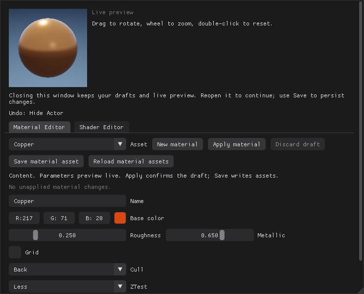

# 基础场景与材质编辑器



*独立材质编辑器系统窗口：左上为 GPU 球体实时预览，下方是参数草稿、Apply / Save / Discard 与每材质 Cull / ZTest / ZWrite；Shader 页签编辑工程自己的 `Standard.hlsli`。*

启动时先出现无边框加载页（占主屏 28% 宽、按图片比例、居中），加载完成后面板窗口按主屏 80% 大小居中显示，带原生边框与自定义标题栏。在 Rider 打开根目录 `RestArtEngine.sln`，编译并运行 `RestArtEngine`（输出文件名为 `RestArtEngine.exe`）。无参数启动会先进入 Project Manager；选择工程后再进入编辑器。本页解释当前基础编辑器的数据关系、保存方式，以及引擎内编辑 HLSL 后 Apply 的工作流。界面使用 Dear ImGui；功能代码位于 `src/Editor/`。

工程管理器列出 `Projects/` 下的所有示例工程（`Sandbox`、`RayTracing_Simple`、`PathTracing_CornellBox`）。`--project` 接受工程目录或 `.raproject` 文件，例如从引擎根目录运行时使用 `--project Projects/Sandbox`，或 `--project Projects/Sandbox/Sandbox.raproject`，可绕过工程管理器直接打开。工程描述决定引擎目录、Content、可编辑 Shader 与默认场景的位置，截图目录独立设置。

引擎目录根部的 `Engine.raeengine` 保存引擎版本和 hash；工程描述中的 `engineVersion` / `engineHash` 绑定到该身份。工程管理器打开工程时先做兼容检查：匹配时直接进入编辑器；版本或 hash 不匹配时可更新绑定、切换到匹配的引擎，或者关闭；旧的 v1 工程没有绑定，首次打开后可升级保存。

以下提到的 `Content/` 和材质 `Shaders/` 都是**当前工程内的目录**。默认 Sandbox 分别对应引擎仓库内的 `Projects/Sandbox/Content/` 和 `Projects/Sandbox/Shaders/`。引擎根目录只保留公共 Shader 管线与默认材质模板，编辑器不会将工程材质或导入网格保存到引擎根目录。

如果在 `.raproject` 中修改了 `contentRoot` 或 `shaderRoot`，实际资产与 Shader 路径随这些配置解析。当前 Content 面板提供文件夹树与资产区（列表/网格两种视图，材质、网格、场景都在这里浏览）；左侧 Details 跟随场景中选中的 Actor 实例，与资源列表的浏览选择分开。材质参数与 Shader 编辑在按需打开的系统独立窗口中。已实现路径导航、搜索、类型筛选、排序、缩略图、类型目录内的文件拖拽移动与重命名；不提供任意磁盘目录浏览。

资产文件操作限定在当前 Content：材质、网格和场景只能在各自的 Materials、Meshes、Scenes 目录树内移动；场景 sidecar 随文件移动。`Rename file...` 改文件名并保留 GUID，浏览器显示文件名，容器内部资产名保持原值。项目导入网格右键 `Reimport` 从记录路径更新，`Reimport from...` 自选新的源文件；两者保持 GUID、名称、存放位置与 Actor 引用。`Delete...` 确认后同步删除文件与内存资产，保留外部源文件；当前与已保存场景引用、Engine、内置图元、当前／启动场景及 Shader 等会阻止删除。删除网格／材质成功会清空场景编辑历史，确认框明确提示；文件操作不支持 Undo，目录整体移动暂不支持。详细失败和引用检查规则见 [资源导入](Importing.md)。Content 获得焦点时，Actor 删除快捷键不会透传。

导入容错可在 Content → `Import options...` 配置。`Skip degenerate triangles` 默认开启，FBX 零面积三角形跳过并警告；关闭后严格拒绝。选择文件和外部拖入共用设置，并保存为本机编辑器偏好。全部面退化时仍拒绝，源文件保持原样；细节见 [导入选项](Importing.md#导入选项)。

## 保存场景初始视角与照明

Scene 面板的 `Store current view` 把当前轨道相机与曝光记录为场景初始视角，`Restore view` 恢复，`Clear opening view` 清除；Save Scene 将其写入场景，普通相机导航不会自动修改这份书签。打开／重新加载场景时自动应用；旧场景没有书签则保持现有视角。

Outliner 的 `+ Light` 提供 Directional、Sky、Rect、Spot 和 Point。选中后在 Details 编辑颜色、强度及对应范围／角度／尺寸，参数实时生效且支持撤销重做；视口标记可点击，支持 Gizmo 与 F 聚焦。灯光沿局部 -Z 发射，缩放不改变光参数。存在任何灯光 Actor（包括隐藏灯）时，Scene 的旧灯光控件禁用，避免同时使用两套光源。完整约定见 [灯光模块](Lighting.md)。

无灯光 Actor 时，`Save lighting in scene` 继续保存旧方向光强度、环境倍率与单个矩形发光面；矩形位置、尺寸、辐亮度在 Scene 调整，轴方向保存在场景 JSON 中。旧 [PathTracing_CornellBox](../Projects/PathTracing_CornellBox/README.md) 仍按此配置加载，渐进式 Path Tracing 保留可见发光面和 MIS 采样。

## 底栏与命令控制台

主窗口底栏为工作区预留独立高度，停靠面板和场景视口随窗口尺寸重新排版。左侧 `Content` 聚焦已有资产浏览器（`Ctrl+Space`），`Output Log` 打开或关闭会话日志；中间 `Cmd` 输入引擎命令，`Ctrl+反引号` 聚焦。右侧 `Tools` 提供 Profiler、Frame Inspector、GC、Project Settings 和 CPU Trace 开关；宽窗口直接显示 Diagnostics，窄窗口将 Content 和 Output Log 收入 Tools。

`All Saved` / `Unsaved` 汇总场景、已应用材质、未应用材质草稿、Shader 和工程配置。点击可查看分类状态并执行 Save Scene、当前材质保存或 Save All，保持各自的保存职责。

命令区支持 Enter 执行、Tab 补全、上下键历史（向下越过最新记录恢复未完成输入）。输入 `help` 查看全部命令，`help scene` 按前缀筛选。常用命令：

| 命令 | 行为 |
| --- | --- |
| `scene.info` / `select <Actor ID>` | 查看场景 Actor ID／选择实例 |
| `actor.addCube` / `actor.addSphere` / `actor.duplicate` | 使用现有 Actor 操作及撤销事务 |
| `edit.undo` / `edit.redo` | 使用编辑器撤销栈 |
| `scene.save` / `material.save` / `save.all` | 保存场景／当前已应用材质／全部修改 |
| `debug.profiler` / `debug.frameInspector` | 打开诊断工具 |
| `gc.settings` / `gc.collect` | GC 设置／请求帧末回收 |
| `trace.start` / `trace.stop` | 开始／停止 CPU Trace，导出在 Diagnostics 中进行 |
| `content` / `project.settings` / `layout.restore` | 资产浏览器／项目设置／恢复布局 |
| `clear` | 清空输出，保留历史 |

命令名称区分大小写；空格分隔参数，单／双引号支持带空格的参数。此处为引擎命令入口，不执行 PowerShell、系统 Shell 或 Python。未知命令、参数错误与操作失败会打开 Output Log。日志窗口支持停靠、外移、筛选、复制、清空和跟随滚动；保留本会话最近 512 条命令结果／编辑器提示与 100 条命令历史，重启不保留，不捕获全部 stdout 或渲染器日志。命令输入和日志窗口焦点会阻止场景快捷键透传。

## 面板布局

Content 用类型色帮助识别：网格蓝、材质绿、场景琥珀、Shader 紫。网格卡片底部色条、列表左侧标记、筛选选项和详情类型文字保持一致；缩略图显示真实内容，选中高亮仍跟随主题。具体色值集中在 [GUI 规范](GuiDevelopment.md#资产浏览与详情窗口)。

六个面板（World Outliner、Scene、Details、Viewport settings、Content & Editors、Scene Viewport）由 Dear ImGui 官方 Docking 系统统一排版。默认布局为左上 Outliner、左下同组的 Scene / Details 页签、右侧设置、底部 Content 和中央场景视口。

**Scene** 显示场景级参数（工程与场景信息、Actor / Mesh / Material 数量、背景 Sky / Black、Key light 与阴影方式）；Viewport settings 只保留 View 相关项（Exposure、VSync、Reset camera）；操作状态与射线追踪摘要中的 Activity 段落移入 Details 顶部，编辑后能立刻在属性旁看到结果；**World Outliner** 每行左侧的小眼睛显示该 Actor 的可见性，点击即可切换（隐藏后名称变暗、眼睛加斜线），点名称完成选择；**Details** 提供主选中 Actor 的名称、可见性、变换与 Mesh / Material 分配编辑，并显示该场景实例的名称、Actor ID、网格类型／几何数量／来源以及它当前使用的材质。即使两个实例使用同一个 Sphere 网格，Details 也只显示当前主实例的信息，不汇总其他实例的材质。点击 Outliner 或视口中的 Actor 切到 Details；底部 Mesh 浏览不改变场景选择、Details 内容或强制切页。多选时明确显示主实例，无选中实例时显示空状态。手动切页后不会每帧强制跳回。
**Content & Editors** 使用 Sources 文件夹树、路径导航、搜索／筛选和资产区。`Add...` 包含新建文件夹与场景网格选择，`Import...` 多选导入 OBJ／FBX，也可从资源管理器拖入当前项目 Content 的资产区域；不支持或损坏的文件在 Import results 显示原因，完整规则见 [统一导入规范](Importing.md)。`Refresh` 重扫磁盘，`View...` 设置 Tiles／List、缩略图大小、名称／类型／大小排序与旧格式文件显示。Back／Forward／Up 和面包屑切换目录；搜索按名称和相对路径匹配全部空格分词，ASCII 不区分大小写，`Include subfolders` 控制递归范围，类型筛选与搜索同时生效。底部显示结果数和选中项；没有匹配时给出清除筛选的提示。Sources 可调宽、隐藏，窄窗自动收起；低矮面板缩小卡片以保留名称和类型。双击文件夹进入，单击资产只改变浏览器选择，双击资产打开 `Asset Details`（预览、GUID、路径、大小与类型信息）。详情里的 `Open` 或右键 `Open` 执行类型动作；网格右键 `Add Actor from mesh` 创建可撤销的场景实例。


- 拖动面板标签，或悬浮窗口的标题栏，在停靠预览出现时松开鼠标。
- 放到目标区域的左、右、上、下停靠目标，可分割区域；放到中央目标，可将两个面板合并到同一个标签组。
- 六个工作区面板拖离标签组后可以悬浮，并继续拖出主窗口成为系统浮窗；跨过主窗口边界时内容完整显示，再拖回停靠目标即可分割或合并回嵌。Diagnostics、Project Settings、Selection Outline、Garbage collection 和 Asset Details 等工具窗也可以外移。材质编辑器保持单独的系统窗口，窗口顶部有 160px 实时材质球预览：GPU 离屏渲染，参数或相机变化时重绘，其余按约 150ms 节流；鼠标左键拖拽旋转、滚轮缩放、双击复位。
- 拖动相邻面板间的分隔条调整占比；悬浮窗口可通过边框调整尺寸。Scene Viewport 会跟随本帧内容区域改变大小。
- 顶部 **Layout** 菜单可以聚焦指定面板；**Restore default layout** 重建默认六面板布局。

Scene Viewport 在自己的窗口中显示场景渲染纹理；拾取、相机和 Gizmo 使用该图像的当前屏幕矩形。视口窗口浮动或与其他面板合并标签后，场景图像仍跟随它显示，不占用原位置的固定矩形。选中的 Actor 会在场景纹理里叠加一圈屏幕空间描边，用于在复杂画面中确认选择；这是编辑器可视化，不写入场景文件，也不影响独立运行时的画面。被其他物体挡住的轮廓段以虚线显示，只画在轮廓上一段一段断开，不填充遮挡区域；默认遮挡物上只画相交的那一圈虚线；设置窗口的 `Outline front objects` 可让前方物体也获得整圈实线描边（交线保持虚线）。描边的开关、粗细（1–6 px）和颜色（Orange / White / Cyan 预设或自定义取色）在工具栏 `UI > Selection outline...` 打开的独立窗口中调整，默认使用品牌橙 `#FD7804`，也可切换为主题强调色或自定义颜色；窗口是编辑器内的浮动小窗，可随时关闭，设置保存在本机 `RestArtEngine.ui.ini`（与主题同文件）。

交互式编辑器通过 Dear ImGui 原生设置将 Dock 树、窗口位置和尺寸写入本机 `RestArtEngine.imgui.ini`，重启后加载上次布局；没有另一份自定义布局文件。首次从旧版自由窗口布局升级时，新 DockSpace 根节点会建立默认布局。已有五面板布局仅在原 Details 所在组补入 Scene；原 Details 自由浮动时保留其位置尺寸并组成双页签，其他区域不重建。已有 Scene 的布局按用户安排保留。自动化自测不加载个人布局文件。Content & Editors 内是完整的 Content 浏览器（Materials / Meshes / Scenes 文件夹树、列表/网格资产区、导入与新建入口）；Material Editor / Shader Editor 两页位于独立材质窗口中。

## 材质拖放与内置引擎材质

从 Content 列表或网格拖动材质到 Scene Viewport，可直接赋给鼠标命中的可见 Actor。拖动时只有当前目标显示描边，移动到另一实例立即切换，松手前不改变材质或选择。该目标提示沿用描边颜色与粗细，关闭选中描边也不隐藏拖放目标提示；结束后恢复原来的选中描边状态，不改偏好。松手只修改命中实例中该三角形所属的材质 Slot，其他 Slot 和使用相同 Mesh 的其他 Actor 不受影响；一次赋值是一条 `Assign Material` 撤销/重做，重复赋同一材质不增加历史。空白处、视口工具栏、被其他窗口遮挡的区域不接受投递，Esc 取消。项目材质和只读引擎材质都可通过此方式引用；保存场景后持久化引用。

Content 的 Sources 区分 **Content** 和 **Engine**。`View > Show Engine` 控制引擎来源的可见性；隐藏 Sources 时仍可通过路径栏的根选择器切换。搜索、历史导航和向上导航在所选来源内工作。

`Engine > Meshes` 提供 **Cylinder（圆柱）、Cube（方块）、Cone（锥体）、Sphere（圆球）、Torus（圆环）、Plane（平面）** 六个内置 StaticMesh。可直接拖入场景或右键 `Add Actor`，使用默认材质并支持撤销／重做；资产本身保持只读，各 Actor 的变换与材质独立。项目通过固定 ID 引用引擎网格，Save All 不复制这些文件到项目。旧场景（包括尚未迁移的 Sandbox 引用）仍能使用兼容图元；编辑器不会自动改写已有实例的网格引用。新建场景和 `+ Sphere`／`+ Cube` 同样使用引擎网格；旧工程仍能加载原 ID，启动不再生成项目 Builtin。

`Engine > Materials > DefaultMaterial` 是引擎随包提供的中性灰材质。新建 Sphere/Cube、从 Content 网格添加或拖入场景的 Actor 默认引用它；已有 Actor 的材质不会被替换，也不会因为浏览另一份材质而改变新 Actor 的默认值。可在实例 Details 的 Material 下拉中为已有 Actor 分配这份材质。New material 同样从这份默认参数开始，但创建的是具有独立 GUID 的可编辑项目资产。

引擎资产在 Details 和材质窗口显示只读来源：可以预览和引用，参数、Apply、重命名、移动、删除均受保护。需要自定义时使用右键、Asset Details 或材质窗口中的 **Copy to Project**：在项目 Materials 下创建带新 GUID 的独立 `.rasset`，然后自动选中并打开副本。复制不会自动替换 Actor 的材质，需要在实例 Details 中分配。副本可按原流程预览 → Apply → Save；这些操作不会修改引擎默认材质。尚有未 Apply 的草稿时先处理草稿再复制。

引擎材质参数和项目共享 Shader 是两层数据；材质窗口的 Shader Editor 仍编辑当前工程的共享 Shader。工程保存不会复制引擎资产，重新打开时从绑定引擎的 Content 挂载。缺失、损坏或占用保留 ID 的资产明确报错，不通过同名材质静默替换。

## 窗口外框与工具栏

场景编辑器与 Project Manager 使用引擎绘制的标题栏和主题边框，跟随 Black / Dark Blue 配色；场景窗口标题显示当前工程名。右侧提供最小化、最大化 / 还原和关闭按钮，关闭仍经过未保存修改提示。拖动标题栏移动窗口，双击标题栏最大化 / 还原；边缘和角落可缩放，标题栏图标或 Alt+Space 可打开 Windows 系统菜单。

最大化使用显示器工作区，避开任务栏；F11 隐藏标题栏与编辑面板，退出后恢复原窗口。最大化按钮保留 Windows 的 `HTMAXBUTTON` 命中语义以支持系统吸附布局，具体弹出界面取决于 Windows 版本和系统设置。自定义标题栏属于主应用窗口，不会将编辑器面板变成独立系统窗口。

顶部工具栏使用两行：第一行是 ImGui 原生菜单栏，放置 Layout / Edit / UI、场景保存 / 加载与保存状态；第二行是窗口内容区，放置渲染路径、检查视图、光追、截图和运行状态。高度包含菜单栏、一行控件、上下内边距及边框，DockSpace 从工具栏下方开始。顶层菜单向下展开，弹出层会临时覆盖下方内容，关闭后恢复显示。

## 主题切换

已接入 `UI > Theme > Black / Dark Blue`，默认 Black，Dark Blue 保留原蓝色配色。

`UI > Gizmo negative-axis hints` 控制移动／缩放控件的负方向条纹提示，默认开启；已保存的手动选择优先。勾选后立即显示条纹，取消后恢复实线；设置以 `gizmo_negative_axis_hints=on/off` 保存到同一个 `RestArtEngine.ui.ini`，重启继续使用。它只影响控件显示，不修改 Actor 变换或轴翻转规则。

切换通过 `EditorTheme` 更新 ImGui 配色，两种主题共享间距和圆角等几何样式。选择与描边偏好保存到进程工作目录下的 `RestArtEngine.ui.ini`，启动时读取；旧 `RestArtEngine.theme.ini` 仅作兼容读取；文件缺失或内容无法识别时回退 Black。这是本机偏好，不属于工程资产，也不是系统用户目录中的全局设置。字体加载仍由 `ImGuiLayer` 负责，尚无字体 / DPI 配置界面。

## Screenshot 截图

点击工具栏 `Screenshot` 或按 `F9`，系统弹出“另存为”对话框，由用户选择保存位置和文件名，格式为 BMP。初次默认打开系统“图片”目录，同次会话记住上次选址；保存到已有文件时系统要求确认覆盖。取消不会生成文件，保存失败会提示并保留编辑器，不自动写入引擎或工程的 `screenshots` 目录。截图内容仍为当前渲染窗口画面（包括当前显示的编辑器 UI）。

`--capture-dir` 仅用于批量／自测，手动 Screenshot 始终弹框。`--frames N` 本身只运行 N 帧，需要自动导出时显式搭配 `--capture-dir PATH` 或 `--capture-temp`。用户选择保存的图片不参与 GC。

## Debug 诊断

`Debug > Profiler...` 打开 Diagnostics：`Record CPU trace` 开始新的有界录制，`Stop CPU trace` 保留已录数据，`Clear trace` 清空事件；`Export trace JSON...` 选择文件保存。帧曲线是主循环 wall time，CPU 提交和 GPU Pass 耗时分别显示。GPU 结果延迟返回并显示其原 Frame ID；Pending / Unavailable 不表示零耗时。

`Debug > Capture next scene frame` 或 Frame Inspector 内的同名按钮捕获下一有效主场景帧。选择冻结资源、RGB/R/G/B/A 通道，点击图片选择坐标，再按 `Read pixel` 读取该帧的原始数值；该操作可以等待 GPU，不影响实时场景选择或 Undo。Deferred 含三张真实 GBuffer，Forward 只列 SceneColor 与 Depth。`Clear capture` 释放捕获；`Export metadata JSON...` 仅导出事件和资源描述，不包含图像，也不能重放。

工具栏 View 下拉新增 Roughness、Metallic、Specular F0、Linear depth、Direct diffuse / specular，Viewport settings 显示各模式的来源和显示范围。材质数据模式不受美术曝光影响，F0 有显示 gamma；直射贡献使用当前曝光和色调映射。完整数据契约与后续能力见 [Diagnostics.md](Diagnostics.md)。

## 资源回收设置

通过 `UI → Garbage collection...` 调整自动回收：默认每 60 秒检查一次，内存缓存闲置 60 秒后可回收，受管临时截图保留 1 小时。修改后点击 `Apply & save` 生效并保存到本机 `RestArtEngine.gc.json`；`Collect now` 在帧末执行一轮，即使关闭自动回收也可使用，仍遵守闲置和保留条件。

窗口显示最近回收的 CPU 内存、GPU 资源估算、临时截图数量及耗时。场景对象、资产、撤销记录和普通截图保留；批量截图需显式使用 `--capture-temp` 才参与到期清理。完整边界与命令行选项见 [资源 GC 与临时 Capture](GarbageCollection.md)。

## Rider 编译按钮

Rider 中的重新编译使用 IDE 自带的 **Rebuild Solution** 或 **Rebuild Selected Projects** 动作，不生成额外的 Shell Run Configuration。右键主工具栏选择 **Customize Toolbar**，在 **Build bar** 下添加对应动作即可；需要图标时，在同一处使用 **Edit Icon** 选择 Rider 内置图标。该按钮只执行编译，不会自动启动 `RestArtEngine.exe`。工具栏和图标属于 Rider 的全局 `customization.xml`，不由 Premake 写入项目 `.idea`。

如果点击绿色运行按钮后出现 `Process creation exception`，那是启动配置的问题，不是编译失败。重新生成 Premake 工程后，`RestArtEngine.vcxproj.user` 会为 Debug、Release 和 Dist 写入正确的 `RestArtEngine.exe` 调试路径。

Premake 的 `vs2022` 操作还会生成 `.idea/.idea.RestArtEngine/.idea/runConfigurations/RestArtEngine.xml` 与 `RefreshConfig.xml`。前者是 C++ 运行配置，启动前构建，使用 `.vcxproj.user` 的调试宏匹配 Debug／Release／Dist；后者只重新生成工程。干净检出应先运行 `scripts/GenerateWIN.bat` 再打开 solution。已经打开的 Rider 若未发现新增条目，可重新打开 solution；XML 生成成功本身不能证明当前 IDE 会话已加载它。

## Actor 与 Mesh

1. 在 Outliner 中选择 Actor，或直接左键点击视口中的网格。左侧切到 Details，显示被点击的具体实例；名称、可见性、变换与资产分配也在 Details 页编辑。
2. 用 `+ Sphere` 或 `+ Cube` 新建 Actor，或用 Duplicate 复制当前 Actor。复制得到独立 Actor ID，仍可共享原来的 Mesh / Material 资产。Plane 可以在 Engine 的 Meshes 中拖入视口或右键 `Add Actor from mesh` 创建。
3. 在 Details 中更换 Mesh 与 Material 引用。使用 Outliner 的 `Delete` 按钮，或右键 Actor 后选择 `Delete Actor` 删除场景实例；对应的 Mesh 与 Material 资产保留。
4. 在 Content 中通过 `Import...` 多选或外部拖入导入 OBJ／FBX；几何写入当前项目 Content 文件夹的 `.rasset` 后按 GUID 引用。同名创建新资产，导入本身不创建 Actor。将列表或网格中的 Mesh 拖入 Scene Viewport 即可放置实例，也可通过 `Add Actor from mesh` 创建，或在 Details 中将它分配给现有 Actor；仅浏览或导入资源不会把它当作场景实例显示在 Details。
5. `Save Scene` 保存到当前活动场景路径，初始路径来自工程 `defaultScene`。重新加载场景会读取保存的 Actor 与资产引用；加载失败时保留当前场景并显示错误。

旋转使用度，场景 Y 轴向上。OBJ／FBX 读取静态位置、法线、面材质分组与 UV：FBX 最多保留前四套，OBJ 保存一套；几何、Slot 和 UV 一起保存在模型 `.rasset` 中。源贴图、材质着色图、骨骼和动画不迁移。FBX 合并默认姿态的网格节点并烘焙层级变换、转换为左手 Y-up 米制；OBJ 保留源坐标。缺少法线时由导入器生成，复杂 OBJ 多边形建议导入前先三角化。

拖入 Mesh 时，视口显示包围盒与接触点预览。落点取鼠标射线命中的最近可见网格表面，未命中时使用 Y=0 地面；根据网格包围盒偏移实例，保持默认旋转与缩放。没有有效落点时不创建。松开左键后创建一个共享该 Mesh 的 Actor，使用引擎默认材质，自动选中并显示 Details；一次 Ctrl+Z 撤销放置，Ctrl+Y 恢复同一实例与位置。按 Esc、在视口外或工具栏上松手均取消放置；Material 拖放用于给已有 Actor 赋材质，不创建实例，Scene 等其他资产不接受投递。拖拽期间视口相机、拾取与变换手柄不会接管这次输入。

## 视口变换工具

Scene 的 Overview 和视口角落显示 `Scene triangles`（视口中缩写为 `Scene tris`）与 `After clipping (GPU)`。前者按场景实例累计并包含隐藏物体，后者为主视角几何通道的异步 GPU 裁剪输出，不包含阴影、描边等重复绘制。悬停查看计数口径和样本来源；硬件光追直出时裁剪项为 `N/A`，查询尚未就绪时显示 `Pending`。详细含义与适用路径见[诊断工具](Diagnostics.md#场景与视口面数)。统计只读，不影响场景选择、相机或变换操作。

选中 Actor 后，视口显示变换手柄。用鼠标拖动轴或平面手柄即可编辑 Actor 的 Transform；Details 的数值会同步更新。工具借鉴 UE 的移动、旋转、缩放操作，使用 ImGuizmo 绘制和交互，并非给 Actor 添加新的运行时组件。

| 操作 | 效果 |
| --- | --- |
| 左键点击网格 | 选择 Actor |
| Ctrl / Shift + 点击 Outliner 或视口网格 | 切换选中集合中的成员；Shift 当前不做连续范围选择 |
| W / E / R | 切换移动 / 旋转 / 缩放工具 |
| Space | 循环切换变换工具 |
| 工具栏 World / Local | 切换移动和旋转的世界 / 局部坐标模式；缩放始终沿局部轴 |
| 工具栏 Snap | 开关步进吸附：移动 0.5 单位、旋转 15°、缩放 0.1 |
| 右键拖动视口 | 环绕观察场景 |
| Alt + 左键拖动变换手柄 | 复制选中的 Actor 并拖动副本；多选时复制整组 |
| Alt + 左键拖动视口（手柄以外） | 环绕观察场景（与右键相同） |
| 中键拖动视口 | 平移相机焦点 |
| 视口滚轮 | 调整相机距离 |
| 选中 Actor 后按 F | 相机聚焦到该 Actor |
| Delete | 删除选中 Actor；多选删除为一条撤销记录 |
| G | 显示 / 隐藏选中描边（与 `UI > Selection outline...` 中的 `Show outline` 同步并保存） |
| H | 切换选中 Actor 的可见性；多选时收敛到同一状态并记为一条撤销 |
| Ctrl+D | 复制选中 Actor；多选复制逐个记入撤销历史 |
| Ctrl+Z / Ctrl+Y（或 Ctrl+Shift+Z） | 撤销 / 重做已记录的编辑动作 |
| Ctrl+S | 保存当前场景 |

W / E / R 和 Space 在视口具有焦点或鼠标位于视口时生效。Delete 等注册命令由编辑器统一派发；当前 Delete 的可用条件是存在主选中 Actor 且未拖动 Gizmo。在文本输入、Gizmo 拖动、材质窗口、GC 设置、描边设置或 Asset Details 窗口获得焦点、任意 popup 打开期间，不派发这组快捷键；除此之外，Delete 不额外要求 Actor 面板／视口焦点。编辑材质或 Shader 文本时，W / E / R 和 Space 也保留文本输入用途。删除后场景会标记为未保存，点击 `Save Scene` 才写入当前工程的场景文件。

多选时 Details 显示主 Actor，Gizmo 以主 Actor 为枢轴对整组应用变换；一次拖拽记为一条撤销记录。Details 的位置、旋转、缩放编辑在控件结束编辑时记录，同一 Actor 的同一字段在 700ms 内连续提交可合并。新增、复制、删除也支持撤销；撤销批量删除会恢复所有实例和顺序，但当前只选中其中一个恢复的 Actor。

按住 Alt 后从变换手柄开始拖动，会在首次有效拖动时复制，原件保留在原位置，副本共享原 Mesh / Material 并成为新选择。没有额外的固定位置偏移，单击不移动不会生成副本；每次手势只复制一次，中途松开 Alt 不影响继续拖动，普通拖动开始后再按 Alt 不切换为复制。整组“复制＋最终变换”合为一条历史：Ctrl+Z 删除副本并恢复原选中集合，Ctrl+Y 恢复同一批副本的 ID、最终变换与选择。该操作和 Ctrl+D 的逐个复制历史不同。

历史默认最多 64 步，不跨会话保存；材质 / Shader 草稿和 Actor 名称尚未纳入历史；Details 的 Mesh 分配、材质 Slot 赋值／Reset、Content 拖放赋材质、可见性开关、H 和灯光属性已接入撤销。Actor 为静态网格或灯光，没有父子组件层级。事务实现及边界见 [UndoTransactions.md](UndoTransactions.md)。

## Material 参数编辑

### 打开独立材质窗口

单 Slot 网格在 Details 的 `Static Mesh Component` 中点击 **Edit assigned material** 或当前材质名称；多 Slot 网格点击对应槽的 **Edit material**，打开该 Actor 在该槽实际使用的材质。两个实例即使共享同一 Mesh，也按各自的材质引用显示；此处不展示整个 Mesh 在场景中的材质集合。打开的仍是共享材质资产编辑器，修改会影响所有引用该材质的实例，不会自动创建材质副本。

独立窗口包含 **Material Editor** 和 **Shader Editor** 两页，具有系统标题栏、边框和任务栏入口，可移到引擎主窗口外；重复点击材质会复用并聚焦已有窗口，最小化后可恢复。没有场景引用时可用 Content 中的 **Open material editor** 或 `UI > Material editor...` 打开材质库，再选择或新建材质。

关闭材质窗口只隐藏界面，当前会话中的参数草稿、实时预览及 Shader 草稿继续保留；重新打开即可继续。主窗口最小化时，可见材质窗口仍可编辑；退出整个引擎仍走原有未保存修改提示。窗口间移动不代表已实现逐显示器字体 DPI 自动缩放。

### 编辑与保存

Ground 默认启用 `Grid`：世界 XZ 平面每 1 个单位一格，每 5 个单位加粗。Material Editor 的 `Grid` 复选框随材质 Apply / Save 保存，可配合 Base Color 调整底色；前向、延迟、Unlit 与解析反射都使用相同网格材质。

独立材质窗口中的 Material Editor 可以创建和选择材质，调整 Base Color、Roughness、Metallic 与 Grid。颜色编辑、滑块拖动和开关变化在同帧渲染中预览，所有引用该材质的 Actor 一起更新，前向、延迟及光追反射使用同一组预览参数；无需点击 Apply 或重新编译 Shader。

界面仍维护独立参数草稿。`Apply material` 将预览提交为内存中的资产参数，只标记该材质未保存，不标记场景；`Discard draft` 恢复最近已提交版本。之后使用 `Save material asset` 仅将当前已应用材质写入 `Content/Materials/` 下的 `.rasset`（按 GUID 保留已有文件的子目录和文件名，新资产使用名称；旧 `.ramat` 保留只读）。其他材质和场景不随之保存；草稿尚未 Apply 或当前材质来自只读 Engine 时按钮禁用。切换材质时，Apply & switch 提交后切换，Discard & switch 丢弃后切换，Cancel 保留当前草稿与预览。

`Cull` 是逐材质的面剔除选项：Back 剔除背面、Front 剔除正面、Off 双面可见；显示背面时使用翻转法线参与光照。它替代原 Two-sided 复选框，兼容已有资产中的 `twoSided`。`ZTest` 选择深度比较，`ZWrite` 控制深度写入；默认 Less／On，Disabled 会同时禁止测试和写入。三者即时预览，Apply／Save／Discard 与数值参数语义相同。Cull 同时作用于光栅、阴影、光追和拾取；ZTest／ZWrite 改变光栅主可见性。当前硬件光追／GI 要求可见材质使用 Less 或 LessEqual 且写深度，其他设置会报告实际不可用，恢复后自动重新启用。旧 `.ramat` 或场景快照缺少 `twoSided` 时仍按双面读取，现代容器缺该字段仍按单面读取。

视口拾取遵循 Cull 并跳过 ZTest Never 的材质；其他自定义深度模式仍按几何最近命中拾取，不模拟 Always／Greater 或关闭深度写入时的最终绘制顺序，可从 Outliner 选择这些特殊效果对象。

`Save Scene`／`Save As` 只保存 Actor、变换、可见性、背景与资产 GUID 引用，不写网格或材质，不应用草稿，也不清除资产的未保存状态。场景的 `Scene saved` 仅表示场景已保存；资产未保存时仍参与退出／切换工程提示。`Save All` 先应用材质和 Shader 草稿，再保存有变化的资产、场景与工程配置；Shader 编译失败时显示错误并留在编辑器中。各文件之间尚无整体保存事务。

场景清单只保留实际使用的资产引用；未使用资产继续保留在 Content。保存前只通过 Content 文件索引检查引用是否已落盘，不读取几何或生成缩略图。未落盘或已删除的依赖会提示先保存资产或使用 Save All，不写出悬空引用；Save As 成功后才切换活动路径。正常 UI 导入、New material 和 Copy to Project 会先发布独立资产；底层 API 创建的纯内存资产需调用方显式保存。已有磁盘资产的内存修改可以保持未保存，重载后恢复磁盘参数。资产保存采用增量写入，实际修改的大型网格落盘仍可能耗时，详见 [资产保存规则](AssetFormat.md#增量网格保存)。

v2/v3 场景引用已加载的材质，v1 仍兼容场景内嵌快照。启动时递归读取 `Content/Materials/` 和 `Content/Meshes/`，再解析场景 GUID；Content 的 Open 场景操作先加载磁盘材质/网格，而普通 `Load Scene` 使用当前内存资产，不自动重新加载全部磁盘资产。`Reload material assets` 显式重新读取独立材质文件并更新引用这些材质的 Actor。加载失败时保留当前资产并显示错误。

多个 Actor 可以引用同一 Material，因此编辑草稿时会同步预览所有引用它的物体。要给某个 Actor 独立外观，先创建新材质，再通过 Details 将它分配给该 Actor。

这是参数式材质编辑器，使用体验接近编辑材质实例的参数。模型已经支持多材质 Slot，按 Actor 实例独立绑定；当前没有 UE 式节点连线、节点到 HLSL 生成或独立的每材质 Shader 图。

## Shader 编辑与 Apply

独立材质窗口的 Shader Editor 页面编辑**当前工程**的 `Shaders/Materials/Standard.hlsli`，默认完整路径是 `Projects/Sandbox/Shaders/Materials/Standard.hlsli`。这是当前工程所有标准材质共享的 HLSL 源码。材质参数资产保存每个材质的数值，Shader 决定这些数值如何参与表面计算。修改共享 Shader 会影响该工程中使用它的所有 Actor，不会修改引擎默认模板或其他工程。

当前可编辑入口为：

```hlsl
Surface EvaluateMaterial(float3 worldPosition, float3 normal, Surface material)
```

`Surface` 包含 `float3 albedo`、`float roughness`、`float metallic`。例如，可以在函数返回前插入以下代码，Apply 后观察以世界高度变化的颜色条纹：

```hlsl
float stripe = 0.5 + 0.5 * sin(worldPosition.y * 10.0);
material.albedo = lerp(material.albedo, float3(0.05, 0.25, 0.8), stripe);
```

保留函数末尾的 `return material;`。这是共享表面函数，修改后同时影响前向和延迟路径。

1. 先保存希望保留的场景和材质参数。
2. 在 Shader 文本编辑区修改源码。
3. 点击 `Apply / Compile`，在引擎进程内调用 Shader 编译器并更新预览，无需重启引擎或重新编译 C++。
4. 查看编译诊断。若有语法或接口错误，修正后再次 Apply。
5. 确认预览符合预期后 `Save shader`，将源码写入当前工程的 `Shaders/Materials/Standard.hlsli`。有未应用草稿时该按钮禁用。

Apply 与 Save 的区别：

| 操作 | 运行中预览 | 磁盘文件 |
| --- | --- | --- |
| 编辑文本草稿 | 不变 | 不变 |
| Shader Apply 成功 | 切换到新编译的 Shader | 不变 |
| Shader Apply 失败 | 保留上一次可用 Shader，显示错误 | 不变 |
| Save shader | 不变，仅已应用且没有新草稿时可用 | 写入最近成功 Apply 的源码 |
| Reload from disk | 确认后读入磁盘源码并重新编译；失败时保留运行版 | 不变 |
| Revert draft | 不变；文本恢复为最近成功 Apply 的版本 | 不变 |

编译器重新生成前向、延迟及描边所需的八个入口。所有入口编译、反射校验和 GPU 对象创建成功后才整体发布；单个入口失败保留原活动版本。失败草稿仍可继续修改，不会因为编译错误而黑屏或关闭程序。

关闭窗口时如有未保存的场景、材质或 Shader 修改，会提供 `Save All & Exit`、`Discard & Exit` 和 Cancel。Shader 编译失败时不能通过保存退出，需修正草稿或明确丢弃修改。

**引擎目录**的 `Shaders/Private/Scene.hlsl` 提供当前渲染管线和工程材质入口之间的接口；引擎的 `Shaders/Materials/Standard.hlsli` 是默认模板，编辑器 Save 不覆盖它。编辑工程的 `Standard.hlsli` 时保留入口函数签名与结构；想改变顶点布局、常量缓冲布局或渲染入口，需要同步修改渲染器 C++。Apply 会通过反射检查绑定、常量布局与输入输出接口，不兼容的修改会被拒绝并保留原运行版本。

Apply 编译当前在内存里的编辑内容，外部编辑器保存的内容需要在引擎内 Reload 才能更新。尚未实现后台文件监视、异步 Shader 编译任务或自动重编译。不要通过重建 C++ 项目来代替 Shader 页面中的 Apply。

## 工具预览的当前限制

材质球使用所选材质的实际 ID。材质窗口、Asset Details 和场景缩略图分别保留 GPU 纹理，同帧打开或调整其他预览尺寸不会覆盖已有图像。场景取景距离仍有上限，大型场景不保证完整入镜；普通保存不一定刷新场景 sidecar，具体边界见 [AssetFormat](AssetFormat.md#当前使用限制)。

场景 GPU 缩略图只在带 renderer 的保存路径（如 `Save All`）刷新；普通 `Save Scene`／Ctrl+S 不刷新 sidecar。资产加载与移动限制见 [AssetFormat.md](AssetFormat.md)。

## 预览与验证

F11 进入视口全屏：主窗口无边框覆盖所在显示器，隐藏主工作区面板，已经打开的独立材质窗口仍可使用。再次 F11、Esc 或 F1 恢复之前的窗口与 UI 显示状态；如果进入全屏前已隐藏 UI，退出后仍保持隐藏。Esc 在普通窗口模式仍是请求关闭。上述快捷键只在主系统窗口具有焦点且没有文本输入时触发；材质窗口的键盘操作不会关闭引擎或切换主窗口全屏。该模式不改变其他工作区面板的 Dock 范围，也不代表独占显示模式。

F2 切换 Forward / Deferred；F3 打开项目配置；F1 隐藏 / 显示面板；右键拖动视口旋转相机，滚轮缩放；F9 截图。Lit 显示完整光照，Unlit 显示不受光照影响的材质本色并保留曝光和色调映射，Albedo 用于检查不经过曝光和色调映射的基础颜色。Scene 的 Shadow method 可选择 2x2 PCF、硬比较、3x3 PCF、PCSS 软阴影、两级 CSM、GTAO、Deferred Contact Shadow、解析光追或禁用阴影；这些控制光栅直接光；实时 GI 同样沿用这些设置，硬件预览与渐进模式单独控制方向光阴影。PCSS 复用现有深度图并执行 blocker search 与百分比渐进滤波，CSM 使用两个方向光级联切片改善近景和远景的深度分配，GTAO 与接触阴影使用延迟 G-buffer，前向路径回退到普通深度阴影。

`Project → Project Settings...` 打开独立配置窗，左侧 Rendering 导航提供硬件光追总开关、反射和阴影选项。修改实时生效，`Save project settings`／`Save All` 保存到当前工程；未保存配置参与退出提示。设备支持、用户请求和实际生效状态分别显示，不支持时保留请求并说明原因。顶部原 `Ray tracing` 复选框已移除，解析式反射位于配置页的 Compatibility preview，作为会话选项保留。硬件要求、源码和边界见 [硬件光追](HardwareRayTracing.md)。

同页通过 `GI method → Path tracing` 开启 GI 和硬件依赖，`GI mode` 独立选择 Progressive accumulation 或 Realtime。`Indirect diffuse (color bleeding)` 与 `Indirect specular (reflections)` 分别控制颜色传递和间接反射，直接光保持独立。实时模式持续采样并将间接光交给 Forward／Deferred，`History samples` 限制历史权重；渐进模式到 `Target samples` 停止。每帧样本、反弹数和贡献开关立即生效，Restart accumulation 可重建历史；曝光不重置累积。实时模式带边缘感知空间滤波，运动时清除旧历史，尚无运动重投影。完整行为和项目字段见 [全局光照](GlobalIllumination.md)。

解析光追同时追踪内置 Sphere / Plane / Cube 与通用 MeshAsset。前 32 个内置对象使用精确解析求交，超出的内置对象、OBJ 和未来网格类型通过结构化三角形缓冲参与环境反射、相互反射和阴影。通用路径不设置引擎层三角形预算，实际可用范围取决于 D3D11 资源创建和显存。它仍是 GPU 解析求交，不是 DXR。

渲染自测和编辑器自测需要 Windows / DX11 设备，分别验证图像与 Shader Apply / 场景编辑效果。

完整目录职责、UE 概念对照及当前能力边界见 [Architecture.md](Architecture.md)。

## 保存场景初始视角与照明

Scene 面板的 Store current view 把当前轨道相机与曝光记录为场景初始视角，Restore view 恢复，Clear opening view 清除；Save Scene 将其写入场景，普通相机导航不会自动修改这份书签。打开／重新加载场景时自动应用；旧场景没有书签则保持现有视角。

Save lighting in scene 保存方向光强度、环境倍率与单个矩形发光面；矩形位置、尺寸和辐亮度在 Scene 调整，轴方向保存在场景 JSON 中。[PathTracing_CornellBox](../Projects/PathTracing_CornellBox/README.md) 使用这组配置。矩形发光面当前只支持渐进式 Path Tracing，其他模式会提示限制。

