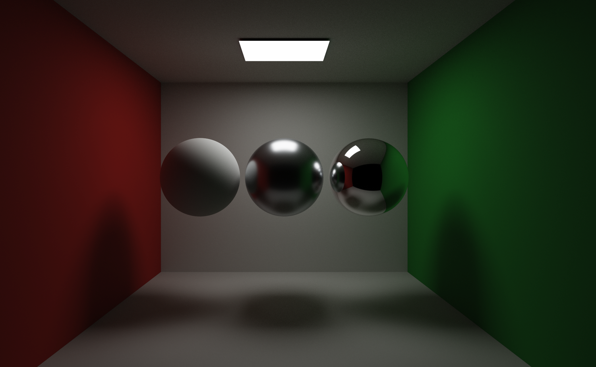
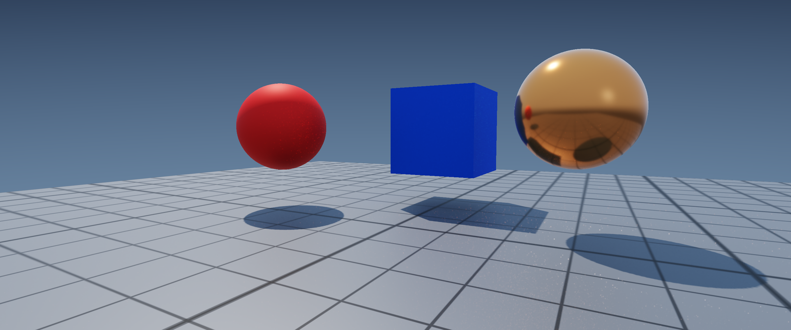

# 全局光照与路径追踪

GI 描述场景中的间接光照。引擎通过平台无关的 `GlobalIlluminationSettings`／`GlobalIlluminationStatus` 表达算法、更新模式、贡献、采样预算及实际状态，与 Forward／Deferred 管线组织及图形 API 分开。

| 维度 | 当前选择 | 含义 |
| --- | --- | --- |
| GI 算法 `method` | Disabled／Path tracing／Screen space (SSGI)／Probe grid (DDGI) | 路径追踪直接采样光路。SSGI 从当前视图的可见表面取样。DDGI 在世界空间存储探针，可用 DXR 追踪场景几何，或使用屏幕空间回退。 |
| 更新模式 `mode` | Progressive accumulation／Realtime | 路径追踪可输出渐进式完整画面，或为光栅提供实时间接光。SSGI 和 DDGI 固定实时更新。 |
| 间接贡献 | Indirect diffuse／Indirect specular | 路径追踪、SSGI 和 DDGI 均可分别控制漫反射和镜面反射。DDGI 由探针提供低频漫反射，镜面使用独立的 SSR 或 DXR。 |
| SSGI 性能与范围 | 质量档、漫反射方向数、步数、半径、厚度 | 调整采样工作量、世界空间追踪范围与交点容差。 |
| DDGI 性能与范围 | 质量档、网格尺寸、每探针光线数、SH 阶数、屏幕空间步数、间距、自动拟合、历史权重 | 调整空间覆盖、方向精度、更新成本和收敛速度。 |
| 路径采样 `sampling` | Uniform／ReSTIR | 实时路径追踪可分别调整直接光与间接光的 reservoir 候选。 |

Windows 的严格 D3D11、D3D11 + D3D12 混合后端和原生 D3D12 在 Deferred 主场景支持 SSGI、屏幕空间探针和屏幕空间反射。混合和原生 D3D12 在设备、管线与场景材质兼容 DXR 1.1 时可追踪硬件探针及 SSGI／DDGI 的镜面反射。路径追踪要求 DXR，在 Forward、Deferred 上均有接收端。Vulkan、OpenGL、Linux 和 macOS 尚无上述 GI 执行路径。


*同一 Cornell Box、同一相机与曝光：左为关闭 GI 的光栅结果，右为路径追踪。间接反弹、金属球的粗糙反射、以及矩形发光面本身的可见性都在右边出现；关闭时主画面不会绘制那块发光面。*

## 配置入口

打开 `Project → Project Settings... → Rendering`（F3），在 `GI method` 选择方法。使用 SSGI 或 DDGI 时选择 Deferred，页面提供 `Use Deferred` 快捷入口。`Active in last scene frame` 显示最近场景帧使用的 GI 或探针来源，`Scene reflections` 显示实际镜面来源（DXR、SSR 或 Off）。`Active quality` 显示活动档位，仅启用 DDGI 镜面时省略探针档位。顶部 GI 状态可打开同一页面。

选择路径追踪会请求硬件光追，再由 `GI mode` 选择更新方式。显式关闭硬件或选择不提供 DXR 的启动后端时，编辑器关闭硬件反射和阴影，并把路径追踪切至 Disabled。SSGI 或 DDGI 的请求继续保留，按实际能力执行。GI 数值、材质草稿和场景编辑在视口实时更新，`Save project settings`／`Save All` 将项目请求写入 `.raproject`。

| 配置 | 默认与范围 | 行为 |
| --- | --- | --- |
| GI mode（路径追踪） | Progressive accumulation | 渐进模式输出完整画面，实时模式输出线性 HDR 间接光，供 Forward／Deferred 消费。 |
| Indirect diffuse (color bleeding) | 开启 | 接收表面的间接漫反射贡献。 |
| Indirect diffuse intensity | 1.0，范围 0–8 | 间接漫反射的艺术强度。1 保持原始光照，0 关闭该贡献，大于 1 强化互染；不改变直接光或间接镜面反射。 |
| Indirect specular (reflections) | 开启 | 路径追踪的间接镜面，或 SSGI／DDGI 的屏幕空间反射（SSR）或 DXR 反射。 |
| Samples per frame | 1，范围 1–16 | 每次有效主场景提交的每像素路径样本预算；批次受剩余目标或历史预算限制。 |
| Target samples／History samples | 256，范围 1–65536 | 渐进模式的停止目标，或实时模式的历史权重上限。 |
| Max bounces | 4，范围 1–12 | 最多着色的表面数，包含相机首先看到的表面。1 不着色第二个表面，仍可接收采样到的环境；2 开始包含物体间表面反弹。 |
| Restart accumulation | 手动操作 | 下一次主场景帧重新建立历史，不修改资产或项目参数。 |

在 F3 的 `Rendering` 页选 `Probe grid (DDGI)`，使用 `Indirect diffuse (color bleeding)` 控制探针互染，再使用 `Indirect specular (reflections)` 控制物体倒影。开启 `Hardware ray tracing` 与 `Ray-traced reflections` 后，可用的 DXR 设备在场景几何中追踪倒影。若保留硬件光追并关闭 `Ray-traced reflections`，探针可继续用 DXR，倒影改用 SSR。严格 D3D11 则使用屏幕空间探针和 SSR。关闭 `Indirect diffuse` 后，Lit 和 GI indirect 仍可合成镜面，漫反射探针停止更新。查看 `Active in last scene frame` 可确认实际路径。

`Ray-traced reflections` 也控制 GI 关闭时的硬件反射预览和 SSGI 的反射后端。路径追踪由自身的 `Indirect specular` 控制镜面贡献。Deferred 主表面的直接光阴影继续使用场景的阴影设置。

`Indirect diffuse intensity` 只在接收面的间接漫反射分量上应用一次。拖动时可在 Lit 或 GI indirect 检查响应。设为 0 可以隔离其他光照，设为大于 1 可以增强亮度和互染。直接光、背景、间接镜面和材质参数保持原值。路径追踪中，通过漫反射路径采到的环境也受该倍率控制。SSGI／DDGI 的漫反射增量来自表面反弹，常规光栅环境光保存在基底中。

命令行 `--path-tracing` 在本次启动请求路径追踪算法及硬件依赖；更新模式仍由项目配置选择。`--no-hardware-rt` 可覆盖硬件总开关。持久化仍由配置页保存。

## 路径追踪的光传输与贡献

`Shaders/Private/PathTracing.hlsli` 实现不透明表面的路径积分：方向／点／Spot／矩形灯直接光照估计、Lambert 漫反射和 GGX 粗糙镜面混合采样、多次表面反弹、天空环境逃逸及 Russian roulette。吞吐量按 BRDF、余弦项和混合采样 PDF 更新；间接光来自射线命中及环境，不叠加旧预览的固定环境漫反射项。Light Actor 参数、范围和来源优先级见 [Lighting](Lighting.md)。

两个贡献开关只分类相机可见接收表面的第一段 BRDF。后续顶点保留完整的漫反射与镜面光传输，因此镜面内仍可以看到其他表面的漫反射 GI。关闭 `Indirect diffuse` 不会把整个场景的漫反射材质删除，关闭 `Indirect specular` 也不会关闭直接高光。

材质使用当前工程的 `EvaluateMaterial`，保留颜色、粗糙度、金属度、Grid、双面和只读草稿语义。路径积分将 albedo 限制为 0–1 反射率；发光与透明材质尚未实现。几何法线用于射线偏移和有效半球检查，平滑法线用于 BRDF。渐进模式的主射线具有随机抖动；实时模式在像素中心求交，与光栅接收表面对齐。样本序列由像素及独立样本索引决定。

材质 Cull Off／Front／Back 同时影响光栅和射线命中，支持镜像变换与背面法线。主相机视锥剔除仅减少光栅提交，不移除屏幕外的 GI／反射供光物体。当前硬件主射线使用最近命中，因此场景中可见材质必须使用 ZTest Less／LessEqual 且 ZWrite On；其他深度状态保留 GI 请求并报告实际不可用，恢复兼容设置后重新采样，避免把间接光合成到错误的接收面。

黑背景只隐藏相机直接看到的环境，不关闭环境对物体的照明；Realtime 的主背景继续由光栅背景设置绘制。

## 单矩形发光面示例

[PathTracing_CornellBox](../Projects/PathTracing_CornellBox/README.md) 使用可选的场景 `lighting` 配置关闭方向光／环境光，并启用一个向下发光的矩形。Progressive PathTracing 的主相机和反射射线按最近距离看见发光面，表面直接光结合随机面积采样与独立 BRDF 采样，通过 MIS 避免重复计光。遮挡限定到灯的位置，遵循硬件及全局阴影开关；背面不发光。普通续接路径命中同灯时终止，直接光已由采样估计器计算。Actor Rect 复用相同面积采样与 MIS；灯参数或环境倍率变化会重置历史。

这与通用发光材质区分：材质结构仍未提供 emission 或透明折射。Realtime 的间接光也对矩形使用 MIS，主光栅直接光和 GI Disabled 使用四点面积近似；光栅主相机不绘制解析发光矩形本身。场景 `lighting.environmentIntensity` 或 Sky Actor 调整环境能量，`background: black` 仍只控制相机背景。光源采样不改变既有间接贡献开关对首段 BRDF 的语义。普通光栅与 Realtime 的局部直接阴影需 Analytic rays，完整限制见 [Lighting](Lighting.md#阴影)。

场景可选 `camera` 记录初始轨道相机、焦点与曝光；启动、打开／重新加载场景时应用。Scene 的 Store current view 显式更新书签，再由 Save Scene 写入；导航不自动改动书签。旧场景省略这些字段时保持原行为。

## 材质与颜色溢出

间接光仍需经过接收面的 BRDF。当前漫反射为 `(1 - Fresnel) * (1 - metallic) * albedo / PI`，按 RGB 通道相乘：蓝色接收面的红色反照率若为零，红光在该面的漫反射红色贡献也为零；纯红接收面对蓝光同理。这种理想纯色不会仅因增加反弹数或采样量而互相染成紫色。

金属度升高会减少漫反射，并让镜面反射更多地受 Base Color 染色。高粗糙度会把反射展开到更宽的方向，降低可辨认的镜像细节。红、蓝涂漆或塑料应使用非金属反射特性；带金属基底的完整涂漆层同样属于非金属外表面。该约定与 [Unreal Engine 的 PBR 材质说明](https://dev.epicgames.com/documentation/en-us/unreal-engine/physically-based-materials-in-unreal-engine) 一致。引擎保留用户设定的颜色和金属度，不自动注入其他通道或提高反弹能量。

排查互染时，先在同一相机与曝光下把接收面设成中性、非金属材质，再切换 `Lit` 与 `GI indirect`。可把供光面的颜色从红换成蓝，观察接收面对应通道是否跟随变化。路径追踪至少要允许两个表面顶点才能表现物体之间的反弹。SSGI 要求供光面在屏幕中可见，DDGI 还需要确认接收面位于探针体积内。

## 路径追踪的两种更新方式

### Progressive accumulation

该模式计算包括主表面直接光、阴影、间接光及背景在内的完整画面。主射线抖动同时提供空间采样。历史保存在线性 HDR 中，每批按样本数加权更新均值，达到目标后停止增加样本；曝光和显示转换在解析阶段完成。初期可能有噪点，静止后逐渐收敛。该模式当前没有降噪器。

进度显示已提交样本数与目标。提高目标可继续已有历史；将目标降到当前计数以下会重新开始。提高每帧采样量或反弹数会增加交互延迟，不能承诺固定帧率或固定时间收敛。



*PathTracing_CornellBox：渐进模式累积 3840 样本（240 帧 × 16 spp）。矩形顶灯同时是直接光估计器和相机可见的发光面；红 / 绿侧墙的颜色溢出来自多次表面反弹，金属球反射包含完整光传输。*

### Realtime

该模式每帧持续计算配置的样本批次，输出**只包含间接光的线性 HDR 缓冲**。Forward 和 Deferred 在各自的光照阶段读取该缓冲，并与当前光栅直接光组合后统一做曝光及显示转换。主表面直接光、其阴影和背景继续由当前光栅设置负责；间接路径的次级直接光仍执行遮挡测试，避免反弹光穿过遮挡物。

`History samples` 限制路径样本的累积权重。达到窗口上限后样本序列仍继续前进，历史通过有界权重持续更新，不进入“已收敛并停止”的状态。场景／光照／材质变化会使路径样本历史失效；相机运动通过单独的时域重建历史复用上一帧间接光。

实时解析默认使用 5×5 空间滤波，按法线、表面平面距离、albedo 和粗糙度抑制跨几何／材质边缘混合。粗糙度小于 0.12 的近镜面接收表面跳过空间模糊，以保留反射清晰度。`Denoise iterations` 以多尺度 5×5 抽样扩展滤波半径（1–4 轮，粗尺度权重衰减），而不是简单重复同一像素核。选择 `Temporal + spatial` 后，另行用上一帧 viewProjection 和主表面的上一帧世界位置做重投影（相机与逐物体运动均支持），以法线／深度／平面距离和当前邻域 clamp 拒绝失效历史，并按当前帧权重与历史混合；历史键只排除相机位姿与 Actor 世界矩阵，拓扑／材质／光照变化仍会重置。移动物体仍可能因遮挡/深度边界产生轻微拖影。



*Sandbox：实时模式只输出间接光，Forward／Deferred 在主表面直接光之后合成。金属球的间接镜面与地面互染来自同一份间接缓冲；开启 temporal denoise 后相机与物体运动均可复用历史。*

## Deferred 实时 GI

SSGI 与 DDGI 用于 Deferred 主场景，包括编辑器场景视口和运行时主视图。材质球和缩略图使用独立预览。两种 GI 共享一次全分辨率线性光照，产生两张图像。一张保存可见表面的直接漫反射，供 SSGI 和屏幕空间探针在命中时采样。另一张保存光栅光照基底，供 DDGI 的 SSR 读取。启用间接镜面时先从光栅基底移出环境镜面，由 SSR 或 DXR 的未命中部分补回。最终在 HDR 中合成间接贡献，统一应用曝光与显示转换，Lit 可继续经过抗锯齿。

两种实时算法共用 `Scene.hlsl` 的 HDR 光照输出。屏幕射线与历史重建位于 `Shaders/Private/ScreenSpaceGi.hlsli`。探针采样、软件追踪与可视化位于 `ProbeGridGi.hlsli`，`HardwareRayTracing.hlsl` 的探针内核和光栅查询复用 `ProbeLighting.hlsli` 的方向与 SH 基函数。

### Screen space (SSGI)

漫反射每轴以主视口一半的分辨率追踪，各方向按余弦加权在接收面半球采样。沿光线由近至远检查世界空间线段与 G-buffer 表面切平面的交点，重投影后再核对法线与厚度。命中读取线性直接漫反射，也可叠加通过深度检验的上帧漫反射历史的 35%。未命中的方向仍计入分母，有屏幕空间探针时可补充低频反弹。光栅基底已经包含环境漫反射。

漫反射射线的步进采样位置随像素和帧错开。每个候选表面负责采样点前后的一段距离，相邻区间衔接并覆盖设置的射程。在射程最后 25% 内，屏幕命中的贡献平滑减到零，可用的探针按剩余权重补充间接光。这样小物体的反弹光可以平滑过渡到周围表面。

相邻 2×2 个追踪像素对半球分层采样。使用软件探针回退时，独立的半分辨率 Pass 在连续 7×7 邻域里以高斯权重重建当帧漫反射，按接收面法线、金属度、切面距离和视深拒绝跨面的样本。最终合成以 3×3 二次 B 样条重建全分辨率漫反射。合成再按接收面颜色、金属度和 Fresnel 着色。

运动向量将接收面投回上一帧，四个历史采样点分别检验深度。首帧和历史失效时使用当前估计。相机和可见几何稳定时，累积窗口逐步增长到 128 帧。相机或供光物体移动、历史覆盖率下降时提高当帧权重，并用当前邻域限制旧值。被遮挡或新出现的表面按有效覆盖率回到当前估计。历史保存未乘艺术强度的间接漫反射，强度只在合成时施加一次。细小物体可能没有落在低分辨率采样点上。

| SSGI 质量 | 每个半分辨率采样点的漫反射方向数 | 每条屏幕射线最大步数 | 屏幕空间探针回退（网格／方向数／步数） |
| --- | ---: | ---: | --- |
| Low | 2 | 6 | 6×3×6／12／6 |
| Medium | 4 | 12 | 8×4×8／24／8 |
| High | 8 | 24 | 12×6×12／32／12 |
| Custom（默认） | 4，可设 1–8 | 8，可设 1–32 | 8×4×8／24／8 |

三个预设的漫反射屏幕步进上限分别是每个低分辨率采样点 12、48、192 步。命中或越出视口可提前结束。表中探针回退仅在未使用 DXR 反射时启用，自动拟合场景并使用 SH-L1。半径（默认 2 个世界单位）控制射程，厚度（默认 0.2）控制交点容差。提高预算可改善可见表面的命中率；转到相机背后的供光物体，需要场景空间的光线才能保留其贡献。

### Probe grid (DDGI)

DDGI 在三维规则网格上存储各方向的低频入射光，用于接收面的间接漫反射。自动拟合将可见 Actor 包围盒的 X、Y、Z 跨度分别除以对应轴的单元数。为使薄场景的探针层仍可分开，最小轴间距取 1 厘米和最大轴间距四分之一中的较大值。探针位于单元中心，覆盖在最外层单元的外边界之外逐渐衰减。关闭自动拟合后使用相机目标和统一的 `Probe spacing`，按一个网格间距对齐原点。设置页显示本帧三个轴的实际间距，`GI probes` 可检查探针位置和采到的光照。

每帧对活动网格内的全部探针取球面方向样本，跨帧轮换方向。偶数射线预算在球面上成对采用相反方向，使均匀光场的一阶方向分量相互抵消。奇数自定义预算覆盖整个球面。`Probe hysteresis` 控制历史平滑程度。0 直接使用本帧的探针样本，正值在输入稳定后逐步延长平均窗口，最多 1024 次更新，1 仍持续追踪。拖动迟滞滑块时沿用已有的探针光照，新值从当帧起生效。每个探针在 SH 图集的 alpha 中记录实际保留的历史长度。从 0 调回 1 后，由一个样本重新积累。屏幕探针在相机移动时将历史窗口限制为最多三次更新。场景、灯光、材质或探针布局导致历史失效时，从当帧结果重新开始。更新后的探针可立即供同帧合成采样。

- **DXR 探针**使用场景加速结构，可命中相机外和隐藏的几何。每条探针射线把命中表面的直接漫反射投影到 SH。矩形光源使用四点面积求积，开启硬件阴影时检查采样点的可见性。镜面高光由镜面通道处理。六个方向各自累计命中距离、距离平方和有效权重，接收时用带偏移的 Chebyshev 可见性权重抑制隔墙漏光。直接看到的矩形灯和天空由光栅主表面的基底处理。
- **屏幕空间探针**在同一 2×2×2 单元组为相邻探针分配互补的球面方向。每个步段用中点定位 G-buffer 表面，求射线与切平面在整个步段内的交点，再用重投影检查法线和位置。容差按像素覆盖范围和位置缓冲的精度计算。探针起点在视口外时，射线可以在进入视口后命中。每条射线只步进一次，结果暂存并由所有 SH 系数复用，未命中的方向贡献 0。
- **屏幕空间探针滤波**在当帧投影更新之后，在带符号的 SH 系数上做空间混合。SSGI 回退使用 3×3×3 邻域。独立 DDGI 在至少 16 个单元的轴上向两侧各取两格，在更短的轴上各取一格。按距离与边界筛选后，每个系数最多使用 81 个探针（含中心）。可见 G-buffer 表面横跨探针之间时，滤波拒绝对应邻居。独立 DDGI 在更新窗口较短时增加空间复用，逐步积累后减弱滤波。SSGI 的回退探针使用固定滤波强度。滤波输出供同帧 DDGI 合成、SSGI 回退与探针调试使用。下一帧累积读取独立的原始 SH 历史。回退只能检查视口记录的可见表面，对屏幕外和被遮挡的几何仍可能缺光或漏光。

两条路径都保留带符号的 SH-L1（4 个 RGB 系数）或 SH-L2（9 个）。硬件路径在世界空间使用二次 B 样条混合最多 27 个邻近探针，逐探针检查朝向、有效性和方向距离矩，缓解探针交界处的明暗折线。射线和 SH 更新预算由原档位决定。屏幕空间回退使用八个邻近探针做三线性混合。两种路径都在混合后计算接收面辐照度。L1 根据平均能量与一阶方向矩做非负的非线性重建，避免曲面因线性近似的负值被整片截黑。L2 采用二阶余弦卷积。重建的 `E/π` 乘接收面颜色、非金属比例和间接光强度。该实现覆盖一次表面反弹。六方向距离矩对薄墙和小于单元尺寸的狭缝仍可能漏光。探针重定位和内部探针分类尚未实现。L1 的数学依据见 [Geomerics 的球谐照明推导](https://community.arm.com/cfs-file/__key/telligent-evolution-components-attachments/01-2066-00-00-00-01-27-70/Simplifying_2D00_Spherical_2D00_Harmonics_2D00_for_2D00_Lighting.pdf)。

| DDGI 质量 | 网格／探针数 | 每探针射线数 | SH | 软件每射线最大步数 | 每帧探针射线数 | 软件步进上限／帧 |
| --- | --- | ---: | --- | ---: | ---: | ---: |
| Low | 8×4×8／256 | 8 | L1 | 6 | 2,048 | 12,288 |
| Medium | 12×6×12／864 | 16 | L1 | 8 | 13,824 | 110,592 |
| High | 16×8×16／2,048 | 32 | L2 | 12 | 65,536 | 786,432 |
| Custom（初始值） | 16×8×16／2,048 | 16 | L1 | 24 | 32,768 | 786,432 |

Custom 每轴可设 2–32 个探针，每探针 1–32 条射线，软件每射线 1–24 步。屏幕步数只影响软件回退。DXR 的实际成本还包括场景遍历和命中处的直接光及遮挡。SH-L2 增加投影系数与表面采样量。全分辨率 G-buffer、光照合成及探针历史图集都有独立成本。以上是工作量预算，GPU 毫秒数应在同一后端、同一场景、同一分辨率测量。

SSGI 和 DDGI 各自保存质量档与 Custom 参数。预设只解析本帧的有效预算，切回 Custom 可恢复原数值。旧工程省略质量字段时使用 Custom。

### 实时镜面反射

当 `Indirect specular` 生效时，SSGI 和 DDGI 复用同一套反射追踪和合成规则。纯金属的间接漫反射为零，反射仍按 Base Color、粗糙度和视角产生。各追踪器输出入射辐射与命中权重，合成只对未命中部分采环境，再在接收面应用一次 Fresnel 和粗糙度权重。开关间接镜面仍保留主表面的直接光高光。

- **SSR** 每轴以主视口一半的分辨率追踪，粗糙度低于 0.25 时取 1 个方向，达到 0.25 时取 2 个，达到 0.45 时取 4 个，在当帧覆盖反射瓣。先将射线裁剪到视锥，再在重叠的步段内求切平面交点，并重投影核对位置和法线。射程末端和屏边渐减命中权重，剩余权重用于环境或探针回退。近镜面以双线性权重重建，较粗糙的表面逐渐转为 3×3 B 样条，遇到法线、表面距离、粗糙度或金属度突变时拒绝邻居。DDGI 读取不含探针间接光的当前帧 HDR 光栅基底，其中包含命中物体的直接镜面。SSGI 仍读取直接漫反射缓冲，在有屏幕空间探针时可为宽反射瓣的未命中方向补充低频光照。SSR 只能命中当前视图中有 G-buffer 数据的表面，画外和被遮挡的物体会缺失。
- **DXR** 以全分辨率追踪一次物体倒影，可命中加速结构内的屏幕外几何。近镜面沿主反射方向取 1 条射线，一般光泽表面取 4 条稳定方向。低 Fresnel 的粗糙非金属表面取 2 条对跖方向，将反射瓣分成 3×3 像素覆盖的九个采样层。宽瓣使用 3×3 几何与材质约束重建；镜面及一般光泽表面使用本像素结果。命中时按射线锥宽调整高光，宽瓣的矩形灯照明使用中心可见性和有限立体角近似。该通道着色倒影中的直接光，目前只做一层物体倒影，使用当前帧。需要逐级反射或倒影内完整的间接光时，可使用路径追踪。

DDGI 的 `SSR distance`、`SSR steps`、`SSR thickness` 默认分别为 2 m、8 步、0.2 m，对应项目的 `screenSpaceRadius`、`screenSpaceSteps`、`screenSpaceThickness`。提高距离后可一并提高步数，以免步长过大漏过薄表面。探针质量档独立控制探针预算。Cornell 换色回归使用 8 m、32 步检查远墙倒影，并另外用默认预算检查镜面路径。

### 论文与方法

- 2019 年的 DDGI 论文使用八面体纹理存储方向辐照度及距离的一、二阶矩，并跨帧馈入间接光以积累多次反弹。论文中的清晰倒影由额外的逐像素镜面射线得到。引擎的探针使用低阶 SH 和六方向可见性统计，当前探针光照覆盖一次表面反弹，镜面由独立通道求解。[Majercik 等，Dynamic Diffuse Global Illumination with Ray-Traced Irradiance Fields，JCGT 2019，第 3–6 节](https://jcgt.org/published/0008/02/01/)
- 2021 年的生产化方案将探针辐照度近似视为预滤波后的光，用来近似镜面射线命中后的更高阶反射。当前 DDGI 的 SSR／DXR 倒影从命中表面的基底或直接光着色取样，探针仍用于相机可见接收面的漫反射。第二阶粗糙反射属于后续扩展。[Majercik 等，Scaling Probe-Based Real-Time Dynamic Global Illumination for Production，JCGT 2021，第 4.4 节](https://jcgt.org/published/0010/02/01/)
- 经典 SSR 论文沿透视校正的二维 DDA 遍历深度缓冲，随机 SSR 的演讲使用重要性采样、邻域复用和时间重投影处理粗糙反射。引擎当前采用固定预算的世界空间分段求交，加半分辨率追踪和几何／材质约束空间重建。SSGI 的时域历史只服务漫反射。[McGuire、Mara，Efficient GPU Screen-Space Ray Tracing，JCGT 2014](https://jcgt.org/published/0003/04/04/) · [Stachowiak，Stochastic Screen-Space Reflections，SIGGRAPH 2015](https://h3.gd/stochastic-ssr/)
- Unreal Engine 的 `SSRT/SSRTDiffuseIndirect.usf` 按接收面半球采样，`ScreenSpaceDenoise.cpp` 将当前帧重建和时域处理分开，`Lumen/LumenScreenProbeGatherTemporal.usf` 在复用历史前检查重投影。本引擎沿用当前帧先重建、历史再稳定画面的思路，保留自身的屏幕射线、球谐探针和资源组织。
- DXR 1.1 定义 `RayQuery`，允许 Compute Shader 直接查询加速结构并处理求交结果。引擎使用该接口实现镜面与探针的独立计算 dispatch，由 Deferred 合成接收结果。[Microsoft DirectX Raytracing Functional Spec，Inline raytracing](https://microsoft.github.io/DirectX-Specs/d3d/Raytracing.html#inline-raytracing)

### 调试视图

- **Lit** 显示光栅基底与当前间接贡献之和。可以在固定相机和曝光下，将漫反射强度从 0 调至 1，比较接收面的亮度及颜色。
- **GI indirect**（`--debug-view 11`）对同一份间接贡献应用当前曝光，背景为黑。Rendering 面板的 `Indirect view EV` 可临时加亮 0–4 档，便于检查微弱互染。它只作用于 SSGI／DDGI 间接光视图，回到 Lit 就使用原曝光，项目文件不保存此值。关闭间接镜面可单独查看互染，关闭间接漫反射可单独查看倒影。黑色表示该处没有可见贡献。实时路径追踪也有间接图。
- **GI probes**（`--debug-view 12`）在 DDGI 场景内叠加实例化探针球。每个球按自己的 SH 和球面法线显示方向与颜色，暗探针保留一层淡轮廓。球有颜色、物体仍暗时，可检查接收面朝向、金属度、颜色、网格覆盖和可见性权重。该视图持续更新探针以供检查，镜面通道在该视图暂停。

在 Rendering 的 `Viewport output` 或场景视口的调试菜单切换视图。其他 G-buffer 调试视图暂停光栅 GI。独立运行可用 `--debug-view` 配合 `--frames`、`--capture-temp` 对照同一相机。

## 路径追踪的 ReSTIR sampling

`sampling = restir` 是 Path tracing 实时模式的**采样层**，不改变 GI 算法本身：

- `ReSTIR direct`：每个 shading point 从场景非矩形灯中采样 `restirCandidates` 个候选，按亮度做加权 reservoir 选择，再乘灯数校正后作为直接光估计；矩形灯继续走独立面积光估计器。
- `ReSTIR indirect`：trace pass 对每像素的若干路径候选（数量同 `restirCandidates`）做加权 reservoir 选择，结果写入路径累积；上一帧 reservoir 通过 u7 上一帧世界位置 + 上一帧 ViewProjection 重投影到 t14，按 20% 当前帧权重混合，再回读到下一帧（u8）。
- `ReSTIR direct`：主表面直接光候选 reservoir 同样通过 t15/u9 做 20% 时域重投影；后续反弹只做当前帧空间 reservoir。
- `ReSTIR spatial reuse` 开启时，direct/indirect 还会平均上一帧 reservoir 的 3×3 邻域（20% 混合），降低单像素 reservoir 噪声。
- 直接光估计仍乘灯数并做 reservoir 校正，indirect 仍按亮度选样本，因此不是严格无偏 ReSTIR。

Uniform 是默认值，保持旧的逐灯精确直接光；ReSTIR 只影响 Path tracing 的实时模式，SSGI/DDGI 不受影响。实现位于 `PathTracing.hlsli`（直接光 reservoir）与 `HardwareRayTracing.hlsl` 的 trace batch（间接路径 reservoir）。

## 历史与资源

SSGI 的重投影只读取独立的线性间接图和深度，DDGI 复用世界空间探针系数，DXR 探针还复用距离矩。视图、视口、网格布局、质量、场景／材质／光照、有效后端等关键输入变化会使相应历史失效。相机移动时 SSGI 按前一帧矩阵重投影，越界和遮挡处重新采样。曝光作用于显示。Shader 热编译失败时继续使用已有管线，成功替换后重建相关历史。

软件探针射线暂存按活动网格和射线预算分配，原始 SH 历史图集容量覆盖最多 32³ 个探针和每探针 9 个系数。固定历史图集为 9216×32 RGBA16F，每张约 2.25 MiB。空间滤波图集按活动网格及 SH 阶数分配，同为 RGBA16F，最大约 2.25 MiB。原始历史图集交替读写，滤波图集保存供本帧消费的结果。只运行 DXR 探针时可以独立建探针图和加速结构。路径追踪另外使用全分辨率累积图、材质／几何引导、共享输出、降噪和 reservoir 资源；切换方法后可能重用之前分配的资源。

## 项目格式与验证入口

可选 `rendering.globalIllumination` 对象：

```json
{
  "method": "pathTracing",
  "mode": "realtime",
  "indirectDiffuse": true,
  "indirectSpecular": true,
  "indirectDiffuseIntensity": 1.0,
  "samplesPerFrame": 1,
  "targetSamples": 256,
  "maxBounces": 4,
  "denoiser": "temporalSpatial",
  "motionVectors": "cameraOnly",
  "denoiseIterations": 2,
"screenSpaceQuality": "custom",
  "screenSpaceRayCount": 4,
  "screenSpaceSteps": 8,
  "screenSpaceRadius": 2.0,
  "screenSpaceThickness": 0.2,
  "probeQuality": "custom",
  "probeGridX": 16,
  "probeGridY": 8,
  "probeGridZ": 16,
  "probeSpacing": 1.0,
  "probeHysteresis": 0.95,
  "probeAutoFit": true,
"probeRayCount": 16,
  "probeShOrder": 1,
  "probeScreenSpaceSteps": 24,
  "sampling": "restir",
  "restirCandidates": 4,
  "restirDirect": true,
  "restirIndirect": true,
  "restirSpatialReuse": true
}
```

缺失 GI 对象或 `method` 使用 `disabled`。方法可选 `disabled`、`pathTracing`、`screenSpace`、`probeGrid`。`screenSpaceQuality` 与 `probeQuality` 分别接受 `custom`、`low`、`medium`、`high`。两种光栅方法的缺省预算见上表。缺失 `probeSpacing`、`probeHysteresis`、`probeAutoFit` 时使用 1.0、0.95、true。路径追踪的模式、降噪、运动矢量及采样策略分别默认 `progressive`、`spatial`、`automatic`、`uniform`。两个贡献默认开启，间接漫反射强度默认 1。项目加载和保存验证所选值及数值范围，保留已有未知字段。

在引擎根目录运行光栅 GI 自测，每种后端使用独立的输出目录。以下示例使用 CMake Release 构建，依次覆盖严格 D3D11 的屏幕空间路径、混合和原生 D3D12 的可用硬件路径。

```powershell
$engine = '.\build\cmake-vs2022\Release\RestArtEngine.exe'
$cornell = '.\Projects\PathTracing_CornellBox\PathTracing_CornellBox.raproject'
& $engine --raster-gi-self-test --project $cornell --backend d3d11 --capture-dir artifacts/gi-d3d11
& $engine --raster-gi-self-test --project $cornell --backend d3d11Dxr --hardware-rt --capture-dir artifacts/gi-hybrid
& $engine --raster-gi-self-test --project $cornell --backend d3d12 --hardware-rt --capture-dir artifacts/gi-d3d12
./scripts/Test-DdgiImageQuality.ps1 -CaptureDirectory artifacts/gi-d3d12
./scripts/Test-SsgiCeilingImageQuality.ps1 -CaptureDirectory artifacts/gi-d3d12 -RequireDxr
```

DDGI 图像检查使用标准 Cornell 相机的中档 DXR 图，按固定的天花板、地板和漫反射球区域检出网格亮斑、亮度折线与球面黑斑。SSGI 图像检查使用同机位的中档 +3 EV 间接光图，测量天花板弧边两侧的亮度落差，同时检查左球上方亮度和两侧墙面互染。严格 D3D11 下省略 `-RequireDxr`。GPU 自测还保存相隔 1 帧和 97 帧的同曝光 DDGI 间接光图。中档 `ceilingTemporal` 检查在 FXAA 和 3.61 倍间接漫反射强度下预热 32 帧，连续读回 16 帧的天花板区域，验证亮度高于 GI 关闭时，并限制像素相邻帧差值和 8×8 色块时间极差的第 95 百分位。

Cornell 中档回归还会比较调节迟滞和显式重置的图像变化，再从 0 调回 1，检查单次更新的噪声能否在接下来的 16 帧消退。结果记在 `hysteresisEdit`。

Cornell 的 DDGI 镜面回归改变侧墙颜色，在纯金属接收面检验倒影颜色是否随墙面变化。关闭漫反射时比较金属倒影及非金属地板的变化，再关闭镜面检查纯金属的间接光。`ddgiReflections` 记录颜色差和开关影响，同一输出目录保存对照截图。支持 DXR 时，`ddgiDxrTiming` 分别记录仅探针、仅反射和两者同开时的有效 GPU 时间戳帧数及耗时中位数；双开值是同帧两次 dispatch 的总区间。

软件 GI 自测保存两种算法的冷启动和改灯帧序列，记录第 1、4、8、32 和 64 帧，以及实际后端的 GPU 时间戳。测试同时关掉硬件光追、硬件反射和硬件阴影。将 Cornell 样例工程复制到 `artifacts/gi-software-fixture` 并保持相机与曝光一致。固定夹具使用 FXAA、3.61 倍间接漫反射强度，DDGI Custom 为 30×30×30 网格、32 射线、SH-L1、24 个软件步进、0.89 迟滞，SSGI Custom 为 4 条射线、8 步、2 m 半径、0.2 m 厚度。

```powershell
$softwareCornell = '.\artifacts\gi-software-fixture\PathTracing_CornellBox.raproject'
& $engine --software-gi-self-test --project $softwareCornell --backend d3d12 --no-backend-fallback --no-hardware-rt --capture-dir artifacts/gi-software
py -m pip install numpy pillow
py ./scripts/Test-SoftwareGiResponsiveness.py artifacts/gi-software --check --output artifacts/gi-software/quality.json
```

图像脚本用 G-buffer 法线选择天花板、地板和后墙的内部区域，衡量 8／32 像素块的亮度和色度起伏、偏离第 64 帧的程度，以及改灯后当帧接近新光照的程度。`--check` 对固定的 1281×721 夹具检查绝对和相对波动、亮度下限和改灯响应。使用 `--baseline` 可另比对同机位同曝光的基线。省略 `--check` 时输出测量结果，便于比较其他档位。时间戳与图像指标可用于比较改动，帧 64 是测量参考点。脚本还检查 5、9、17 像素邻域内的亮度残差。自测在转动镜头期间保存 Lit，在同一终止机位停稳后再次回读画面和法线，用于衡量移动中的颗粒和光照响应。

读取输出目录内的 `raster-gi.json` 和 Lit／GI indirect 图像，可对照质量档、首帧、零强度、实际执行路径及有效 GPU 时戳。比较耗时请使用同次运行的适配器、分辨率、相机和硬件状态；报告中的 `medianGpuFrameMs` 是主渲染 RHI 时间戳区间。DXR 探针与反射另在 DXR command list 上计时，`medianDxrDispatchMs` 只覆盖 dispatch，排除加速结构构建、历史复制与队列同步。Profiler 分别标明帧号和 DXR dispatch 毫秒数。另可使用 `--gi-self-test --capture-dir artifacts/gi-path` 验证路径追踪收敛、颜色溢出和两种光栅接收端，使用 `--hardware-rt-self-test` 检查硬件配置交互与保存重载。

当前不包含透明／折射、发光材质、体积散射、纹理或环境光重要性采样及神经网络降噪。有限反弹、有限样本、现有材质模型和空间滤波会限制结果；高动态范围环境及低粗糙材质可能需要更多样本，快速移动物体的遮挡/深度边界仍可能拖影。同步与硬件能力要求见 [HardwareRayTracing](HardwareRayTracing.md)。

## 扩展位置

新增 GI 方法涉及 `GlobalIlluminationMethod`、项目格式、设置界面、能力判定和主场景 pass 编排。光栅 GI pass 在 `src/Renderer/Pipelines/ScenePipeline.cpp` 声明资源依赖，在 `SceneRenderer.cpp` 绑定与执行。`Shaders/Private/Scene.hlsl` 引入 `ScreenSpaceGi.hlsli` 与 `ProbeGridGi.hlsli`，分别实现屏幕空间追踪、探针查询及对应的接收面合成。软硬探针共用 `ProbeLighting.hlsli` 的采样方向与带符号 SH 约定。DXR 探针、反射及路径采样使用 `HardwareRayTracing.hlsl` 和 D3D12 后端。积分与光源估计使用 `PathTracing.hlsli`。改变采样分布、网格映射、材质含义或历史格式时，更新对应历史失效条件，并检查各可用后端的实际接收面图像。
