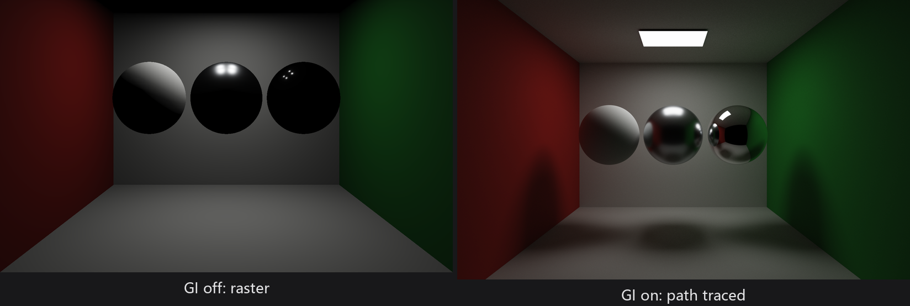
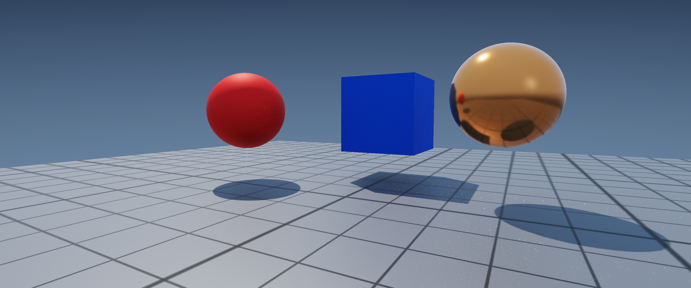

# 全局光照与路径追踪

GI 描述场景中的间接光照。引擎通过平台无关的 `GlobalIlluminationSettings`／`GlobalIlluminationStatus` 表达算法、更新模式、贡献、采样预算及实际状态，与 Forward／Deferred 管线组织及图形 API 分开。

| 维度 | 当前选择 | 含义 |
| --- | --- | --- |
| GI 算法 `method` | Disabled／Path tracing | 是否计算间接光照，以及采用的光传输算法。当前只有路径追踪算法实现。 |
| 更新模式 `mode` | Progressive accumulation／Realtime | 渐进式累积完整画面，或持续计算供光栅管线使用的间接光。 |
| 间接贡献 | Indirect diffuse／Indirect specular | 分别选择接收表面的颜色溢出与反射贡献，直接光不受这两个开关影响。 |

当前实现是 Windows 上同适配器 DX11／DX12 DXR 1.1 的组合。其他 GI 算法、Vulkan／OpenGL 后端及 Linux／macOS GI 尚未实现。不支持的请求保留在项目中，并显示不能生效的原因；不能将架构接口视为各平台已支持。



*同一 Cornell Box、同一相机与曝光：左为关闭 GI 的光栅结果，右为路径追踪。间接反弹、金属球的粗糙反射、以及矩形发光面本身的可见性都在右边出现；关闭时主画面不会绘制那块发光面。*

## 配置入口

打开 `Project → Project Settings... → Rendering`（F3），将 `GI method` 设为 `Path tracing`，会同时启用硬件光追。再通过 `GI mode` 选择更新模式。关闭硬件开关保留 GI 偏好。普通数值、材质草稿、场景和相机变化自动更新，无需 Apply 或保存；`Save project settings`／`Save All` 将请求写入 `.raproject`。

工具栏的 `GI` 状态入口显示实际生效模式、暂停或不可用状态，点击打开上述配置，悬停可查看原因与间接贡献开关。`DX11 + DXR` 仅表示硬件通道活跃；`GI: Off` 时硬件预览仍可显示反射和阴影，但不会计算物体间的漫反射颜色溢出。

| 配置 | 默认与范围 | 行为 |
| --- | --- | --- |
| GI mode | Progressive accumulation | 渐进模式输出完整路径追踪画面；实时模式输出线性 HDR 间接光，供 Forward／Deferred 消费。 |
| Indirect diffuse (color bleeding) | 开启 | 接收表面的间接漫反射贡献。 |
| Indirect diffuse intensity | 1.0，范围 0–8 | 间接漫反射的艺术强度。1 保持原始光照，0 关闭该贡献，大于 1 强化互染；不改变直接光或间接镜面反射。 |
| Indirect specular (reflections) | 开启 | 接收表面的间接镜面／粗糙反射贡献，独立于旧硬件反射开关。 |
| Samples per frame | 1，范围 1–16 | 每次有效主场景提交的每像素路径样本预算；批次受剩余目标或历史预算限制。 |
| Target samples／History samples | 256，范围 1–65536 | 渐进模式的停止目标，或实时模式的历史权重上限。 |
| Max bounces | 4，范围 1–12 | 最多着色的表面数，包含相机首先看到的表面。1 不着色第二个表面，仍可接收采样到的环境；2 开始包含物体间表面反弹。 |
| Restart accumulation | 手动操作 | 下一次主场景帧重新建立历史，不修改资产或项目参数。 |

独立 `Ray-traced reflections` 只用于 GI 关闭时的硬件预览；GI 启用时保留该偏好，但由 `Indirect specular` 控制 GI 反射。`Ray-traced shadows` 用于硬件预览和渐进式完整画面；Realtime 模式将其禁用并保留偏好，主可见表面的直接光阴影沿用 Scene 中的 Forward／Deferred 阴影设置。

`Indirect diffuse intensity` 在拖动时立即生效，并重新开始受影响的 GI 历史。关闭 `Indirect diffuse` 或 GI 时保留强度请求，重新开启继续使用该值。该倍率在首个接收表面的间接漫反射分量上只应用一次，后续反弹不重复相乘；实时与渐进模式使用同一规则。高于 1 的值是艺术控制，不代表物理反射率提高，也不会更改材质资产。它会一起增强间接漫反射的亮度和颜色，不是独立的饱和度旋钮。

这里沿用现有 GI 贡献分类：直接灯光估计器、相机直接看到的背景和发光矩形不受倍率影响；通过漫反射路径采样得到的环境照明也属于该漫反射贡献，会一起缩放。

命令行 `--path-tracing` 在本次启动请求路径追踪算法及硬件依赖；更新模式仍由项目配置选择。`--no-hardware-rt` 可覆盖硬件总开关。持久化仍由配置页保存。

## 光传输与贡献

`Shaders/Private/PathTracing.hlsli` 实现不透明表面的路径积分：方向／点／Spot／矩形灯直接光照估计、Lambert 漫反射和 GGX 粗糙镜面混合采样、多次表面反弹、天空环境逃逸及 Russian roulette。吞吐量按 BRDF、余弦项和混合采样 PDF 更新；间接光来自射线命中及环境，不叠加旧预览的固定环境漫反射项。Light Actor 参数、范围和来源优先级见 [Lighting](Lighting.md)。

两个贡献开关只分类相机可见接收表面的第一段 BRDF。后续顶点保留完整的漫反射与镜面光传输，因此镜面内仍可以看到其他表面的漫反射 GI。关闭 `Indirect diffuse` 不会把整个场景的漫反射材质删除，关闭 `Indirect specular` 也不会关闭直接高光。

材质使用当前工程的 `EvaluateMaterial`，保留颜色、粗糙度、金属度、Grid、双面和只读草稿语义。路径积分将 albedo 限制为 0–1 反射率；发光与透明材质尚未实现。几何法线用于射线偏移和有效半球检查，平滑法线用于 BRDF。渐进模式的主射线具有随机抖动；实时模式在像素中心求交，与光栅接收表面对齐。样本序列由像素及独立样本索引决定。

材质 Cull Off／Front／Back 同时影响光栅和射线命中，支持镜像变换与背面法线。主相机视锥剔除仅减少光栅提交，不移除屏幕外的 GI／反射供光物体。当前硬件主射线使用最近命中，因此场景中可见材质必须使用 ZTest Less／LessEqual 且 ZWrite On；其他深度状态保留 GI 请求并报告实际不可用，恢复兼容设置后重新采样，避免把间接光合成到错误的接收面。

黑背景只隐藏相机直接看到的环境，不关闭环境对物体的照明；Realtime 的主背景继续由光栅背景设置绘制。

## 单矩形发光面示例

[PathTracing_CornellBox](../Projects/PathTracing_CornellBox/README.md) 使用可选的场景 `lighting` 配置关闭方向光／环境光，并启用一个向下发光的矩形。Progressive PathTracing 的主相机和反射射线按最近距离看见发光面，表面直接光结合随机面积采样与独立 BRDF 采样，通过 MIS 避免重复计光。遮挡限定到灯的位置，遵循硬件及全局阴影开关；背面不发光。普通续接路径命中同灯时终止，直接光已由采样估计器计算。Actor Rect 复用相同面积采样与 MIS；灯参数或环境倍率变化会重置历史。

这与通用发光材质区分：材质结构仍未提供 emission 或透明折射。Realtime 的间接光也对矩形使用 MIS，主光栅直接光和 GI Disabled 使用四点面积近似；光栅主相机不绘制解析发光矩形本身。场景 `lighting.environmentIntensity` 或 Sky Actor 调整环境能量，`background: black` 仍只控制相机背景。光源采样不改变既有间接贡献开关对首段 BRDF 的语义。普通光栅与 Realtime 的局部直接阴影需 Analytic rays，完整限制见 [Lighting](Lighting.md#阴影)。

场景可选 `camera` 记录初始轨道相机、焦点与曝光；启动、打开／重新加载场景时应用。Scene 的 Store current view 显式更新书签，再由 Save Scene 写入；导航不自动改动书签。旧场景省略这些字段时保持原行为。

## 材质与颜色溢出

间接光仍需经过接收面的 BRDF。当前漫反射为 `(1 - Fresnel) * (1 - metallic) * albedo / PI`，按 RGB 通道相乘：蓝色接收面的红色反照率若为零，红光在该面的漫反射红色贡献也为零；纯红接收面对蓝光同理。这种理想纯色不会仅因增加反弹数或采样量而互相染成紫色。

金属度升高会减少漫反射，并让镜面反射更多地受 Base Color 染色。高粗糙度会把反射展开到更宽的方向，降低可辨认的镜像细节。红、蓝涂漆或塑料应使用非金属反射特性；带金属基底的完整涂漆层同样属于非金属外表面。该约定与 [Unreal Engine 的 PBR 材质说明](https://dev.epicgames.com/documentation/en-us/unreal-engine/physically-based-materials-in-unreal-engine) 一致。引擎保留用户设定的颜色和金属度，不自动注入其他通道或提高反弹能量。

排查颜色传递时，先确认 GI 实际开启、`Indirect diffuse` 开启及至少两次表面着色，再使用中性漫反射接收面隔离输运；随后换回目标彩色材质，分别比较漫反射吸收与镜面贡献。天空填充、直接光、物体间距及接收面的朝向也会影响局部互染的可见程度。GPU 自测同时覆盖中性地面与彩色相邻接收面，避免仅凭全图差异或反射噪点判断 GI 是否正常。

Sandbox 的红、蓝示例材质使用非金属涂漆：金属度 0、粗糙度 0.4，红色为 `(0.75, 0.04, 0.04)`，蓝色为 `(0.04, 0.10, 0.75)`。两个现代材质容器保留原 GUID，优先于同 GUID 的旧 `.ramat` 加载。该工程默认请求实时路径采样，开启两种间接贡献，预算为每帧 4 样本、512 样本历史和 4 次表面着色；设备不支持时仍按能力回退。引擎通用默认值保持上表定义。

## 两种更新方式

### Progressive accumulation

该模式计算包括主表面直接光、阴影、间接光及背景在内的完整画面。主射线抖动同时提供空间采样。历史保存在线性 HDR 中，每批按样本数加权更新均值，达到目标后停止增加样本；曝光和显示转换在解析阶段完成。初期可能有噪点，静止后逐渐收敛。该模式当前没有降噪器。

进度显示已提交样本数与目标。提高目标可继续已有历史；将目标降到当前计数以下会重新开始。提高每帧采样量或反弹数会增加交互延迟，不能承诺固定帧率或固定时间收敛。


*PathTracing_CornellBox：渐进模式累积 3840 样本（240 帧 × 16 spp）。矩形顶灯同时是直接光估计器和相机可见的发光面；红 / 绿侧墙的颜色溢出来自多次表面反弹，金属球反射包含完整光传输。*

### Realtime

该模式每帧持续计算配置的样本批次，输出**只包含间接光的线性 HDR 缓冲**。Forward 和 Deferred 在各自的光照阶段读取该缓冲，并与当前光栅直接光组合后统一做曝光及显示转换。主表面直接光、其阴影和背景继续由当前光栅设置负责；间接路径的次级直接光仍执行遮挡测试，避免反弹光穿过遮挡物。

`History samples` 限制历史累积权重。达到窗口上限后样本序列仍继续前进，历史通过有界权重持续更新，不进入“已收敛并停止”的状态。相机或场景变化使历史整体失效；当前没有运动重投影，移动时不能继续复用旧视角的样本。

实时解析使用 5×5 空间滤波，按法线、表面平面距离、albedo 和粗糙度抑制跨几何／材质边缘混合。粗糙度小于 0.12 的近镜面接收表面跳过空间模糊，以保留反射清晰度。它可以降低噪声，但不保证消除所有噪点，也不等同于具有运动重投影的时域降噪器。



*Sandbox：实时模式只输出间接光，Forward／Deferred 在主表面直接光之后合成。金属球的间接镜面与地面互染来自同一份间接缓冲；实时模式不做运动重投影，静止后仍可能保留少量噪点。*

## 历史与资源

首批样本覆盖历史，不读取未初始化资源。相机、视口尺寸、几何／可见性、材质／法线、光照、背景、算法／更新模式、贡献开关、反弹数、相关阴影选项、成功发布的 Shader 及显式重启会使历史失效。材质草稿恢复已提交值同样触发新历史。曝光只改变最终显示，不使历史失效。

非 Lit 调试视图暂停采样，不将 Albedo／Normal 等数据写入 HDR 历史；返回 Lit 时有效历史可以继续。材质球、详情预览和缩略图不消费或重置主场景样本。Shader 候选失败保留旧管线和有效历史，成功后重新建立历史。

当前硬件通道按视口分配一张 RGBA8 显示图像、三张 RGBA32_FLOAT 内部图像（样本均值和两份几何／材质引导），以及一张共享 RGBA16_FLOAT 间接光输出，合计 **60 字节／像素**。3840×2160 时约 **475 MiB**，还不包含加速结构、上传缓冲、原有光栅目标及资源重建时的临时重叠。内部累积保持 FP32，实时解析写入 FP16 共享缓冲时限制到其有限范围 65504，避免溢出为无穷。Realtime 是更新策略名称，不保证特定硬件、分辨率或场景下达到固定 FPS。

## 项目格式与验证入口

可选 `rendering.globalIllumination` 对象：

```json
{
  "method": "pathTracing",
  "mode": "realtime",
  "indirectDiffuse": true,
  "indirectSpecular": true,
  "indirectDiffuseIntensity": 1.0,
  "samplesPerFrame": 1,
  "targetSamples": 256,
  "maxBounces": 4
}
```

缺失对象或 `method` 时默认 `disabled`；缺失 `mode` 默认 `progressive`，缺失两个贡献开关默认 `true`，缺失 `indirectDiffuseIntensity` 默认 `1.0`，因此旧路径追踪项目保持原来的光照强度。强度必须为 0–8 的有限数值，布尔值、字符串和越界值均拒绝。算法和模式字符串、贡献布尔值及整数范围同样严格验证。保存保留未知嵌套字段，失败保留原 manifest；请求值不随设备能力自动改写。

运行 `RestArtEngine.exe --gi-self-test --capture-dir artifacts/gi` 检查实际 GPU 画面。颜色溢出、粗糙反射、低／高样本误差、历史重置、曝光独立、模式和贡献开关、两条光栅路径接收实时间接光都需要相应证据；`--hardware-rt-self-test` 补充配置真实交互和保存重载。设备不可用时明确报告跳过，不能把零错误或 dispatch 计数作为 GI 画质证明。本页说明实现契约，不宣称所有检查已运行通过。

当前不包含透明／折射、发光材质、体积散射、纹理或环境光重要性采样、运动重投影及神经网络降噪。有限反弹、有限样本、现有材质模型和空间滤波会限制结果；高动态范围环境及低粗糙材质可能需要更多样本。同步与硬件能力要求见 [HardwareRayTracing](HardwareRayTracing.md)。

## 单矩形发光面示例

[PathTracing_CornellBox](../Projects/PathTracing_CornellBox/README.md) 使用可选的场景 lighting 配置关闭方向光／环境光，并启用一个向下发光的矩形。Progressive PathTracing 的主相机和反射射线按最近距离看见发光面，表面直接光结合随机面积采样与独立 BRDF 采样，通过 MIS 避免重复计光。遮挡限定到灯的位置，遵循硬件及全局阴影开关；背面不发光。普通续接路径命中同灯时终止，直接光已由采样估计器计算。灯参数或环境倍率变化会重置历史。

该示例只验证渐进式 Path Tracing；换到实时模式时，矩形发光面本身不进入光栅主画面。解析发光面不是通用发光材质或透明折射。lighting.environmentIntensity 调整环境能量，background: black 仍只控制相机背景。光源采样不改变既有间接贡献开关对首段 BRDF 的语义。

场景可选 camera 记录初始轨道相机、焦点与曝光；启动、打开／重新加载场景时应用。Scene 的 Store current view 显式更新书签，再由 Save Scene 写入；导航不自动改动书签。旧场景省略这些字段时保持原行为。

## 扩展与迭代

改 GI 从枚举和配置开始：`GlobalIlluminationMethod`、`GlobalIlluminationSettings` 的范围钳制、`Project.cpp` 的校验、Project Settings 的控件、`RenderFeatures` 的判定，最后才是 `HardwareRayTracing.cpp` 的 dispatch 分支。新增贡献类型要同时进场景常量、HLSL 和 `HistoryKey`，否则改参数不会触发重算，画面会停在上一次的样本上。

采样侧的扩展集中在 `PathTracing.hlsli`：新的光源类型、环境重要性采样、更稳的 MIS 权重、时域降噪都动这里。改完用 `--gi-self-test` 的颜色溢出、收敛和历史重置用例验证，并确认实时模式的 5×5 滤波没有把边缘抹花——它按法线、平面距离、albedo 和粗糙度抑制跨边缘混合，加字段就要一起改。

路线上的缺口按依赖排：先做运动重投影与时间降噪，再谈环境重要性采样、透明与发光材质、其他 GI 算法，最后才是 Vulkan 光追和每视图独立历史。当前枚举只有 `Disabled` 和 `Path tracing` 两项，没有第三种算法可选，不要用不存在的选项做功能承诺。
