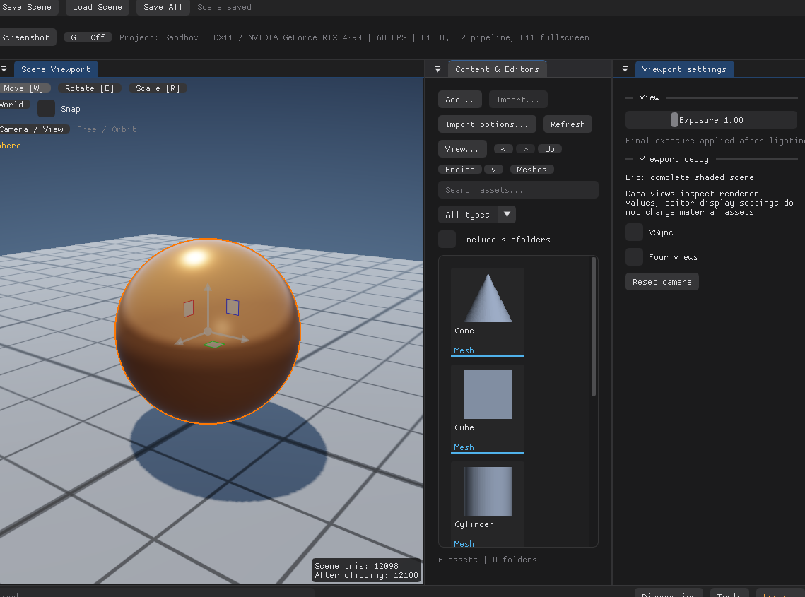

# GUI 设计与开发规范

本页是 RestArtEngine GUI 的设计、实现与验收入口，覆盖 Project Manager、启动加载页和编辑器工作区。下述默认风格延续现有实现，可以随具体设计任务演进。下述质量目标与当前已实现能力分别说明。

*把 Content & Editors 停靠到右侧后的布局：面板可以分割、并标签、拖出主窗口成为系统窗口；尺寸与位置由本机 `imgui.ini` 保存。*

产品和模块边界见 [README](../README.md)、[Architecture](Architecture.md)，操作行为见 [EditorGuide](EditorGuide.md)，命令和事务见 [UndoTransactions](UndoTransactions.md)。实现状态以对应源码为准，测试入口与覆盖要求见本页验收部分。

## 工程结构与现有能力

以下列出 GUI 模块的源码入口及能力边界，不将设计目标视为已实现功能。

| 范围 | 源码入口 | 已有实现与边界 |
| --- | --- | --- |
| GUI 适配 | [ImGuiLayer.cpp](../src/ImGui/ImGuiLayer.cpp)、[依赖版本](vendor/imgui.md) | Dear ImGui `v1.91.9b-docking`，Win32 / DX11；未接通跨平台 GUI 后端。 |
| 窗口与启动 | [MinimalApp.cpp](../app/MinimalApp.cpp)、[WindowChrome.cpp](../src/ImGui/WindowChrome.cpp)、[LoadingScreen.cpp](../src/Editor/LoadingScreen.cpp) | Project Manager 当前仍在入口实现；自定义窗口栏保留系统命令；加载页使用品牌背景与相对布局。 |
| 工作区 | [EditorDockManager.cpp](../src/Editor/EditorDockManager.cpp) | 六个稳定面板身份，原生 Docking、分割、合并标签、主窗口内悬浮、外部系统浮窗及布局恢复；材质编辑器保持独立窗口。 |
| 面板与会话 | [SceneEditor.cpp](../src/Editor/SceneEditor.cpp) | Outliner、Scene（场景级参数与当前场景切换）、Details（Actor 实例属性）、Viewport settings、Content & Editors（`AssetRegistry` 驱动的文件夹树、列表/网格资产区、`Asset Details` 窗）、工具栏、草稿和关闭提示；中央为 Scene Viewport。Content 不再嵌套 Meshes 页签，Material Editor / Shader Editor 位于系统独立 MaterialWorkspace；不存在独立 AssetBrowser、MaterialEditor 或 OutputLog 类。 |
| 项目配置 | [ProjectSettings.cpp](../src/Editor/ProjectSettings.cpp) | `Project → Project Settings...` 打开独立可关闭窗口，左侧 Rendering 导航提供硬件光追／效果开关、GI 算法与采样预算，显示设备支持／请求／实际状态、累积进度和重启。修改自动反馈、显式保存，加入 Save All 与未保存退出提示；焦点不传给场景编辑。 |
| 视口交互 | [ViewportInteraction.cpp](../src/Editor/ViewportInteraction.cpp)、[SelectionOutline.cpp](../src/Renderer/SelectionOutline.cpp) | 场景图像、拾取、相机、ImGuizmo、多选、Alt 拖动复制与 Content Mesh 拖入放置；选中 Actor 由编辑器专用遮罩通道绘制屏幕空间描边，默认品牌橙，可选主题强调色或自定义颜色。 |
| 命令与历史 | [EditorCommands.cpp](../src/Editor/EditorCommands.cpp)、[UndoStack.cpp](../src/Editor/UndoStack.cpp) | 已接入动作共用命令和 enable predicate；应用级快捷键、部分旧输入路径仍分散。撤销覆盖有限，不能描述为全部属性可撤销。 |
| 底栏与命令控制台 | [EditorStatusBar.cpp](../src/Editor/EditorStatusBar.cpp)、[EditorConsole.cpp](../src/Editor/EditorConsole.cpp) | 固定底栏预留 DockSpace 高度，提供 Content／Output Log／Cmd／诊断工具与保存状态。独立无 UI 命令模型负责解析、注册、历史和补全；GUI 复用现有动作与撤销。日志为本会话编辑器提示和命令结果，Content 入口聚焦已有面板。 |
| 视觉与字体 | [EditorTheme.cpp](../src/ImGui/EditorTheme.cpp)、[ImGuiLayer.cpp](../src/ImGui/ImGuiLayer.cpp) | 默认 Black、可选 Dark Blue；配色与共用几何集中，字体仍在适配层。`UI` 菜单承载主题子菜单，并以下拉末项 `Selection outline...` 打开独立的小设置窗口（开关、粗细、主题强调色、预设色或自定义颜色）；选择与本机 `RestArtEngine.ui.ini` 同步。没有完整设计 token、字体配置或跨屏 DPI 体系。 |

Scene / Assets 不依赖 ImGui、ImGuizmo 或 DX11；Renderer 提供场景纹理，不管理 Dock 节点。编辑器模块负责布局、控件与交互；Shader、Pass、GPU 资源和后端能力归渲染模块。跨模块改动先约定数据与预览契约。

## 系统材质窗口

材质参数与工程共享 Shader 两页位于按需打开的系统独立 `MaterialWorkspace`，Scene 与 Details 中当前 Actor 实例的材质引用复用同一入口；Content 面板保留完整资产浏览（材质、网格、场景），材质编辑仍在独立窗口。Mesh 资产保存几何、命名材质 Slot 与可选 UV 流；Details 的材质入口按当前实例的 Slot 覆盖、网格默认绑定和兼容回退解析，不汇总同 Mesh 的其他实例。

编辑器通过锁定版 Win32/DX11 后端接入系统 viewport，材质窗口不自动并回主窗口，也不加入工作区默认 Dock 树；关闭保留本次会话草稿和实时预览，应用退出统一确认。普通工作区面板与工具窗自动外移／回嵌，不逐帧绑定主 viewport；DockSpace 宿主和主工具栏继续位于主窗口。普通系统浮窗由主窗口拥有，随主窗口最小化隐藏、恢复后显示；独立材质窗口保留无父窗口的策略。最小化路径继续提交仍需处理的平台窗口并维持 Dock 树，隐藏的场景浮窗不持续渲染。普通面板保留既有无关闭按钮的语义，可关闭工具窗沿各自状态关闭。场景目标尺寸与主 swapchain 分开，图像桌面矩形与纹理局部矩形显式映射，不能按主窗口边界裁掉外部视口。完整跨屏字体 DPI、其他平台／后端不由此自动获得支持。操作说明见 [EditorGuide](EditorGuide.md)，架构契约见 [Architecture](Architecture.md)。

## Scene / Details 信息分工

Details 的信息主体是场景中具体选中的 Actor 实例，不是 Content 中的 Mesh 资产。默认布局继续为左上 Outliner、左下 Scene / Details，底部是完整 Content 浏览器（文件夹树、列表/网格资产区、导入与新建入口），中央视口和右侧设置延续原布局。界面图标统一放在 `assets/icons/<area>/`，命名与绘制规范见该目录 README；Outliner 小眼睛按 20px 渲染，由 `drawEyeIcon` 过程绘制（杏仁眼形 + 实心瞳孔，隐藏时加斜线），同目录 SVG/PNG 为设计源。World Outliner 每行先画 `Selectable`（名称、选中与右键菜单），再用它的行矩形把透明 `Button`（`ImDrawList` 自绘眼睛，可见／隐藏两态，隐藏加斜线）放到同一行左侧，两者共享行高与垂直中心；眼睛点击走 `setActorVisible`，产生一条可撤销的 Show/Hide 记录，隐藏行的名称用 `TextDisabled` 配色。Scene 只保留场景级参数（工程与场景信息、Actor / Mesh / Material 统计、背景 Sky / Black、Key light 与 Direct-light 阴影方式）；曝光（Exposure）留在 Viewport settings，作为所有光照与后处理之后的最终提亮系数；Actor 实例的全部编辑（名称、可见性、变换、Mesh / Material 分配）都在 Details，并附带该实例的 Mesh 几何与来源、各 Slot 的有效 Material；材质按钮继续打开系统独立窗口。共享网格不代表共享实例属性或共享材质。

选场景／Outliner 的 Actor 显示 Details，浏览／导入 Mesh 资源不改变 Details 目标或强制切页；切页是一次性事件，不按已有选中状态每帧抢焦点。多选标识主实例；无选中、删除后失效选择、缺失 Mesh／Material 均给出明确状态，撤销恢复后重新按 Actor ID 解析。窄 Details 使用纵向信息和换行入口，长来源路径可换行；底部不重复放属性区。

Content 的 List／Tiles Mesh 共用路径拖拽 payload；场景图像按本帧实际矩形建立接收区，排除工具栏、遮挡窗口和弹窗。拖动仅画包围盒与落点预览，释放投递时由 SceneEditor 创建、选中并记录一条放置历史。拾取与放置共用可见三角面命中规则（含材质双面与负缩放），无表面时使用 Y=0 地面；包围盒支持偏移防止枢轴埋入表面。Esc 取消整次资源拖拽，未投递或无效目标不修改场景和历史；资源拖拽期间抑制相机、Gizmo 和拾取。选中描边借用的 Actor ID 列表在本帧全部选择修改结束后绑定，避免创建实例使旧指针失效。

Material 沿用相同 payload 与接收区，按最近可见三角面确定目标 Actor 与材质 Slot；悬停借用既有描边通道只标识该目标，不修改选择、材质或撤销历史。临时目标提示独立于选中描边开关，保留颜色与粗细，结束恢复偏好；Actor ID 存在编辑器成员中，保证渲染期间指针有效。释放只修改命中实例对应 Slot 的材质引用并记录一条 `Assign Material`；相同材质、空白或取消不产生历史。Project 和只读 Engine 材质都可以引用，不改共享 Mesh 或材质参数。

工作区增加为六面板，保留 `Details`、`Content & Editors` 和 `RestArtEngine.DockSpace.v1` 身份；新 `Scene` 加入旧 Details 所在组，不全局重置用户布局。恢复默认才重建六面板树。验证应覆盖实际 Mesh／Actor 点击联动、手动切页、旧 dock／浮窗迁移及新 context 读回、双主题截图和既有材质／视口／事务回归。

Scene Overview 与 Scene Viewport 角落同步显示场景三角面数和 GPU 裁剪输出；Profiler 同时标明 GPU 样本序列。视口统计为 draw-list 只读叠加，不创建输入控件、不改变本帧图像矩形，窄视口裁剪／换行，拖拽资源时避开底部投递提示。未就绪、不可用、无视口和硬件光追直出的 N/A 分别显示，不能伪造 0。统计口径见 [Diagnostics](Diagnostics.md#场景与视口面数)，不能把各 Pass 的提交总量标成裁剪后或遮挡后可见面数。

## 资产浏览与详情窗口

项目导入网格在列表／网格共用右键菜单提供 `Reimport`、`Reimport from...`。前者使用记录来源，后者成功后更新来源；两者保留资产身份和场景引用。菜单只记录操作请求，离开资产遍历后再替换与刷新，避免索引失效。`Delete...` 经确认后调用资产删除服务，同步库、选择和详情状态；执行时重新检查活场景引用及编辑保护，保存场景引用由资产服务检查。删除网格／材质会清空场景 Undo／Redo，确认框须明确提示，取消或失败不清历史。源文件路径与 Content／Engine 来源标签分开显示。详细限制见 [Importing.md](Importing.md)。

`Content & Editors` 采用 Sources／导航／筛选／Asset View 分区，交互组织参考 [UE Content Browser 官方说明](https://dev.epicgames.com/documentation/unreal-engine/content-browser-interface-in-unreal-engine)，配色和控件仍使用本引擎主题。宽面板采用两行工具栏，窄窗换行；Sources 可调整宽度或隐藏，内容宽度小于 500 时自动隐藏，路径导航仍可用。进入目录会展开 Sources 对应祖先，不每帧强制重开用户收起的节点。

List／Tiles 共用 `AssetRegistry::query` 的目录、名称／路径搜索、类型、递归范围与排序结果；文件夹卡片支持双击导航。Tiles 缩略图偏好 48–128px，低高度时进一步收敛，保留两行名称和类型标签；列表保留名称，宽度允许时显示类型与大小。卡片背景、选择与文本复用主题颜色，长名与完整路径通过 tooltip 查看。底部显示资产／文件夹数量及选择状态；空目录与搜索无结果有不同提示。

资产类型色由 `EditorTheme.cpp` 的 `rae::imgui::assetTypeColor` 统一提供，参考 UE 的 [GetTypeColor 类型显示属性](https://dev.epicgames.com/documentation/en-us/unreal-engine/API/Developer/AssetTools/IAssetTypeActions)。本引擎采用下表配色，不宣称与 UE 色值完全一致；Black／Dark Blue 保持同一类型颜色，避免切主题改变含义。

| 类型 | 色值 | 视觉用途 |
| --- | --- | --- |
| Mesh | 蓝色 `#50B2EB` | 网格资产 |
| Material | 绿色 `#64CD85` | 材质资产 |
| Scene | 琥珀色 `#EEAF4F` | 场景资产 |
| Shader | 紫色 `#B891EF` | Shader 源文件 |
| Unknown | 灰色 `#A7AEB8` | 未知类型回退 |

卡片底部色条、列表左侧标记、类型文字、无缩略图时的图标和筛选选项使用同一映射；文件夹保持中性色。实际缩略图不染色，选择／悬停仍用主题反馈，名称与类型文字继续提供非颜色识别。配色是编辑器显示属性，不写入资产或改变材质参数；新增类型时在这一入口补色，目前没有逐资产自定义颜色界面。

- 双击任意资产打开 `Asset Details` 窗口：左侧 GPU 预览（材质球 / 网格），右侧名称、类型、GUID、路径、大小和类型信息；`Open` 再执行类型动作（打开场景、打开材质编辑器、选中网格）。
- 场景缩略图在带 renderer 的保存路径（如 Save All）由 GPU 渲染并写 `<scene>.rthumb`；材质/网格缩略图是保存资产时生成的 64×64 CPU 光栅图，存进容器。
- 资产拖拽和 Open 延迟到注册表遍历结束后执行，避免重扫导致指针失效；文件移动只在对应类型目录内，目录整体移动暂禁。重命名显示文件名，GUID 不变；删除保护已加载资产与当前场景，具体边界见 EditorGuide。
- 浏览选择与 Actor 选择独立，Content 焦点屏蔽 Actor 快捷键；网格右键创建实例通过 `actor.addFromMesh` 命令进入 UndoStack。双击 Details 和 Open 类型动作保持分离。
- 材质编辑器是独立 OS 窗口，`--editor-self-test` 的主窗口截图不包含它；验证其预览要用像素回读（staging texture）或窗口级 PrintWindow，不能拿主窗口截图冒充。

## 默认设计方向与视觉规则

Diagnostics 是按需打开的可关闭、可停靠工具窗，复用既有主题与 DockSpace，不重置原六面板布局。Profiler 与 Frame Inspector 共用工具窗；冻结图像的取像素不消费 Live 视口输入。Diagnostics 获得焦点时抑制场景快捷键（包括鼠标悬停 Live 视口时的 F/W/E/R/Space），关闭录制和捕获不写入工程资产；工具行为见 [Diagnostics.md](Diagnostics.md)。

面向技术美术的桌面工具：以场景视口和高频编辑为中心，使用稳定的停靠面板、清晰分组、紧凑但可读的属性控件。借鉴 Godot 的职责和交互，不引入其 GUI 运行时，也不把其他引擎的品牌图标当本项目资源。Project Manager 和加载页可使用不同的信息密度，仍应保持主题、术语和反馈一致。

| 设计方面 | 任务中的要求 |
| --- | --- |
| 信息层级 | 先划分全局命令、场景操作、对象属性、资产编辑与反馈，再安排位置；主要工作保持在视口及上下文面板，低频选项渐进展开。 |
| 主题与语义色 | 复用 EditorTheme，Black / Dark Blue 的信息层级与控件几何一致。新增共享色按用途命名，如背景层、正文、次要文字、强调、选择、警告和错误；状态不能只用颜色表达。 |
| 排版 | 沿用当前字体加载路径，检查中英文、数字、单位、路径和快捷键。标签与值对齐，单位和精度一致；长名可截断但应能查看完整内容，错误与主要操作不能只剩省略号。 |
| 间距与尺寸 | 新控件优先使用现有样式和 `GetFrameHeight()` / 文本测量；共享调整进入主题或复用控件，局部例外说明用途。不要为每个面板另建间距体系。 |
| 图标与操作 | 使用一致的线宽、尺寸和含义；图标按钮提供名称或提示、焦点与可用状态。高风险操作明确命名，避免含义模糊的仅图标按钮。复用项目资源并核对外部资源许可。 |
| 反馈 | 区分正常、悬停、按下、选中、键盘焦点和禁用；适用时补充空内容、加载、无结果、错误和未保存状态。错误说明原因及下一步，耗时工作让用户看见状态。 |
| 尺寸变化 | 按可用内容宽度安排表格列、换行、堆叠、滚动或溢出入口；低频操作可收纳，主要动作仍可达。不能靠每帧强制面板位置挤出用户布局。 |

当前共用几何的参考值为 WindowPadding `(18,18)`、FramePadding `(10,6)`、ItemSpacing `(10,10)`、ItemInnerSpacing `(8,6)`，Window / Child / Frame / Popup 圆角分别为 `9 / 7 / 5 / 7`。这些是源码基线，不是已确认的全局设计 token 标准；正文数值与代码不同则先查明改动。字体为 ImGui 默认拉丁字体，Windows 本机字体可用时合并 16px 微软雅黑中文字符。各面板仍有局部尺寸和提示色，不能声称已经全面统一。

视口移动／缩放 Gizmo 默认开启负方向条纹提示。`UI > Gizmo negative-axis hints` 可以切换提示，即时生效并保存到 `RestArtEngine.ui.ini` 的 `gizmo_negative_axis_hints=on/off`；旧配置缺少该项时默认开启，已有显式 on/off 选择优先。`ViewportInteraction` 按偏好将 ImGuizmo 的 `HatchedAxisLineThickness` 设为原生值 `6` 或 `0`，保留轴翻转、命中测试与变换行为，不修改第三方源码。

新风格需比较布局、密度与可读性对现有工作流的影响；尚未实现的配色、字阶、密度档或 token 表明确标为提案。

## 外部标准如何使用

桌面编辑器采用其中适用的设计原则与可测量目标；WCAG 原本面向 Web，CSS 像素不直接等于本工程物理像素，不能据此宣称 ImGui 编辑器获得完整 WCAG 合规或屏幕阅读器支持。

| 资料 | 用于本项目的设计与验收 |
| --- | --- |
| [WCAG 2.2：文字对比度](https://www.w3.org/WAI/WCAG22/Understanding/contrast-minimum.html) | 普通有效文字以至少 `4.5:1` 为设计目标；满足该标准大字号定义的文字为 `3:1`。禁用、纯装饰等例外单独判定，不将重要说明伪装成禁用文字。 |
| [WCAG 2.2：非文字对比度](https://www.w3.org/WAI/WCAG22/Understanding/non-text-contrast.html) | 识别可操作控件或状态所必需的图形线索，以相邻背景至少 `3:1` 为目标；无需机械要求所有装饰分隔线达标。 |
| [WCAG 2.2：目标尺寸](https://www.w3.org/WAI/WCAG22/Understanding/target-size-minimum.html) | 参考 `24×24 CSS px` 的最小目标及间距/等价入口等例外，结合桌面逻辑尺度验证实际命中面积；高密度控件兼顾误触和操作效率，不把移动端尺寸直接套用到全部工具栏。 |
| [Microsoft：键盘交互](https://learn.microsoft.com/en-us/windows/apps/develop/input/keyboard-interactions) | 设计 Tab / Shift+Tab 顺序、焦点可见、Enter / Space 激活、Esc 退出当前上下文，以及作用域明确的快捷键；选择适合控件类型的方向键行为。目标是完整操作路径可达，现有实现需逐项实测。 |
| [Dear ImGui：当前锁定版本 FAQ](https://github.com/ocornut/imgui/blob/v1.91.9b-docking/docs/FAQ.md) | 输入捕获、稳定 ID、自绘控件、字体与 DPI 按仓库锁定版本核对。先读本地对应源码，不能把新版 API 直接套到旧版本。 |

可读性评估需同时检查实际截图和语义色数值：计算真实背景/前景对比度，检查透明混色和细线显示；截图观感不能代替数值检查，数值达标也不能代替实际字号与布局检查。键盘和辅助技术能力分别验收；开启键盘导航标志不证明所有自绘控件可访问。

## 实现中必须守住的契约

1. **面板身份与布局。** 六面板及 Dock 根 ID `RestArtEngine.DockSpace.v1` 影响持久化与测试。实时停靠交给 ImGui，内部 DockBuilder 隔离在 DockManager 的默认布局创建／恢复与兼容迁移中。已有布局不得每帧重置；更名先处理稳定 ID 与迁移。布局 ini 和主题偏好是本机设置，不写进场景或材质；沿用原生 ini，不另起一套布局序列化。
2. **顶部区域与视口。** 标题栏的 WorkPos / WorkSize、两行工具栏、DockSpace 和场景图像使用同帧布局。菜单在 BeginMenuBar / EndMenuBar 中绘制，不能在普通内容区用 BeginMenu + SameLine 模拟。图像、投影、拾取、相机与 Gizmo 使用本帧实际图像屏幕矩形，遮挡/隐藏区域不能继续消费视口输入。
3. **输入与控件身份。** 平台输入始终传给 ImGui 后端，再仲裁编辑器/场景是否消费；不因捕获标志而停止给 ImGui 送事件。依文本输入、弹窗、活动控件、面板焦点与拖动所有者仲裁输入；不能仅凭鼠标在视口内就接管全部快捷键。拖动由起始命中的所有者保持或明确取消，不能在中途抢占。稳定业务 ID 与显示名分离，列表重排/重命名不改变编辑对象。自绘控件要接入实际命中、键盘焦点和状态反馈，不能仅画图。ImGui 的输入捕获标志与本帧命中状态一起核对，避免错误屏蔽或双重消费。Alt 从 Gizmo 开始表示复制，从手柄外开始表示环绕。
4. **命令、编辑与保存。** 已接入动作复用 EditorCommandRegistry，菜单/按钮/快捷键共用 enable 条件；输入作用域由调用方正确处理。新操作明确撤销范围和一次手势的历史粒度，保存值快照与稳定 ID，不持有可能因容器扩容失效的 Actor 指针。Scene 连续变换、批量操作和 Gizmo 聚合遵循事务文档，不擅自把全部操作标为可撤销。
5. **预览与草稿。** 材质实时预览、Apply 内存提交、Save 磁盘保存、Discard 恢复已提交状态各有含义；切换资产和关闭处理未提交/未保存状态。Shader 草稿与最后可用管线分开，编译失败保留可用版本。GUI 的文案、禁用条件和状态反馈必须与真实行为一致。GPU 实时反馈改动需同时验证渲染结果。
   Engine 的参数与文件操作按来源只读，不能仅靠禁用控件保护；Apply、保存、移动等执行入口也检查归属。Copy to Project 生成新 GUID，只发布新文件，成功后再更新库与浏览选择；不自动修改 Actor 引用、不保存其他草稿。Project/Engine 使用不同浏览键，搜索与向上导航不跨来源。
6. **平台窗口与资源。** 窗口绘制和原生命中区域同步修改，关闭沿用 WM_CLOSE 和未保存提示；保留拖动、缩放、系统菜单和最大化语义。F11 是主窗口全屏，不是独立视口。纹理/字体资源按所属层管理创建和释放。Windows / Linux / macOS 的架构目标不等于已经有各平台 GUI 实现。

资产与工具预览的当前加载/保存限制分别见 [AssetFormat](AssetFormat.md#当前使用限制) 与 [RenderingDevelopment](RenderingDevelopment.md#离屏工具预览)，界面存在不等于这些路径已完整闭环。

## 验收选择与覆盖边界

按变化选择检查。配置/文档改动检查配置解析、引用与说明的一致性；不要求无关的 GPU 测试。低风险文案修改不写复述实现的测试。影响画面时检查真实截图，影响行为时执行定向用户路径，必要时补充能发现回归的测试。

| 变化 | 相关验收 |
| --- | --- |
| 主题、字体、组件与布局 | Black / Dark Blue 的层级、状态和对比度；默认与受影响窄布局、长中英文/路径、缩放后无重叠和不可达操作。`UI > Selection outline...` 打开的设置窗口应完整可见、可点击、在两种主题下都可读，关闭后不影响视口快捷键；`G` 切换描边、`H` 切换选中 Actor 可见性应即时生效。描边只描外轮廓，被遮挡段是虚线轮廓，内部不填充。确认正常/禁用/错误等实际相关状态。 |
| Dock 或视口区域 | 分割、合并标签、浮动回嵌、恢复默认、重新启动读回；同帧图像矩形、遮挡、拾取、相机和 Gizmo。 |
| 编辑交互 | 文本和场景快捷键隔离、焦点和弹窗、单选/多选、一次操作撤销与重做；选中描边应贴合实际轮廓、前后渲染路径一致、两种主题都可见；适用时覆盖 Apply / Save / Discard / Cancel、切换与关闭。 |
| 原生窗口 | 原生命中、缩放、最小化恢复、最大化、关闭确认、F11；改动涉及吸附/跨屏时单独做 OS 交互，不能用命中值代替。 |
| 材质/Shader 反馈 | 实际 GPU 图像、连续预览、提交一致性、失败恢复与资源生命周期；仅 CPU 值改变不通过。 |

已有自动化入口是 [EditorSmoke.cpp](../app/EditorSmoke.cpp)、[Test-Window.ps1](../scripts/Test-Window.ps1)、[Test-WindowChrome.ps1](../scripts/Test-WindowChrome.ps1) 和 [Validate-Render.ps1](../scripts/Validate-Render.ps1)。执行前核对脚本参数并显式传入本次可执行文件；桌面输入和 GPU 测试串行，使用隔离的工程、布局与输出目录，保留用户正在编辑的工程及进程。

新环境使用 `cmake --preset windows-vs2022` 与 `cmake --build --preset windows-debug-engine`。已有配置优先使用对应本工作区的目录。编辑器自测示例为 `build/cmake-vs2022/Debug/RestArtEngine.exe --editor-self-test --capture-dir artifacts/gui-validation`；窗口脚本须通过 `-Executable` 指向同一产物，`Test-WindowChrome.ps1` 还可指定独立 `-CaptureDirectory`。

截图注明构建、主题、窗口尺寸、字体/样式缩放和场景，前后比较保持条件一致。自测必须使用临时工程副本：测试直接跑在用户工程上会写资产，包括将已提交材质另存为 `.rasset`；夹具目录每轮清理。当前测试中的 150% 字体/样式缩放不能证明操作系统跨显示器 DPI 支持。系统吸附弹窗、跨屏、完整键盘路径、中文输入法以及屏幕阅读器等，只有实际检查过才报告通过；不因本页列出目标而视为已覆盖。
