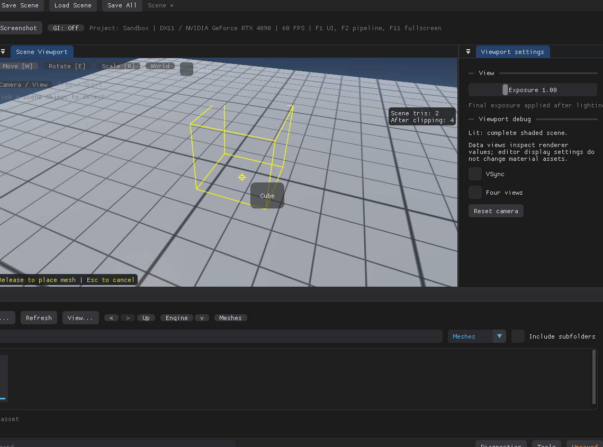

# 资源导入

外部源文件通过统一的 `Assets/AssetImport` 服务进入项目 Content。选择文件与外部拖入共享格式识别、校验、名称处理、持久化和结果报告；后续新增贴图等类型时扩展该服务的格式描述与处理器，编辑器不再另建一条按扩展名直接复制文件的通路。

*把 Engine 的 Cube 拖进视口：黄色线框是放置预览，松手创建 Actor，Esc 取消。外部文件拖入走的是另一条入口，只接受 Content 资产区。*

## 操作规范

1. 在 Content 中打开目标项目文件夹。根目录和项目子目录均可作为目标，Engine Content 为只读。
2. 点击 `Import...` 选择一个或多个源文件，或从资源管理器拖入 Content 的资产列表／网格区域。导入目的地是当前目录；工具栏、Sources、场景视口和其他窗口不接受外部文件导入。
3. 导入器按扩展名（ASCII 大小写不敏感）选择处理器，再实际解析内容。未知格式、目录、损坏或无有效几何的文件会被拒绝并说明原因；仅修改扩展名不能绕过解析。
4. 每个成功源文件产生一个自包含 `.rasset` 和新 GUID。同名采用新文件名，既有资产不被覆盖。多文件逐个处理，成功项保留，失败项显示逐项原因。
5. Content 刷新并选中成功的资源。导入本身不创建 Actor，也不产生场景撤销记录；将 Mesh 拖入 Scene Viewport 或选择 `Add Actor from mesh` 后才创建实例。

### 重新导入已有资产

在 Content 的列表或网格中右键项目导入网格：

- `Reimport`：从该资产记录的源文件路径重新读取。
- `Reimport from...`：选择新的 OBJ／FBX 源文件；成功后将新路径记为该资产的来源，后续 `Reimport` 使用此路径。取消选择不修改资产。

重新导入保留资产 GUID、内部名称和 Content 文件位置，替换几何、材质分区、UV 及缩略图；使用该网格的 Actor 保持引用和变换。材质 Slot 的网格默认绑定及 Actor 覆盖按 `sourceKey` 匹配，避免槽顺序改变时按数字位置错绑；来源身份不存在时不把旧绑定强加到新的槽上。源文件缺失、格式不支持、解析失败或无法替换目标时保留旧文件与内存资产，并显示原因。导入选项与普通导入共用，警告同样显示在结果窗口。

FBX 的同名不同源材质在普通导入时会保留为不同 Slot，但没有可靠的跨导出唯一身份。旧或新网格含这类重名槽时，重新导入明确拒绝并保持原资产和绑定；请在源工具中为材质设置唯一名称，再作为新资产导入并分配 Slot。唯一材质名称与 OBJ `usemtl` 名称保持不变时可跨槽重排保留绑定；重命名不被视为原槽。

当前重新导入支持已加载的项目 Imported Mesh `.rasset`。Engine 只读资源、内置图元和其他资产类型不能重新导入。来源文件不会被修改；此操作立即保存到资产文件，不进入场景 Undo。

### 删除资产

Content 右键 `Delete...` 显示确认框，确认后删除项目资产文件并同步内存库和浏览状态；不会删除记录的外部 OBJ／FBX 源文件。取消或失败保持旧状态。已加载且未被引用的项目网格和材质可以删除，后续保存不会重新生成它们。

当前场景的 Actor 引用及项目 Content 中保存的场景引用会阻止删除网格／材质；存在损坏或无法检查的场景时，也会拒绝并显示原因。先解除引用并保存相关场景，再删除资产。同 GUID 的其他文件会阻止删除，以免旧版资产重新出现。Engine、内置图元、当前／启动场景、Shader 和仍有未保存编辑的材质受到保护。

文件删除不能通过场景 Undo 撤销。删除网格／材质成功后会清空场景编辑历史，避免 Undo／Redo 恢复指向已删除资产的引用；确认框会说明这一行为。引用检查范围为当前项目，不扫描其他工程。

外部拖入使用当前帧的可见 Content 资产区域判定目标；被其他窗口或弹窗覆盖时不导入。原生消息适配覆盖主窗口和独立工具窗口，拖到材质等工具窗口同样会按 Content 命中规则拒绝。拒绝项和成功导入的警告在 Import results 中保留详情。

### 导入选项

Content 的 `Import options...` 提供 `Skip degenerate triangles`（跳过退化三角形），默认开启。开启时，FBX 的重合顶点、共线顶点或转换到浮点网格后坍缩所造成的**零面积**三角形会跳过，其余几何正常导入，结果窗口显示跳过数量；关闭时，遇到这种三角形严格拒绝整个源文件。两种入口共用设置，偏好保存为编辑器 `RestArtEngine.ui.ini` 的 `import_skip_degenerate_triangles`，不写入项目或源文件。

选项不会按任意面积阈值删掉细小但有效的三角形。无论开关状态，全部退化而没有有效面的文件均拒绝。有效三角形的零长度或缺失法线可用几何法线修复，并以警告报告修复角点数量；非有限数据、越界索引、孔洞和无效变换仍按错误拒绝。

## 支持范围

| 格式 | 当前产物 | 处理规则 |
| --- | --- | --- |
| `.obj` | 一个静态网格 | 读取位置、显式法线、缺失法线生成、`usemtl` 面材质分组和一套 `vt`（UV0）；支持正／负索引及 UV 接缝。多边形采用扇形三角化，复杂非凸多边形建议在 DCC 中预先三角化。保留源坐标。 |
| `.fbx` | 一个合并静态网格 | 支持二进制与 ASCII；处理所有 Mesh 节点实例、每实例的面材质 ID 与最多四套 UV，烘焙层级及 geometric transform，转换为左手 Y-up、米制，处理非均匀缩放、镜像绕序及缺失法线。 |

网格包含材质 Slot、按槽分区的三角形索引及可选 UV 流。切线、顶点色、源材质着色图、贴图、骨骼、蒙皮、动画和 blend shape 不迁移；FBX 使用默认姿态下未经蒙皮变形的控制网格，不创建 Actor 层级。曲线、摄像机、灯光等不产生资源，点／线面被忽略，孔洞明确失败；退化三角形按上述选项处理。贴图文件目前会作为不支持格式拒绝；格式注册入口可扩展不代表纹理资产已实现。

### 材质 Slot 与 UV

源文件的面材质 ID 是网格内部的 **Slot 索引**，不是引擎材质资产 GUID。导入保留源材质名称与来源键，不自动把 DCC 材质或 `.mtl` 转成引擎 Shader／贴图。每个 Slot 可在 Actor 的 Details 中独立引用已有引擎材质；有效绑定按 Actor 覆盖 → 网格槽默认材质 → Actor 兼容回退材质解析。无显式材质分组的旧网格继续作为单槽使用。

相同源材质的三角形聚合为连续 section，避免交错面导致逐面提交。FBX 合并节点时按每个实例的材质表解释面 ID；同名的不同源材质不会合并。UV 按三角化后的面角读取并保留接缝，不能用位置索引代替 UV 索引；镜像调整绕序时同步调整 UV 角点。

FBX 按每个源网格的通道顺序保留前四套为 UV0–UV3，超出部分忽略并在导入结果中明确警告。合并实例按通道索引对齐，缺少的通道／角点补零，名称采用首次出现的该通道名称。OBJ 只有 UV0。UV 坐标直接保留，不翻转 V、不限制在 0–1，非有限值或越界引用会拒绝整个源。当前不执行 UV 展开、打包、图集烘焙或 Lightmap 生成。

所有 Slot、section 和 UV 数据都在同一个 `.rasset` 内。位置／法线顶点仍为 24 字节，UV 使用独立可选二进制流：没有 UV 的网格不分配四套坐标，避免扩大无 UV 大网格的内存。旧资产缺少新字段时仍按单材质、零 UV 读取；新属性需要支持该格式的引擎版本，字段见 [资产格式](AssetFormat.md#多材质分区与-uv-流)。

FBX 读取使用固定版本 [ufbx v0.23.1](https://github.com/ufbx/ufbx/tree/v0.23.1)，来源与许可见 [vendor/ufbx/README.rae.md](../vendor/ufbx/README.rae.md)。不读取外部依赖，不解包内嵌资源。限制为源文件 256 MiB、解析临时／结果内存各 512 MiB、层级 256、单多边形 65536 角点、输出 1200 万三角形角点；这些是独立上限，不是总进程内存上限。非法索引、非有限值、超出 ±1e9 的坐标与奇异实例变换会失败。

## 持久化与扩展契约

`AssetImportReport` 记录每个源的成功 GUID、生成路径、清理警告或拒绝原因。新导入的每个源是一项独立事务：先解析到隔离资产，校验目标位于项目 Content 内，生成不冲突的文件名，写临时文件并排他发布，再加入内存资源库。失败不添加内存资产，不覆盖现有文件；本轮临时文件会清理。重新导入则核对原资产身份，先完成隔离解析和临时写入，再原子替换原文件并更新同 GUID 内存资产。原始来源文件不移动、不修改。普通资产保存策略见 [AssetFormat.md](AssetFormat.md#读写策略)。

网格从整个项目 Content 递归加载／按 GUID 查找原位置保存，因此导入到自定义目录、Content 内移动及重启后引用保持有效。内置网格从引擎 `Content/Meshes` 只读挂载，编辑器不再生成项目 `Meshes/Builtin`；旧文件与图元 ID 仍可读取。材质加载目前仍限定 `Materials` 类型目录树。

容器保存几何与来源元数据，重启和移动项目不依赖源文件存在；再次重新导入时才需要可用的来源路径。`sourcePath` 可能包含绝对路径，分享资产前应检查该元数据。普通批次导入不提供全批撤销或自动覆盖；重新导入是对指定资产的显式操作。后续新增格式应保持逐源事务、失败不破坏既有状态与同样的两种入口。
