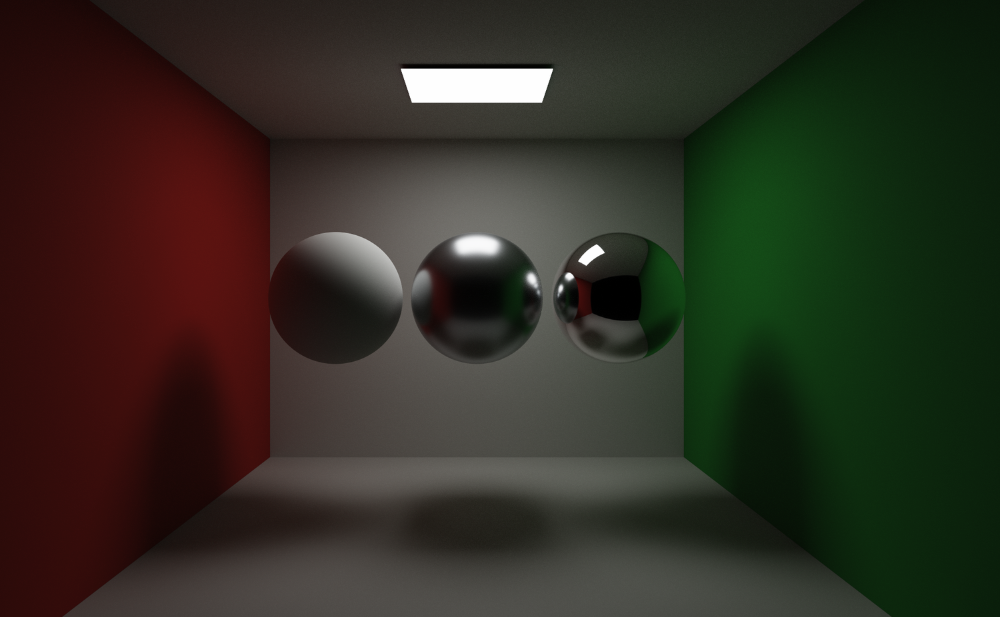

# 场景灯光

灯光是带 `LightComponent` 的 Actor，与静态网格 Actor 共用稳定 ID、名称、可见性和 Transform。Scene 数据不依赖编辑器或图形 API；GPU 打包位于 `Renderer/Lighting`，共享采样位于 `Shaders/Private/Lighting.hlsli`。

*PathTracing_CornellBox 的矩形顶灯是唯一光源。普通光栅用四点面积近似，Progressive PathTracing 用面积／BRDF 采样与 MIS，因此这里能看到可见发光面本身，以及金属球上对顶灯的锐利反射。*

## 创建与编辑

在 Outliner 的 `+ Light` 菜单创建灯光；窄或矮面板中入口收进 `+ Add / Actions → Light`。选中后在 Details 调整参数。灯光可在 Outliner 或视口标记上选择，支持移动／旋转 Gizmo、F 聚焦、复制、删除和撤销重做。颜色、强度等属性实时更新，不需要保存或重新编译 Shader；保存场景才写入磁盘。

| 类型 | 用途 | 主要参数 |
| --- | --- | --- |
| Directional | 方向光，模拟远处平行入射的直接光 | 颜色、强度、旋转、Cast shadows |
| Sky | 程序化环境照明，提供间接环境能量 | 颜色、强度；位置和旋转不起作用 |
| Rect | 单面矩形区域光 | 颜色、强度、位置、旋转、范围、宽高、Cast shadows |
| Spot | 聚光灯 | 颜色、强度、位置、旋转、范围、内外半锥角、Cast shadows |
| Point | 各方向发光的点光源 | 颜色、强度、位置、范围、Cast shadows |

场景使用 Y 向上，灯光沿 Actor 的局部 **-Z** 发射，矩形位于局部 X/Y 平面。旋转单位为度，Spot 角度为半角，满足 `0 ≤ inner ≤ outer < 90°`；内外角相等时为硬边。Transform 的缩放不改变灯的范围、矩形尺寸或能量，请直接编辑相应参数。

颜色是线性 RGB，强度使用引擎的相对能量标度，不标称流明或照度单位。点光／聚光采用距离平方衰减与范围边缘平滑淡出，范围之外没有贡献。矩形的宽高改变发光面积，因此也改变总能量。普通着色使用四点面积积分近似，近距离可能看到采样近似，不等同于 LTC 或收敛的路径追踪。Progressive PathTracing 使用面积／BRDF 采样与 MIS，主相机和反射可见矩形发光面；普通光栅、硬件预览和 Realtime 主视图只计算照明，不显示该发光面本体。

Sky 是现有程序化环境的颜色与能量控制，不包含 HDRI 导入、环境捕获或独立探针。关闭 GI 时使用环境近似；启用硬件 GI 时环境能量参与实际路径采样。背景颜色与照明是不同设置，黑背景不等于关闭天空照明。

## 来源优先级与预算

场景只要包含任意灯光 Actor，灯光列表就接管旧 Scene 灯光参数；隐藏灯光仍保留这种接管，因此隐藏最后一盏灯不会突然恢复默认方向光。删除所有灯光 Actor 后，恢复旧场景／视口光照设置。Scene 面板在接管时禁用旧灯光控件并给出说明。

当前最多处理按 Actor 顺序排列的 **32 盏可见直接灯**（Directional、Rect、Spot、Point）。超额灯光保留在场景中，Scene 面板显示超额提示；隐藏灯光不占预算。Sky 颜色与强度单独累加，不占这 32 个槽位。灯光不参与网格三角面数、资产依赖、材质拖放或几何加速结构。

## 阴影

首个可见、强度大于零且请求投影的方向光可使用现有方向光阴影贴图及 PCF／PCSS／CSM。其他方向光和局部灯在普通光栅与 Realtime GI 下需选择 Analytic rays 才有直接光阴影；硬件预览（GI Disabled）及 Progressive PathTracing 使用硬件射线投影。Realtime 的硬件通道只提供间接光，不为光栅主画面生成局部直接光阴影图。矩形阴影在普通射线路径使用四个采样点。

每灯 `Cast shadows` 控制请求，Scene 的 `Shadow Disabled` 关闭全部灯的投影；硬件路径还遵循项目硬件阴影开关。Sky 不提供该开关，其遮蔽来自 GI 光传输。局部灯可见性测试只到发光位置，灯后方物体不会挡住该灯。大场景使用软件三角形射线的成本可能较高。

## 文件与运行契约

含灯光的 `.rascene` 写为 v4，Actor 的 `light` 与 `mesh` 二选一。`light` 包含稳定类型字符串、`color/intensity/range/innerConeAngle/outerConeAngle/width/height/castShadows`；无灯光场景继续写 v3，v1–v3 仍可加载。灯光只保存场景数据，不生成网格或材质资产。非法值、混合组件或丢失网格引用导致保存／加载失败，保留原有状态。

GPU 契约为独立 `LightingConstants`（b7），包含计数与模式、Sky 累加值和 32 个 96 字节光源，总计 3104 字节。Shader 热编译校验布局，普通参数通过常量更新。硬件 GI 历史键包含完整灯光数据；改变颜色、强度、方向、位置或可见性会失效累积，不需要重建不变的网格几何。

当前运行后端是 Windows D3D11 及其 DX12/DXR 通道；平台无关场景数据不表示 Vulkan、OpenGL、Linux 或 macOS 已实现。验证入口为 `--lighting-self-test`、`--gi-self-test` 与 `--editor-self-test`，均应使用隔离工程。

## 扩展与迭代

新增灯型要从枚举一路改到 Shader：`Scene/Light.h` 加类型与字段，`World.cpp` 的 v4 序列化读写，`Renderer/Lighting.cpp` 的 96 字节 `GpuLight` 打包与 3104 字节 `LightingConstants`，`Lighting.hlsli` 的结构镜像，`Scene.hlsl` 的光栅估计器，`PathTracing.hlsli` 的 NEE/MIS 分支，编辑器的创建菜单和 Details 子面板，最后是本页表格与 `--lighting-self-test`。字段增加会改变 b7 大小，必须同步 `static_assert`、HLSL 布局和反射校验，否则候选管线会直接编译失败。

比新增灯型更常见的改动是替换光栅估计器。矩形光现在是四点积分，不是 LTC；换成 LTC 要同时改 `Lighting.hlsli`、路径追踪的面积采样和本页的取舍说明，否则两条路径的柔度会对不上。局部光的独立阴影贴图是更大的缺口，得先给管线加每灯资源，再处理 Forward/Deferred 与 CSM 的交互，不是加个分支就能收尾。

迭代时守住两条：灯光变化不能让网格几何重建，只让 GI 历史失效；新增字段必须进 `HistoryKey`，否则画面会继续用旧光照的样本。这两条比功能本身更容易被忽略。
