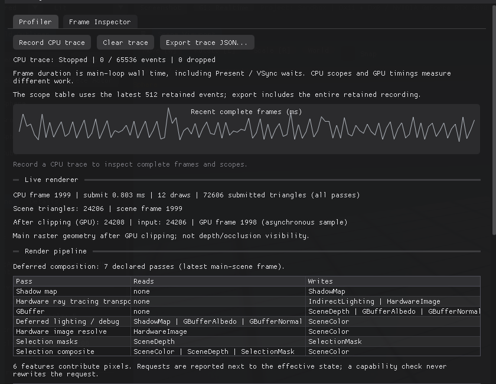

# 渲染管线：组合层、执行层与特性策略

本文说明 RestArtEngine 现在**如何描述、校验并执行一帧场景渲染**，以及为什么要把「声明」「执行」「特性可用性」拆成三层。它同时是这套结构的阅读指南：读完你应该能看懂一张帧截图背后经过哪些 Pass、每个 Pass 依赖什么资源、某个特性为什么亮着或为什么被禁用，以及新增一个 Pass／特性时该改哪里。



*`Diagnostics` 的 `Render pipeline` 表：每行是一条声明，`Reads` / `Writes` 列出资源位；表内顺序就是执行顺序，也是 Profiler 的计时行。声明与实际执行不一致的两种短路情况见 6.3。*

相关源码：

| 位置 | 职责 |
| --- | --- |
| [`include/RestArtEngine/Renderer/RenderPipeline.h`](../include/RestArtEngine/Renderer/RenderPipeline.h) | 管线组织维度、资源位、Pass 声明、构建与校验接口 |
| [`src/Renderer/Pipelines/ScenePipeline.cpp`](../src/Renderer/Pipelines/ScenePipeline.cpp) | 按帧条件组合 Pass 列表、资源边校验、可读描述 |
| [`include/RestArtEngine/Renderer/RenderFeatures.h`](../include/RestArtEngine/Renderer/RenderFeatures.h) | 特性的三层状态模型与矩阵 |
| [`src/Renderer/RenderFeatures.cpp`](../src/Renderer/RenderFeatures.cpp) | 每条特性的判定规则与阻塞原因 |
| [`src/Renderer/Passes/ShadowPass.h`](../src/Renderer/Passes/ShadowPass.h) | 第一个被抽出的 Pass：阴影深度图 |
| [`src/Renderer/SceneRenderer.cpp`](../src/Renderer/SceneRenderer.cpp) | DX11 执行器：按声明顺序执行、发布诊断与特性矩阵 |
| [`tests/RenderPipelineTests.cpp`](../tests/RenderPipelineTests.cpp) | 组合顺序、资源边与特性判定的 CPU 回归 |

---

## 1. 为什么需要这一层

改造前，一帧的流程是一段约 450 行的顺序代码：阴影、硬件光追、G-buffer、光照、后处理、描边、捕获全部写在同一个函数里，互相靠局部变量和 `if` 串联。这带来三个具体问题：

1. **依赖不可见**：某个 Pass 读了哪张纹理、谁先写它，只能靠读代码推断。把 `DeferredLighting` 挪到 `GBuffer` 前面，编译器不会报错，画面会以难排查的方式坏掉。
2. **文档会漂移**：文档里写的 Pass 顺序和实际代码是两份独立维护的真相。
3. **扩展靠加分支**：新增一个后处理就是再加一个 `if`，新增一个特性就是再加几个布尔量。

这一层用一张**数据化的 Pass 列表**取代顺序代码：谁先谁后、每个 Pass 读什么写什么，都写成可检查的数据；同一张列表既被拿去执行，也被拿去做诊断、写文档、跑测试。概括成一句话：

> **声明是施工图，执行器是施工队，校验器是审图，特性矩阵是设备和可用性清单。**

四者共用同一份事实，所以不会各说各话。

---

## 2. 先把四个维度分开

引擎里有四个经常被混为一谈的维度。它们各自独立，只在明确的兼容性约束下组合：

| 维度 | 取值 | 回答的问题 | 代码位置 |
| --- | --- | --- | --- |
| 渲染体系 | PBR / NPR（NPR 尚未实现） | 用什么着色模型家族 | 目标见 [RenderingDevelopment.md](RenderingDevelopment.md#pbr-与-npr-双体系目标) |
| 管线组织 | `RenderPath::Forward` / `Deferred` | 一帧拆成哪些阶段、在哪阶段着色 | `RenderPipeline.h` |
| 图形后端 | DX11 / DX12 / Vulkan / OpenGL | 用哪个 API 提交 | `RenderBackend.h`（目前仅 DX11 真实可用） |
| 可选特性 | 阴影方案、解析光追、DXR、GI、DOF、描边 | 这一帧启用了哪些能力 | `RenderFeatures.h` |

**不要**把「Deferred」等同于「PBR」，也不要把「阴影方案」当成后端能力。管线组织只决定阶段形状；特性只决定在形状里插入什么。PBR/NPR 将来是在「着色函数与材质契约」这一层分化，Forward 和 Deferred 都可以服务任一体系。

---

## 3. 资源模型：什么算一条依赖边

`PipelineResource` 只列举**会在 Pass 之间传递的 GPU 图像/缓冲**：

| 资源 | 含义 | 生产者 |
| --- | --- | --- |
| `SceneColor` | 最终场景颜色（编辑器场景纹理或交换链） | 光照 / 背景 / 硬件回读 / DOF / 描边 |
| `SceneDepth` | 主视图深度 | G-buffer 或 Forward 几何 |
| `ShadowMap` | 2048² 方向光深度数组（1–2 层） | 阴影 Pass |
| `GBufferAlbedo` / `GBufferNormal` / `GBufferPosition` | 三张 RGBA16F G-buffer | G-buffer Pass |
| `RayTriangleScene` | 软件三角光追的世界空间三角形 + UV 缓冲 | **帧开始前**由渲染器准备，属于外部输入 |
| `IndirectLighting` | 实时 GI 解析后的间接光 HDR 图，供光栅直接叠加 | 硬件传输 Pass |
| `HardwareImage` | DXR 整幅预览/参考图 | 硬件传输 Pass |
| `SelectionMask` | 编辑器描边遮罩（可见 / 遮挡双通道） | 描边遮罩 Pass |
| `DepthOfFieldSource` | 景深 Pass 的内部源色副本 | 景深 Pass |
| `FrameCapture` | 帧检查器快照 | 捕获 Pass |

几个刻意的取舍：

- **常量缓冲和采样器不算边**。`b0`–`b8` 是每帧统一上传的绑定，不构成「谁生产给谁消费」的关系；把它们画进图里只会让图变成绑定清单。
- **`RayTriangleScene` 是外部输入**。它在 Pass 列表开始前由 `prepareRayTriangles()` 准备好，校验器把它当作帧输入（`pipelineFrameInputs`），而不是要求某个 Pass 生产它。
- **场景几何本身不是资源**。所有绘制类 Pass 都隐含读取世界与资产；把它抽象成资源没有信息量。
- **一个资源可以有多个写者**（`SceneColor` 会被光照写、被硬件回读覆盖、被 DOF 改写），但**任何读取都必须发生在至少一个写者之后**。这正是校验器检查的核心。

---

## 4. 一帧的 Pass 声明

`buildScenePipeline(PipelineBuildInputs)` 根据「这一帧到底会不会跑」的布尔条件生成列表。注意输入是**已解析的能力结果**，不是用户愿望：例如 `hardwareTransport` 只有在设备支持、管线就绪、材质深度兼容且本帧没失败时才为真。

### 4.1 Deferred

| # | Pass | 存在条件 | 读 | 写 |
| --- | --- | --- | --- | --- |
| 1 | `Shadow map` | 光栅阴影方案且方向光需要阴影 | — | `ShadowMap` |
| 2 | `Hardware ray tracing transport` | DXR 本帧执行 | — | `HardwareImage`（+ 实时模式 `IndirectLighting`） |
| 3 | `GBuffer` | 总是 | — | 三张 G-buffer + `SceneDepth` |
| 4 | `Deferred lighting / debug` | 总是 | 三张 G-buffer + 可选 `ShadowMap` / `RayTriangleScene` / `IndirectLighting` | `SceneColor` |
| 5 | `Hardware image resolve` | 声明了硬件传输 | `HardwareImage` | `SceneColor` |
| 6 | `Screen-space depth of field` | 镜头启用 DOF 且不在数据视图 | `SceneColor`、`SceneDepth` | `SceneColor`、`DepthOfFieldSource` |
| 7 | `Selection masks` | 编辑器有选中 | `SceneDepth` | `SelectionMask` |
| 8 | `Selection composite` | 编辑器有选中 | `SceneColor`、`SceneDepth`、`SelectionMask` | `SceneColor` |
| 9 | `Frame capture` | 请求了帧捕获 | `SceneColor`、`SceneDepth`、三张 G-buffer | `FrameCapture` |

### 4.2 Forward

| # | Pass | 存在条件 | 读 | 写 |
| --- | --- | --- | --- | --- |
| 1 | `Shadow map` | 同上 | — | `ShadowMap` |
| 2 | `Hardware ray tracing transport` | 同上 | — | `HardwareImage`（+ `IndirectLighting`） |
| 3 | `Forward background` | 总是 | — | `SceneColor` |
| 4 | `Forward geometry / debug` | 总是 | `SceneColor` + 可选阴影/三角形/间接光 | `SceneColor`、`SceneDepth` |
| 5 | `Hardware image resolve` | 同上 | `HardwareImage` | `SceneColor` |
| 6–9 | 后处理与描边、捕获 | 同上 | 同上 | 同上 |

两个容易问的问题：

- **为什么 Forward 几何 Pass 要读 `SceneColor`？** 因为它是在背景已经画好的颜色上合成几何；如果背景 Pass 不在它前面，校验器会拒绝这份声明。它没有采样颜色纹理，但语义上确实是「读—改—写」。
- **为什么 G-buffer Pass 不读 `RayTriangleScene`？** 因为 G-buffer 只做材质求值（`EvaluateMaterial`），反射与射线阴影发生在光照 Pass 的 `Shade()` 里；把三角形缓冲提前声明给 G-buffer 会让依赖图说谎。

### 4.3 可选能力如何改变列表

| 设置 | 列表变化 |
| --- | --- |
| `ShadowMethod::AnalyticRay` / `Disabled` | 不生成 `Shadow map`；光照不再声明 `ShadowMap` |
| 解析反射（`rayTracing`）或解析阴影 | 光照 Pass 增加 `RayTriangleScene` 读 |
| DXR 可用且请求开启 | 增加 `Hardware ray tracing transport`；有传输就有 `Hardware image resolve` |
| GI 实时模式且 DXR 实际运行 | 传输多写 `IndirectLighting`，光照多读它；`resolve` 运行时短路 |
| 镜头启用景深且 `debugView <= 1` | 增加 `Screen-space depth of field` |
| 编辑器有选中 | 增加 `Selection masks` + `Selection composite` |
| 请求捕获下一帧 | 增加 `Frame capture` |

---

## 5. 校验器在防什么

`validatePipeline()` 是纯 CPU、无 GPU 依赖的检查，规则只有五条，但能挡住绝大多数「改错顺序」的事故：

1. **读取必须有生产者**：按顺序累积 `available`，任何 Pass 读取未写过的资源就报错，并列出缺失资源名。例如把 `DeferredLighting` 放到 `GBuffer` 前面，会得到：
   `pass 1 ('Deferred lighting / debug') reads GBufferAlbedo | GBufferNormal | GBufferPosition before any earlier pass produces it.`
2. **Forward / Deferred 不能串味**：Deferred 管线里出现 `ForwardBackground` / `ForwardGeometry`，或反过来，直接拒绝。
3. **路径必需阶段齐全**：Deferred 必须有 G-buffer 与光照；Forward 必须有背景与几何。
4. **最终必须有 `SceneColor`**：没有任何 Pass 生产可呈现图像时拒绝。
5. **Pass 名唯一且非空**：诊断、捕获事件和 GPU 计时都靠名字归属；重名会让统计互相污染。

校验失败是**编程错误**，不是用户配置错误：`SceneRenderer::render` 会带着具体 Pass 名和资源名返回失败，而不是画一帧错误的图。`PipelineValidation` 的 `error` 字段是给人看的，测试里直接对它断言。

此外，`describePipeline()` 输出与执行**同一份列表**的文本：

```text
[Deferred] 4 passes
  1. Shadow map | reads: none | writes: ShadowMap
  2. GBuffer | reads: none | writes: GBufferAlbedo | GBufferNormal | GBufferPosition | SceneDepth
  3. Deferred lighting / debug | reads: GBufferAlbedo | GBufferNormal | GBufferPosition | ShadowMap | writes: SceneColor
  4. Hardware image resolve | reads: HardwareImage | writes: SceneColor
```

诊断面板显示的 Pass 表就是这个描述的结构化版本；文档里的表格也照它维护。

---

## 6. 执行层：声明如何变成 GPU 命令

`SceneRenderer::render` 的骨架现在分成四段：

```text
① 帧准备（不属于任何 Pass）
   相机与视口、Light 打包、SceneConstants/ShadowConstants/RayConstants、
   可见材质深度兼容性扫描、光追三角形准备

② 解析能力并组合
   PipelineBuildInputs → buildScenePipeline() → validatePipeline()

③ 按声明顺序执行
   for (pass : pipeline.passes) switch (pass.kind) { ... }
   每个 case 在真正开始 GPU 工作前调用 beginDiagnosticPass(pass.name)

④ 收尾
   finishDiagnostics()、特性矩阵快照、编辑器回读、设备移除检查
```

执行器仍然是 DX11 即时上下文，Pass 之间靠显式状态绑定衔接；这一层**没有** Render Graph、没有自动屏障、没有瞬态资源别名。声明解决的是「顺序与依赖可见」，不是「自动调度」。真正的 RHI 抽象（`include/RestArtEngine/Renderer/RHI/`）尚未实现，现在的 `IRenderBackend` 只是生命周期骨架。

### 6.1 为什么阴影 Pass 单独抽成了模块

`src/Renderer/Passes/ShadowPass.cpp` 是第一个从 `render()` 里搬出来的阶段。它展示了 Pass 模块最小应有的样子：

- **输入**：设备上下文、已上传的 `b3`、每层深度的 DSV、层数、图尺寸；
- **行为**：设置 2048² 视口 → 逐层绑定 DSV、清深度、写该层光照常量、绘制可见几何 → 解绑 DSV → 恢复相机常量；
- **输出**：深度数组内容（由渲染器持有）。

它通过 `std::function` 回调拿到「写本层常量」和「绘制几何」，因此不反向依赖 `SceneRenderer::Impl`。**资源所有权仍留在渲染器**：这一版只抽出阶段逻辑，不搬资源生命周期；等 RHI 的资源描述稳定后再把纹理、DSV、常量缓冲的归属移进 Pass，避免现在为抽象而抽象。

### 6.2 诊断标签来自声明

`RenderDiagnosticsFrame::passes` 的名字不再由手写字符串决定，而是 `pass.name`。这保证三件事一致：

1. 画面上真实执行的顺序；
2. Profiler 里看到的 pass 行；
3. 文档与测试里断言的顺序。

`DiagnosticsSmoke` 仍要求 G-buffer 事件出现在名为 `GBuffer` 的 Pass 下，所以声明里的名字是稳定契约，不能随意改。

阴影 Pass 内部的 1–2 级 CSM 切片不再各占一行：cascade 的矩阵、视口与清屏属于同一个 Pass 的内部实现，Profiler 只报告一条 `Shadow map`。这样「计时行数 = 声明 Pass 数」，读表时不会把内部循环误当成独立阶段。

### 6.3 声明与「这一帧实际跑没跑」的差别

有两种情况声明会略微超前于现实：

- **硬件传输失败**：`Hardware image resolve` 被声明（因为尝试了传输），但执行时 `hardwareFrameReady == false`，该 case 直接短路，不产生计时行。
- **渐进式硬件帧的景深**：`Screen-space depth of field` 被声明，但薄透镜景深已经在路径追踪里解析完成，case 短路，特性矩阵把它标成 `Degraded`。

这类「声明按尝试、执行按结果」的差别被刻意保留：Pass 列表描述**这一帧计划做什么**，特性矩阵描述**最终实际生效什么**。两者对不上时，矩阵负责给出原因。

---

## 7. 特性策略：三层状态

`RenderFeatures.h` 把「一个特性为什么没生效」拆成三层，从上往下检查，报告**第一个失败的层**：

| 层 | 状态 | 含义 | 例子 |
| --- | --- | --- | --- |
| 构建可用性 | `UnavailableInBuild` | 这份二进制没编进该实现 | 裁剪掉的 DXR 模块 |
| 设备/后端 | `UnsupportedByDevice` | 选中的适配器或 API 跑不了 | 无 DXR 1.1 的显卡 |
| 帧前置条件 | `BlockedByDependency` | 设备可以，但这一帧的依赖不满足 | 材质用了光栅专属深度状态、场景阴影被关闭、实时 GI 接管了直接阴影 |
| 生效 | `Active` | 请求且实际使用 | 当前 Deferred + PCSS |
| 降级 | `Degraded` | 请求了，但由另一种实现承担了部分语义 | 渐进路径追踪里的薄透镜景深 |
| 未请求 | `Off` | 用户/工程没开 | 未开启的 GI |

关键规则：**能力检查永远不修改请求值**。设备不支持 DXR 时，工程里 `hardwareRayTracing = true` 仍然保留，矩阵报告 `UnsupportedByDevice`；换到支持的设备后会自动重新计算，而不是被静默改写成 `false`。这与 `GlobalIlluminationStatus` 已有的 `requested / effective / reason` 约定一致。

### 7.1 当前判定规则

| 特性 | 请求来源 | 生效条件 | 常见阻塞/降级 |
| --- | --- | --- | --- |
| `ForwardPath` / `DeferredPath` | `SceneSettings::path` | 二选一 | 另一条恒为 `Off` |
| `ShadowMapPCF` / `Hard` / `PCF9` / `PCSS` / `CSM2` | `shadowMethod` | 对应的光栅方案 | 只运行命中的那一个 |
| `AmbientOcclusionGTAO` | `shadowMethod == GTAO` | Deferred | Forward：`BlockedByDependency`，退回光栅阴影图 |
| `ContactShadows` | `shadowMethod == ContactShadow` | Deferred | Forward：同上 |
| `AnalyticRayTracing` | `shadowMethod == AnalyticRay` 或 `rayTracing` | 请求即生效 | — |
| `HardwareRayTracing` | `hardwareRayTracing` | 构建 + 设备 + 管线 + 材质深度四层都通过 | 逐层报告；运行期 dispatch 失败同样转为 `BlockedByDependency`，保留光栅画面直到用户重新开关 |
| `HardwareReflections` | `hardwareRayTracingReflections` | 硬件生效且 GI 关闭 | GI 开启：间接镜面接管 |
| `HardwareShadows` | `hardwareRayTracingShadows` | 硬件生效、场景阴影未禁用、非实时 GI | 实时 GI 接管直接阴影 |
| `PathTracingGI` | `globalIllumination.method` | 硬件光追生效 | 继承硬件阻塞原因 |
| `RealtimeGI` | `globalIllumination.mode == Realtime` | 路径追踪 GI 生效 | 同上 |
| `DepthOfField` | 镜头启用且可求值 | 屏幕空间 Pass 执行 | 薄透镜路径追踪：`Degraded` |
| `SelectionOutline` | 编辑器有选中 | 编辑器提供选择 | 无选择：`BlockedByDependency` |

### 7.2 怎么读诊断面板

`Debug → Diagnostics → Profiler` 下方的 **Render pipeline** 区块：

1. 第一行说明当前路径与 Pass 数；
2. Pass 表逐行给出「Pass 名 / 读 / 写」，与第 4 节表格同源；
3. **Render features** 表只列非 `Off` 的特性，显示状态与原因；
4. 再往下是原有的 CPU / GPU 计时表，行名与 Pass 表一致。

如果你在视口里打开了 DXR 但画面仍是光栅，先看 feature 表里 `Hardware ray tracing` 的状态：`Unsupported by device` 是硬件问题，`Blocked by dependency` 多半是某个材质用了 `ZTest Greater` 或 `ZWrite Off`，原因会直接写在表格里。

---

## 8. 两个追踪练习

### 8.1 实时 GI 的间接光是怎么到像素上的

```text
Hardware ray tracing transport     写 IndirectLighting（DX12 共享 RGBA16F）
        ↓  （同时更新 b6 giViewport.x = 1，并绑定 t9）
Deferred lighting / debug          读 IndirectLighting
        ↓  Scene.hlsl: ShadeSurfaceContributions()
        if (giViewport.x > 0.5) return direct + indirectLightingBuffer.Load(...)
        ↓
SceneColor
```

在声明里，这条链就是 `HardwareTransport.writes ∋ IndirectLighting` → `DeferredLighting.reads ∋ IndirectLighting`。如果硬件传输没有运行，光照 Pass 根本不会声明这个读，着色器走原来的 `Environment()` 环境近似分支。**声明不是注释，它和运行时的 `giViewport.x` 开关是同一件事的两个视角。**

### 8.2 为什么 Forward + GTAO 不是「悄悄降级」

用户选择 `ShadowMethod::GTAO` 时，请求是「用屏幕空间环境遮蔽」。Forward 没有位置/法线缓冲，无法计算它。系统不会假装运行 GTAO，也不会偷偷把 `shadowMethod` 改成 `ShadowMap`：

- 管线仍然生成 `Shadow map` Pass（直接光需要阴影）；
- 特性矩阵：`Shadow map (2x2 PCF)` = `Active`，`GTAO` = `BlockedByDependency`，原因写明需要 Deferred G-buffer；
- 切回 Deferred 后，同一个请求自动重新生效。

这就是「不覆盖用户偏好、显示请求与实际差别」的具体形态。

---

## 9. 新增一个 Pass 的步骤

1. **加枚举**：在 `RenderPipeline.h` 的 `RenderPassKind` 增加一项，并在 `toString` 补名字。
2. **定义资源边**：如果需要新的中间纹理，先在 `PipelineResource` 增加位，并想清楚谁写、谁读。
3. **组合**：在 `buildScenePipeline()` 的正确位置 `add(...)`，写清 `reads` / `writes`；如果它只在某种能力下存在，给 `PipelineBuildInputs` 增加对应布尔量（由调用方解析能力后填入，不要在组合函数里读 `SceneSettings`）。
4. **执行**：在 `SceneRenderer::render` 的 `switch` 增加 case；先做短路判断，再 `beginDiagnosticPass(pass.name)`，然后提交 GPU 工作。
5. **资源生命周期**：若 Pass 拥有 GPU 资源，放到 `src/Renderer/Passes/<Name>.{h,cpp}`，明确初始化、尺寸变化、热编译与销毁行为。参考 `ShadowPass` 的边界：只搬阶段逻辑时，用回调拿绑定与绘制，不要反向依赖 `Impl`。
6. **测试**：在 `tests/RenderPipelineTests.cpp` 增加顺序与资源边断言；需要 GPU 的再挂到 `--self-test` / `--editor-self-test`。
7. **文档**：更新本文件第 4 节的表格。文档与声明应来自同一次阅读。

## 10. 新增一个特性的步骤

1. **枚举与命名**：`RenderFeatures.h` 增加 `RenderFeature`，`toString` 补人类可读名。
2. **请求字段**：在 `FeatureRequests` 增加用户/工程意图；只放「用户能选的值」，不要放派生结果。
3. **能力字段**：在 `FeatureCapabilities` 增加设备或帧级前提；由渲染器在设备创建、材质扫描或传输尝试后填写。
4. **判定规则**：在 `evaluateRenderFeatures` 里按「构建 → 设备 → 帧依赖」顺序检查，报告第一个失败层；不要在这里修改请求。
5. **执行接线**：用能力结果决定 Pass 是否存在、材质是否走该分支；若特性关闭会影响消费者，明确「替换 / 禁用 / 回退」并写进原因。
6. **UI**：诊断面板自动显示矩阵条目，无需单独加面板。
7. **测试**：为每条状态至少写一个断言（尤其 `UnsupportedByDevice` 与 `BlockedByDependency` 的原因文本）。
8. **验收**：两套体系（未来 PBR/NPR）各自的画面、实时参数、热编译失败恢复、保存重载与开关都要单独验证，不以图像相同作为共享能力的通过标准。

---

## 11. 与 PBR/NPR 双体系的关系

这次改造只建立**管线组织与特性策略**的地基，没有引入渲染体系维度。将来接入 NPR 时，预期落点是：

- 在 `RenderFeatures` 增加体系维度的请求（工程/场景/材质粒度待定），与路径、后端正交；
- 着色差异落在材质契约与 `Shaders/`，而不是复制一套 Pass 列表；共享的阴影、深度、后处理 Pass 继续复用；
- 若 NPR 需要自己的 Pass（例如风格化描边、分段光照片段），它按第 9 节接入，声明自己的资源边，并在特性矩阵里声明适用体系与降级行为。

NPR 的专属特性必须能声明「仅 NPR」「共享」「仅 PBR」，以及关闭一种体系时不能破坏另一种体系仍在消费的资源。这些是 [RenderingDevelopment.md](RenderingDevelopment.md#pbr-与-npr-双体系目标) 的既有约束，本层只负责让它们有地方可落。

---

## 12. 验收

```powershell
# CPU：组合顺序、资源边、特性三层判定
# CMake 构建时由 CTest 运行；也可单独编译：
#   cl /std:c++20 /I include tests/RenderPipelineTests.cpp ^
#      src/Renderer/Pipelines/ScenePipeline.cpp src/Renderer/RenderFeatures.cpp

# GPU：前向 / 延迟一致性、阴影方案、光追开关、Unlit 与法线截图
.\scripts\Validate-Render.ps1

# GPU：编辑器全流程（真实输入注入，覆盖 Diagnostics 面板读取）
.\bin\windows-x86_64\Debug\RestArtEngine.exe --editor-self-test --capture-dir artifacts\editor-validation
```

这一层改造的验收标准是**画面与改造前逐像素一致**（声明驱动的执行没有改变任何 Pass 的实际命令与顺序），同时：

- `RenderPipelineTests` 全绿；
- `Validate-Render.ps1` 的前向/延迟一致性检查通过；
- Diagnostics 面板能显示与文档一致 Pass 表与特性表；
- 故意把 `DeferredLighting` 移到 `GBuffer` 前的测试会失败并给出缺失资源名。

---

## 13. 术语表

| 术语 | 在这套代码里的含义 |
| --- | --- |
| Pass（阶段） | 一段有明确输入/输出资源的 GPU 工作，对应 `RenderPassDeclaration` |
| 管线组织（path） | Forward / Deferred，决定阶段形状 |
| 资源边 | `reads` / `writes` 位掩码描述的生产者—消费者关系 |
| 帧输入 | 不属于任何 Pass、在管线前准备好的资源（`RayTriangleScene`） |
| 请求值 | 用户/工程设置，能力检查不修改 |
| 生效值 | 这一帧实际使用的实现 |
| 构建可用性 | 该实现是否编进当前二进制 |
| 降级 | 特性仍贡献画面，但部分语义由别的实现承担 |
| 阻塞 | 设备/构建都支持，但这一帧的前置条件不满足 |
