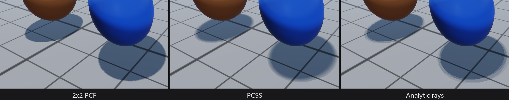

# 阴影方案

直接光阴影有九种接法，切换只影响常量与 Pass 分支，不重建几何或深度资源。它们在光栅、解析光追和硬件光追三条路径上的生效范围并不相同，下面按「怎么算、怎么用、怎么验收、怎么加」四层说明。

*同一测试场景的接触阴影放大：2×2 PCF 的边缘有硬锯齿，PCSS 随距离变软，Analytic rays 由光线求交得到更干净的软过渡。三种方法的代价与生效范围见下节。*

## 原理

光栅方案共享一张 2048² × 2 切片的深度数组。2×2 PCF、硬比较、3×3 PCF、PCSS 和两级 CSM 都在同一张资源上采样，靠 `shadowParameters.w` 选择过滤方式；CSM 另外使用两层的矩阵，并按 10% 近远距离切分。GTAO 和 Deferred Contact Shadow 不产生自己的阴影图：前者用延迟 G-buffer 的位置与法线乘在环境光上，后者沿光源方向做短步进，只缩放直接光的可见度；Forward 下两者都退回阴影贴图。解析光追完全不跑阴影 Pass，用 4 条抖动光线对内置图元和三角形场景求交，所有开启投影的灯都能投。`Disabled` 不采样任何阴影项。

光栅路径只有一个阴影贴图消费者：第一盏可见、强度大于零、`Cast shadows` 为真的方向光。其余方向光和局部灯要阴影，只能选 Analytic rays 或打开硬件光追。硬件通道的阴影射线覆盖所有开启投影的灯，包括局部灯和矩形灯；矩形阴影在解析路径是 4 个采样点。

## 使用

Scene 面板的 Shadow method 下拉是唯一入口，九项与枚举一一对应，默认 2×2 PCF。这个选择属于会话状态，不写进 `.rascene`，重启会回到默认；要固定效果，就在启动参数或截图脚本里显式设置。每盏灯的 `Cast shadows` 是独立开关，Scene 的 `Disabled` 会关掉全部灯的投影。

解析阴影必须显式选择 Analytic rays；`--rt` 只打开解析反射，不会顺带打开阴影。硬件阴影由 `Project → Project Settings... → Rendering` 的 `Ray-traced shadows` 控制，和 GI 的渐进/实时模式共用同一条通道。

## 生产

代价差别直接决定选型。2×2 PCF 和硬比较最便宜；PCSS 最贵，blocker search 省不掉；两级 CSM 多一次深度 Pass；GTAO 和 Contact Shadow 只增加延迟光照阶段的采样。解析光追的成本随三角形数线性增长，大场景要谨慎；硬件阴影的成本在加速结构构建与射线遍历上，静态帧可以复用。

验收入口是 `EditorSmoke`：它分别渲染 PCSS、CSM2、GTAO、Contact Shadow、AnalyticRay、Disabled 和默认 PCF，并与 Disabled 的基准图比对。`--editor-self-test` 覆盖这些路径的像素差异，`Validate-Render.ps1` 在标准场景上做前向/延迟与光追开关的回归。设备不支持硬件光追时，`Ray-traced shadows` 保留请求并报告实际不可用，不会静默改写项目配置。

几个常见误判。阴影整片消失，先查第一盏投影方向光是否存在、`Cast shadows` 是否为真、Shadow method 是否被设成 Disabled。局部灯没阴影是光栅路径的预期行为，不是缺陷。硬件通道下阴影异常，先确认可见材质没有用 `ZWrite Off` 或非 Less/LessEqual 的深度比较——这会让整帧硬件通道停用。矩形灯的阴影是四采样近似，近看会有采样痕迹，换成概率采样就是另一套估计器。

## 迭代

新增一种阴影方法要同时改五处：

1. `RenderPipeline.h` 的 `ShadowMethod` 枚举，以及 `buildScenePipeline()` 里的 `rasterShadowMap` 判定；
2. `SceneRenderer` 把枚举翻译成 `shadowParameters.w`（或新增常量位）并上传；
3. `Shaders/Private/Scene.hlsl` 的 `ShadowMapVisibility` 与分支路由；
4. `RenderFeatures` 增加条目，让诊断面板能报告请求、生效和阻塞原因；
5. 编辑器下拉、`EditorSmoke` 的对比用例，以及本页的原理段落。

如果新方法需要自己的资源（额外深度层、屏幕空间缓冲），先加 `PipelineResource` 位并在声明里写明读写，否则校验器会拒绝。已知还没做的三项：局部灯的独立阴影贴图、每盏灯一张图、PCSS 的时域降噪。它们都在当前边界内，不是实现细节。
